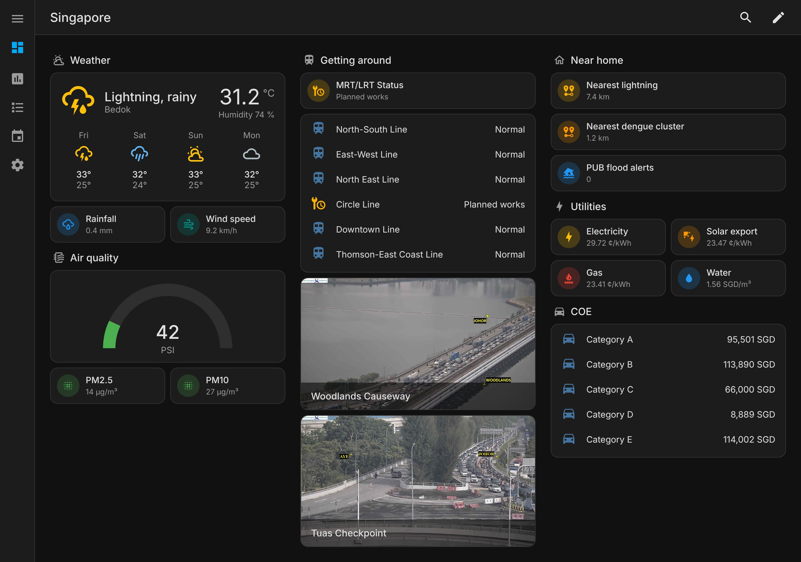
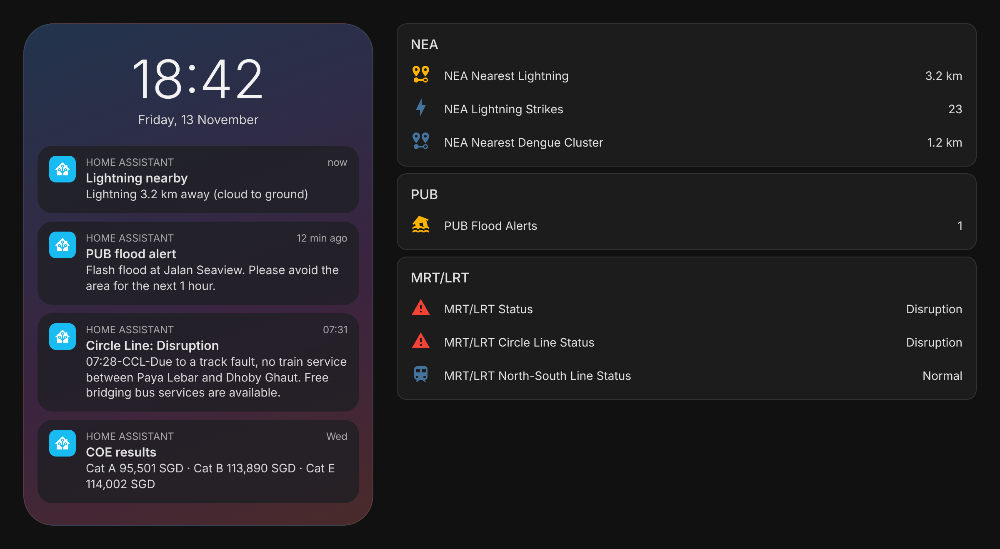
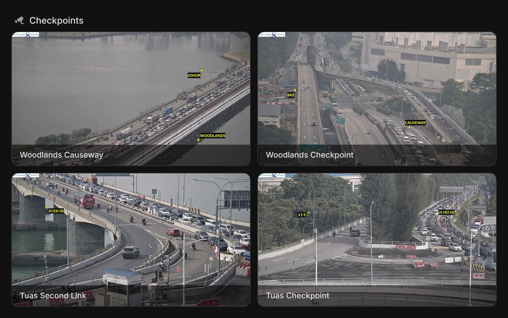
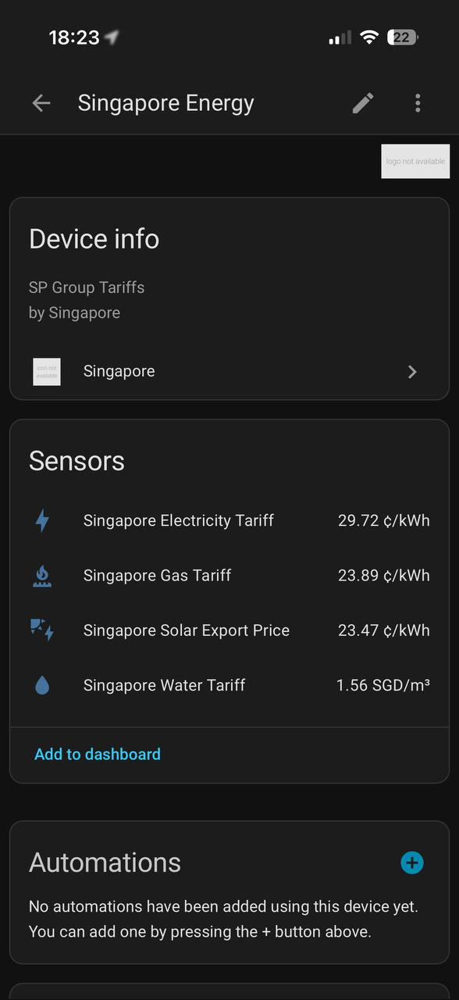
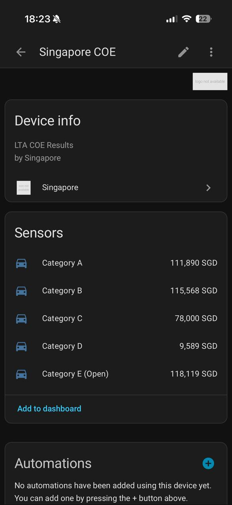
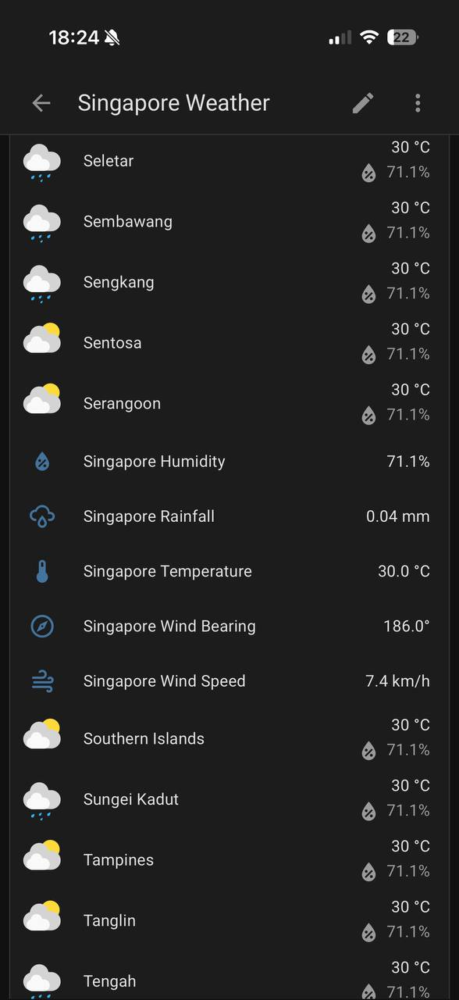
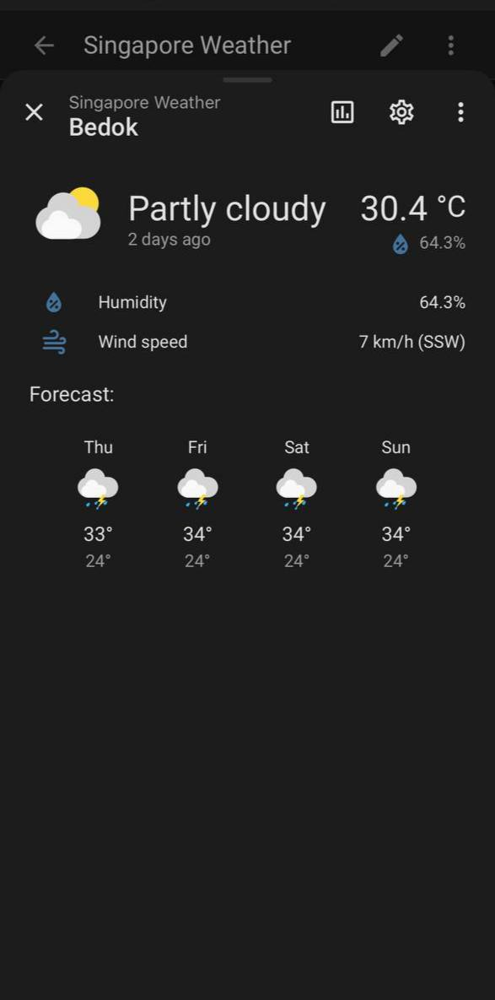
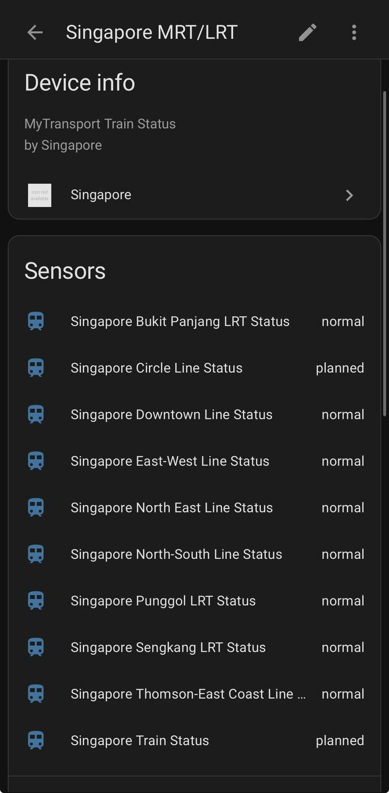
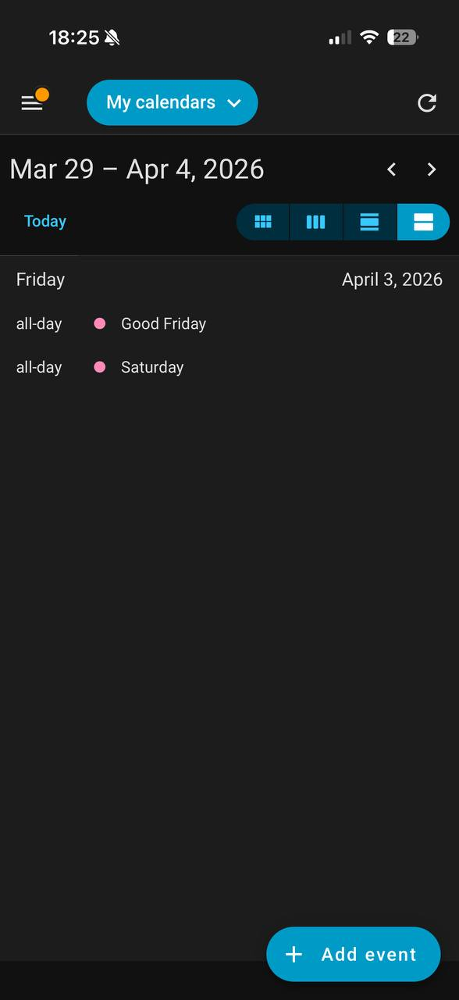

<h1 align="center">Singapore for Home Assistant</h1>

<p align="center">
  Weather, PSI, MRT status, COE prices, utility tariffs, flash floods, dengue and lightning,<br>
  straight from official Singapore government sources. No API keys, no accounts.<br>
  Optionally, link your SP Group e-account for your own electricity, water and bill readings.
</p>

<p align="center">
  <a href="https://hacs.xyz"></a>
  <a href="https://github.com/kianhean/singapore-homeassistant/releases"></a>
  <a href="https://github.com/kianhean/singapore-homeassistant/actions/workflows/tests.yml"></a>
  
  <a href="LICENSE"></a>
</p>

<p align="center">
  <a href="https://my.home-assistant.io/redirect/hacs_repository/?owner=kianhean&repository=singapore-homeassistant&category=integration"></a>
  <a href="https://my.home-assistant.io/redirect/config_flow_start/?domain=singapore"></a>
</p>

<p align="center">
  
  <br>
  <sub>An example dashboard built only from Home Assistant's built-in cards. The integration provides the entities; <a href="examples/dashboard.yaml">this YAML</a> builds the dashboard. Camera stills are real LTA images.</sub>
</p>

## What's inside

| | | |
|---|---|---|
| 🌦️ **Weather**<br>A weather entity for every NEA forecast area, with hourly and 4-day forecasts, live temperature, humidity, wind and rain | 😷 **Air quality**<br>PSI and six pollutants, overall and per region, ready for a Map card | ☀️ **UV index**<br>NEA's hourly UV index and exposure level (low to extreme), with today's peak |
| 🚇 **MRT/LRT**<br>Network and per-line status (normal, planned works, disruption) with LTA's message | 🛂 **Checkpoints**<br>Woodlands and Tuas traffic camera stills as camera entities | 🚗 **COE**<br>Category A–E premiums, refreshed after each bidding exercise |
| ⚡ **Lightning**<br>Live strikes and the distance to the nearest one from your home | 🦟 **Dengue**<br>Active NEA clusters and how far the nearest is from your home | 🌊 **Flash floods**<br>PUB flood alerts as they're issued and cancelled |
| 🔌 **Utilities**<br>SP Group electricity, gas and water tariffs, plus your solar export price | 🎉 **Public holidays**<br>MOM's holiday list as a calendar | 🧩 **Blueprints**<br>[One-click automations](#one-click-blueprints) for lightning, MRT disruptions, floods, haze and COE |
| 🏠 **Your SP account** *(optional)*<br>Sign in once to get your own electricity, water and gas usage, down to the half hour on a smart meter | 📊 **Energy dashboard**<br>Hourly electricity history and its cost at the current SP tariff, ready for Home Assistant's Energy dashboard | 🧾 **Bills**<br>Last bill, amount due, meter readings and SP Green Goals, for [reminders and dashboards](#your-sp-account) |

The public data needs no API keys and no account: one config entry, and a diagnostics download when
something looks off. Linking your SP Group e-account is optional ([how](#optional-link-your-sp-group-e-account));
that part is built on [maci0/home-assistant-sp](https://github.com/maci0/home-assistant-sp) by
[@maci0](https://github.com/maci0) ([Credits](#credits)).

## Installation

The integration is in the default HACS store. Use the **Open in HACS** button above, or:

1. Open **HACS** in Home Assistant.
2. Search for **Singapore** and install it.
3. Restart Home Assistant.

Requires **Home Assistant 2025.4** or newer.

## Setup

1. Go to **Settings → Devices & Services → Add Integration** (or use the **Add integration** button above).
2. Search for **Singapore**.
3. Enter a name and click **Submit**.

Only one Singapore entry can be added. Entities are grouped into devices (Energy, COE,
Weather, MRT/LRT, Air Quality, PUB, NEA, Traffic Cameras, Public Holidays).

The lightning and dengue distances are measured from the home location in
**Settings → System → General**, so make sure it's set.

### Optional: link your SP Group e-account

1. Open **Settings → Devices & Services → Singapore**.
2. Click **Add SP account** and sign in with the email and password you use in the SP app.
   If your account has MFA, you'll be asked for the code from SMS, email or your authenticator app.

There's no price to enter: the electricity cost for the Energy dashboard uses the SP Group
tariff this integration already reads (`sensor.energy_electricity_tariff`).

The password is never stored: only the session tokens SP returns are kept, and they renew
themselves. You can add more than one account. Each one gets its own device, named after the
premise address.

> **Entity IDs on older installs:** since v0.3.0, entity names come from their device
> (for example *Energy Electricity Tariff*). New installs get IDs like
> `sensor.energy_electricity_tariff`. Installs that started before v0.3.0 keep their
> original IDs (for example `sensor.singapore_electricity_tariff`), so existing dashboards
> and automations keep working. This README uses the IDs a new install gets.

## Recipes

<p align="center">
  
  <br>
  <sub>Notifications like these come from the blueprints and automations below.</sub>
</p>

### One-click blueprints

Import a blueprint, then create an automation from it and pick your lines, distance, purifier
and so on from drop-downs. For the notify action, enter your phone's, for example
`notify.mobile_app_your_phone`.

| Blueprint | What it does | |
|---|---|---|
| ⚡ **Lightning nearby** | Notify when lightning strikes within a distance of home that you choose | <a href="https://my.home-assistant.io/redirect/blueprint_import/?blueprint_url=https%3A%2F%2Fgithub.com%2Fkianhean%2Fsingapore-homeassistant%2Fblob%2Fmain%2Fblueprints%2Fautomation%2Fsingapore%2Flightning_nearby.yaml"></a> |
| 🚇 **MRT/LRT line disruption** | Notify when your lines are disrupted (optionally planned works too) during your travel hours, and when service resumes | <a href="https://my.home-assistant.io/redirect/blueprint_import/?blueprint_url=https%3A%2F%2Fgithub.com%2Fkianhean%2Fsingapore-homeassistant%2Fblob%2Fmain%2Fblueprints%2Fautomation%2Fsingapore%2Fmrt_line_disruption.yaml"></a> |
| 🌊 **PUB flash-flood alert** | Notify for each new flash-flood alert, anywhere or only near home | <a href="https://my.home-assistant.io/redirect/blueprint_import/?blueprint_url=https%3A%2F%2Fgithub.com%2Fkianhean%2Fsingapore-homeassistant%2Fblob%2Fmain%2Fblueprints%2Fautomation%2Fsingapore%2Fflood_alert.yaml"></a> |
| 😷 **Haze mode** | Turn purifiers or fans on above a PSI level and off when the air clears | <a href="https://my.home-assistant.io/redirect/blueprint_import/?blueprint_url=https%3A%2F%2Fgithub.com%2Fkianhean%2Fsingapore-homeassistant%2Fblob%2Fmain%2Fblueprints%2Fautomation%2Fsingapore%2Fhaze_purifier.yaml"></a> |
| 🚗 **COE results** | One notification with every category's premium after each bidding exercise | <a href="https://my.home-assistant.io/redirect/blueprint_import/?blueprint_url=https%3A%2F%2Fgithub.com%2Fkianhean%2Fsingapore-homeassistant%2Fblob%2Fmain%2Fblueprints%2Fautomation%2Fsingapore%2Fcoe_results.yaml"></a> |

The blueprints live in [`blueprints/automation/singapore/`](blueprints/automation/singapore) and
need Home Assistant 2025.4 or newer.

### Or copy the YAML

Simpler versions to paste into an automation's YAML editor. Change `notify.notify` to your
phone's notify action.

<details>
<summary><b>⚡ Warn me when lightning is close</b></summary>

```yaml
alias: Lightning nearby
triggers:
  - trigger: numeric_state
    entity_id: sensor.nea_nearest_lightning
    below: 5
actions:
  - action: notify.notify
    data:
      title: Lightning nearby
      message: >-
        Lightning {{ states('sensor.nea_nearest_lightning') | float | round(1) }} km away
        ({{ state_attr('sensor.nea_nearest_lightning', 'type') | replace('_', ' ') }})
```

Cloud-to-ground strikes are the dangerous kind. NEA notes that most strikes fall within
5–6 km of a thunderstorm, so 5 km is a sensible threshold for getting out of the pool.
</details>

<details>
<summary><b>🚇 Tell me if my MRT line is disrupted before work</b></summary>

```yaml
alias: Circle Line disruption
triggers:
  - trigger: state
    entity_id: sensor.mrt_lrt_circle_line_status
    to: disruption
conditions:
  - condition: time
    after: "06:30:00"
    before: "09:30:00"
    weekday: [mon, tue, wed, thu, fri]
actions:
  - action: notify.notify
    data:
      title: "Circle Line: Disruption"
      message: "{{ state_attr('sensor.mrt_lrt_status', 'details') }}"
```
</details>

<details>
<summary><b>🌊 Flash-flood alert</b></summary>

```yaml
alias: PUB flood alert
triggers:
  - trigger: numeric_state
    entity_id: sensor.pub_flood_alerts
    above: 0
actions:
  - action: notify.notify
    data:
      title: PUB flood alert
      message: "{{ state_attr('sensor.pub_flood_alerts', 'locations') | join(', ') }}"
```
</details>

<details>
<summary><b>😷 Turn on the air purifier when the haze is bad</b></summary>

```yaml
alias: Haze mode
triggers:
  - trigger: numeric_state
    entity_id: sensor.air_quality_psi
    above: 100
actions:
  - action: fan.turn_on
    target:
      entity_id: fan.living_room_purifier
  - action: notify.notify
    data:
      message: >-
        PSI is {{ states('sensor.air_quality_psi') }}
        ({{ state_attr('sensor.air_quality_psi', 'band') | replace('_', ' ') }}). Purifier on.
```
</details>

<details>
<summary><b>🚗 Send me the COE results</b></summary>

```yaml
alias: COE results
triggers:
  - trigger: state
    entity_id: sensor.coe_category_a
    not_from: [unavailable, unknown]
    not_to: [unavailable, unknown]
actions:
  - action: notify.notify
    data:
      title: COE results
      message: >-
        Cat A {{ '{:,}'.format(states('sensor.coe_category_a') | int) }} SGD ·
        Cat B {{ '{:,}'.format(states('sensor.coe_category_b') | int) }} SGD ·
        Cat E {{ '{:,}'.format(states('sensor.coe_category_e') | int) }} SGD
```
</details>

<details>
<summary><b>☀️ Sunscreen reminder when the UV is high</b></summary>

```yaml
alias: High UV
triggers:
  - trigger: state
    entity_id: sensor.nea_uv_exposure
    to: [high, very_high, extreme]
conditions:
  - condition: time
    weekday: [sat, sun]
actions:
  - action: notify.notify
    data:
      title: UV is {{ states('sensor.nea_uv_exposure') | replace('_', ' ') }}
      message: >-
        UV index {{ states('sensor.nea_uv_index') }}. Sunscreen and a hat if you're
        heading out.
```
</details>

#### With a linked SP account

Replace `1_example_road_singapore` with your SP account device's slug (it's named after your
premise address; the device page shows the entity IDs).

<details>
<summary><b>🧾 Tell me when a new SP bill arrives</b></summary>

```yaml
alias: New SP bill
triggers:
  - trigger: state
    entity_id: sensor.1_example_road_singapore_last_bill
    attribute: bill_date
conditions:
  # Skip restarts: only a real change from one bill to the next.
  - condition: template
    value_template: >-
      {{ trigger.from_state is not none
         and trigger.from_state.attributes.get('bill_date') is not none }}
actions:
  - action: notify.notify
    data:
      title: New SP bill
      message: >-
        
        {{ states('sensor.1_example_road_singapore_last_bill') }} SGD,
        due {{ (as_datetime(due) | as_local).strftime('%-d %b') }}.
```
</details>

<details>
<summary><b>💸 Remind me to pay before the due date (skips GIRO)</b></summary>

```yaml
alias: SP bill due soon
triggers:
  - trigger: time
    at: "09:00:00"
conditions:
  - condition: numeric_state
    entity_id: sensor.1_example_road_singapore_amount_due
    above: 0
  - condition: template
    value_template: >-
      
      {{ due is not none
         and not state_attr('sensor.1_example_road_singapore_amount_due', 'giro_enabled')
         and (as_datetime(due) - now()).days < 3 }}
actions:
  - action: notify.notify
    data:
      title: SP bill due soon
      message: "{{ states('sensor.1_example_road_singapore_amount_due') }} SGD outstanding."
```
</details>

<details>
<summary><b>🎯 Warn me when I pass my Green Goals target</b></summary>

```yaml
alias: Over the Green Goals target
triggers:
  - trigger: template
    value_template: >-
      {{ states('sensor.1_example_road_singapore_electricity_this_month') | float(0)
         > state_attr('sensor.1_example_road_singapore_electricity_this_month', 'goal_target') | float(1e9) }}
actions:
  - action: notify.notify
    data:
      title: Over this month's electricity target
      message: >-
        {{ states('sensor.1_example_road_singapore_electricity_this_month') }} kWh used,
        target {{ state_attr('sensor.1_example_road_singapore_electricity_this_month', 'goal_target') }} kWh.
```
</details>

<details>
<summary><b>🪫 Prepaid credit running low</b></summary>

For prepaid (PPMS) accounts only; the sensor exists when SP reports a prepaid balance.

```yaml
alias: SP prepaid credit low
triggers:
  - trigger: numeric_state
    entity_id: sensor.1_example_road_singapore_prepaid_credit
    below: 20
actions:
  - action: notify.notify
    data:
      title: SP prepaid credit low
      message: "{{ states('sensor.1_example_road_singapore_prepaid_credit') }} SGD left. Top up in the SP app."
```
</details>

## Dashboard ideas

**Copy the whole dashboard:** [`examples/dashboard.yaml`](examples/dashboard.yaml) builds the dashboard
at the top of this page. Paste it into a new dashboard's raw configuration editor.

**PSI by region:** the hero dashboard lists the 24-hour PSI for each region. Each regional sensor
also carries `latitude`/`longitude`, so you can put them on a Map card instead ([YAML below](#psi-on-the-map)).

**Checkpoint cameras:** a picture-entity card per camera gives you a quick look at the Causeway and Second Link queues.

<p align="center">
  
  <br>
  <sub>Real LTA stills from data.gov.sg, Friday 13 November 2026, 16:50.</sub>
</p>

### Your SP account

With an SP account linked, **[`examples/sp_account_dashboard.yaml`](examples/sp_account_dashboard.yaml)**
adds an *SP account* dashboard built only from built-in cards. Find-and-replace its two
placeholders (your device slug and premise ID, explained at the top of the file), then paste it in.
It shows:

- **This month:** kWh used and the estimated cost so far (Statistic cards on the imported
  statistics), last month's kWh for comparison, the current SP tariff, and today's usage.
- **Usage:** daily bars for the last 30 days, and hourly bars for the last 3 days from the
  smart meter. That's where the evening air-con hours show up.
- **Bills:** amount due, the last bill, a bar chart of every bill in the
  past year, your Green Goals usage against its target, and the meter reading.

A test runs the example against a real Home Assistant, so every entity and statistic in it exists
on a new install.

**The Energy dashboard** is the other half: under **Settings → Dashboards → Energy**, add
**SP Group electricity** as grid consumption and **SP Group electricity cost** as its cost (details
in the [entity reference](#sp-group-e-account-optional)). You then get Home Assistant's own
usage, cost and comparison views for your flat or house.

**Today's estimated cost.** Combine the account's usage with the tariff the integration
scrapes, using a template sensor in `configuration.yaml`:

```yaml
template:
  - sensor:
      - name: Electricity cost today
        unique_id: sp_electricity_cost_today
        unit_of_measurement: SGD
        device_class: monetary
        state: >-
          {{ (states('sensor.1_example_road_singapore_electricity_today') | float(0)
              * states('sensor.energy_electricity_tariff') | float(0) / 100) | round(2) }}
        availability: >-
          {{ has_value('sensor.1_example_road_singapore_electricity_today')
             and has_value('sensor.energy_electricity_tariff') }}
```

**Weather and usage together.** A History graph card with **Electricity last 30 min** and
`sensor.weather_temperature` shows how much a hot afternoon costs you in air-con. Put both
on one card.

## Entity reference

Everything the integration creates, by data source. Expand a section for its entities and attributes.

### SP Group utility tariffs

Scraped from the [SP Group tariff page](https://www.spgroup.com.sg/our-services/utilities/tariff-information)
every 24 hours.

<details>
<summary>Entities and attributes</summary>

| Entity ID | Name | Unit | Description |
|-----------|------|------|-------------|
| `sensor.energy_electricity_tariff` | Energy Electricity Tariff | ¢/kWh | Total residential electricity tariff (with GST) |
| `sensor.energy_solar_export_price` | Energy Solar Export Price | ¢/kWh | Electricity tariff minus network costs |
| `sensor.energy_gas_tariff` | Energy Gas Tariff | ¢/kWh | Piped natural gas tariff (with GST) |
| `sensor.energy_water_tariff` | Energy Water Tariff | SGD/m³ | Water tariff, lower residential tier (≤40 m³, with GST) |

Tariff sensors include `quarter` (e.g. `Q1`), `year`, and `source` as state attributes.
The solar export price sensor also includes `network_cost` and `total_tariff`.

<p align="center">
  
</p>

</details>

### SP Group e-account (optional)

Your own SP account data, read from the same APIs the SP Group app uses (Auth0 sign-in, then
the Jarvis and Njord services) every 30 minutes. Added per account with **Add SP account**
(see [Setup](#optional-link-your-sp-group-e-account)). The device is named after the premise
address, so entity IDs look like `sensor.<your_address>_electricity_today`.

<details>
<summary>Entities, attributes and the Energy dashboard</summary>

Sensors are only created for what your account has (for example, gas and the EV sensors
appear only when SP returns data for them). New ones are added without a reload.

| Name | What it is |
|------|------------|
| Electricity cumulative | Smart-meter (AMI) or billed total for the loaded window (~13 months) |
| Electricity last billed / Water last billed / Gas last billed | Latest billed month |
| Electricity today | AMI kWh for today (SGT) |
| Electricity last 30 min | Last published AMI half-hour slot (lags a few hours) |
| Water / Gas | Sum of billed months |
| Last bill | Latest bill in SGD |
| Amount due | Outstanding amount; negative is a credit |
| Prepaid credit | PPMS balance, when the account is prepaid |
| Electricity meter / Water meter | Last actual meter register reading |
| Electricity this month / Water this month | Green Goals usage, with `goal_target` and `percent_difference` attributes |
| GreenUP points, EV wallet, EV session, EV last charge, EV unpaid | When you use those SP services |
| Unread notifications, Bill delivery, FCU (Tengah cooling), SP tariff | When SP returns them |
| Account | Account status; carries the address, account number and retailer as attributes |

**Energy dashboard.** After the first poll, long-term statistics are imported:

- Grid consumption: pick the statistic **SP Group electricity**
  (`singapore:<premise_id>_electricity`), not a sensor. It is built from the AMI half-hours
  (folded to hours) where available, else billed months.
- Cost: pick **SP Group electricity cost** (`singapore:<premise_id>_electricity_cost`) as the
  grid source's cost. It's priced at the SP Group regulated tariff (incl. GST) this integration
  scrapes, and the whole series is re-priced when the tariff changes each quarter, so past
  quarters show at the current rate. If you buy from an Open Electricity Market retailer, your
  real rate differs; use your bills (**Last bill**) for exact amounts.
- Gas: **SP Group gas** (`singapore:<premise_id>_gas`) when SP returns gas data.
- **SP Group bill** (`singapore:<premise_id>_last_bill`) has one point per billed month.
- Don't use *Electricity cumulative*, *Electricity last billed*, *Electricity meter* or
  *Electricity this month* as a grid source. They measure different things.
- Leave water out of Energy: SP bills water monthly, so there's no hourly series.

</details>

### COE bidding results

Pulled from the [LTA dataset on data.gov.sg](https://data.gov.sg/datasets/d_69b3380ad7e51aff3a7dcc84eba52b8a/view)
daily at **19:30**, after each bidding exercise.

<details>
<summary>Entities and attributes</summary>

| Entity ID | Name | Unit | Category |
|-----------|------|------|----------|
| `sensor.coe_category_a` | COE Category A | SGD | Cars ≤1600cc / ≤97kW (electric) |
| `sensor.coe_category_b` | COE Category B | SGD | Cars >1600cc / >97kW (electric) |
| `sensor.coe_category_c` | COE Category C | SGD | Goods vehicles and buses |
| `sensor.coe_category_d` | COE Category D | SGD | Motorcycles |
| `sensor.coe_category_e` | COE Category E | SGD | Open — all except motorcycles |

Each sensor includes `category`, `description`, `month`, `bidding_no`, and `source` as
state attributes.

<p align="center">
  
</p>

</details>

### NEA realtime weather readings

Updated every **10 minutes** from [data.gov.sg collection 1459](https://data.gov.sg/collections/1459/view).
Station readings are averaged across all available stations at fetch time.

<details>
<summary>Entities and attributes</summary>

| Entity ID | Name | Unit | Description |
|-----------|------|------|-------------|
| `sensor.weather_temperature` | Weather Temperature | °C | Aggregated air temperature |
| `sensor.weather_humidity` | Weather Humidity | % | Aggregated relative humidity |
| `sensor.weather_wind_speed` | Weather Wind Speed | km/h | Aggregated wind speed |
| `sensor.weather_wind_bearing` | Weather Wind Bearing | ° | Aggregated wind direction |
| `sensor.weather_rainfall` | Weather Rainfall | mm | Aggregated rainfall |

<p align="center">
  
</p>

</details>

### Weather entities (by forecast area)

One weather entity per NEA forecast area from [data.gov.sg collection 1456](https://data.gov.sg/collections/1456/view),
updated every **10 minutes**.

<details>
<summary>Entities and attributes</summary>

Example entities: `weather.weather_bedok`, `weather.weather_ang_mo_kio`,
`weather.weather_woodlands`.

- **Current condition** comes from the area's 2-hour NEA forecast, mapped to an HA
  condition (`sunny`, `partlycloudy`, `rainy`, `lightning-rainy`, etc.).
- **Current temperature, humidity and wind** come from the live readings above.
- **Daily forecast** is NEA's Singapore-wide 4-day outlook, with high/low temperature,
  humidity and wind for each day. It is the same for every area.
- **Hourly forecast** is NEA's 24-hour forecast for the area's region (north, south, east,
  west or central): one entry per forecast period, usually 6 pm–6 am, 6 am–midday and
  midday–6 pm. NEA gives no temperature per period, so entries carry a condition only. Each
  area is assigned to the region whose centre is nearest its NEA map location, which can be
  a judgement call for areas near a boundary (the `forecast_region` attribute shows which).

Attributes: `forecast_area`, `forecast_region`, `raw_condition` (NEA's original text),
`valid_start` / `valid_end` (the 2-hour forecast window), plus the live readings.

<p align="center">
  
</p>

</details>

### MRT/LRT train status

Updated every **5 minutes** from [mytransport.sg](https://www.mytransport.sg/trainstatus).
Tracks both an overall network status and a per-line status for each MRT/LRT line.

<details>
<summary>Entities and attributes</summary>

| Entity ID | Name | Description |
|-----------|------|-------------|
| `sensor.mrt_lrt_status` | MRT/LRT Status | Overall network status: `normal`, `planned`, or `disruption`; `details` attribute holds LTA's messages |
| `sensor.mrt_lrt_<line>_status` | e.g. MRT/LRT Circle Line Status | Per-line status, e.g. `sensor.mrt_lrt_circle_line_status` |

Lines: North-South, East-West, North East, Circle, Downtown, Thomson-East Coast,
Bukit Panjang LRT, Sengkang LRT, Punggol LRT.

<p align="center">
  
</p>

</details>

### Air quality (PSI)

Updated every **15 minutes** from [data.gov.sg / NEA](https://data.gov.sg/datasets/d_fe37906a0182569d891506e815e819b7/view).
Grouped under an **Air Quality** device.

<details>
<summary>Entities and attributes</summary>

| Entity ID | Name | Unit | Description |
|-----------|------|------|-------------|
| `sensor.air_quality_psi` | Air Quality PSI | — | Singapore-wide 24-hour PSI (highest region); `band` attribute: `good` / `moderate` / `unhealthy` / `very_unhealthy` / `hazardous` |
| `sensor.air_quality_psi_<region>` | e.g. Air Quality PSI North | — | 24-hour PSI for north, south, east, west, central — **with map location and every reading for that region** |
| `sensor.air_quality_pm2_5` | Air Quality PM2.5 | µg/m³ | 24-hour PM2.5 (highest region) |
| `sensor.air_quality_pm10` | Air Quality PM10 | µg/m³ | 24-hour PM10 (highest region) |
| `sensor.air_quality_ozone` | Air Quality Ozone | µg/m³ | 8-hour max O₃ (highest region) |
| `sensor.air_quality_nitrogen_dioxide` | Air Quality Nitrogen Dioxide | µg/m³ | 1-hour max NO₂ (highest region) |
| `sensor.air_quality_sulphur_dioxide` | Air Quality Sulphur Dioxide | µg/m³ | 24-hour SO₂ (highest region) |
| `sensor.air_quality_carbon_monoxide` | Air Quality Carbon Monoxide | mg/m³ | 8-hour max CO (highest region) |

The Singapore-wide pollutant sensors also expose a `regions` attribute with each region's value.

</details>

#### PSI on the map

Each regional PSI sensor has `latitude`/`longitude` attributes (NEA's region label
locations), so it shows up as one circle per region on a Map card. Use `label_mode: state`
to show the PSI number inside each circle; tap a circle to see every reading for that
region (3-hour and 24-hour PSI, PM2.5, PM10, O₃, NO₂, SO₂, CO and the sub-indices):

```yaml
type: map
title: Singapore PSI
default_zoom: 11
entities:
  - entity: sensor.air_quality_psi_north
    label_mode: state
  - entity: sensor.air_quality_psi_south
    label_mode: state
  - entity: sensor.air_quality_psi_east
    label_mode: state
  - entity: sensor.air_quality_psi_west
    label_mode: state
  - entity: sensor.air_quality_psi_central
    label_mode: state
```

### PUB flood alerts

Updated every **2 minutes** from [PUB via data.gov.sg](https://data.gov.sg/datasets/d_f1404e08587ce555b9ea3f565e2eb9a3/view).

<details>
<summary>Entities and attributes</summary>

| Entity ID | Name | Description |
|-----------|------|-------------|
| `sensor.pub_flood_alerts` | PUB Flood Alerts | Number of active flash-flood alerts (`0` when none) |

Attributes: `locations` (list of alert descriptions) and `alerts` (full details per alert:
description, area, severity, instruction, issued time, latitude/longitude). An alert stays
active until PUB issues its matching Cancel, or for 3 hours at most.

See [Recipes](#recipes) for a notification automation.

</details>

### Checkpoint traffic cameras

Updated every **2 minutes** from [LTA via data.gov.sg](https://data.gov.sg/datasets/d_6cdb6b405b25aaaacbaf7689bcc6fae0/view).
Only the Woodlands and Tuas checkpoint cameras are exposed, as `camera` entities showing the latest still.

<details>
<summary>Entities and attributes</summary>

| Entity ID | LTA camera | View |
|-----------|-----------|------|
| `camera.traffic_cameras_woodlands_causeway` | 2701 | Woodlands Causeway (towards Johor) |
| `camera.traffic_cameras_woodlands_checkpoint` | 2702 | Woodlands Checkpoint (towards BKE) |
| `camera.traffic_cameras_tuas_second_link` | 4703 | Tuas Second Link |
| `camera.traffic_cameras_tuas_checkpoint` | 4713 | Tuas Checkpoint |

A camera shows as unavailable while LTA leaves it out of the feed.

</details>

### Dengue clusters

Updated every **6 hours** from [NEA via data.gov.sg](https://data.gov.sg/datasets/d_dbfabf16158d1b0e1c420627c0819168/view).

<details>
<summary>Entities and attributes</summary>

| Entity ID | Name | Unit | Description |
|-----------|------|------|-------------|
| `sensor.nea_dengue_clusters` | NEA Dengue Clusters | — | Number of active clusters; attributes `total_cases` and `clusters` (locality, cases, centroid) |
| `sensor.nea_nearest_dengue_cluster` | NEA Nearest Dengue Cluster | km | Distance from your HA home location to the nearest cluster boundary (`0` = inside a cluster) |

The nearest-cluster distance uses the home location in **Settings → System → General**.

</details>

### Lightning

Updated every **2 minutes** from [NEA's Lightning Detection System via data.gov.sg](https://data.gov.sg/datasets/d_08238953fe0f6dd13f10714ebfbcb9f9/view).
Strikes are kept for a rolling **30-minute** window. The feed also covers the region
around Singapore (for example Johor and the Riau Islands).

<details>
<summary>Entities and attributes</summary>

| Entity ID | Name | Unit | Description |
|-----------|------|------|-------------|
| `sensor.nea_lightning_strikes` | NEA Lightning Strikes | — | Strikes detected in the last 30 min; attributes `cloud_to_ground`, `cloud_to_cloud` and `strikes` (newest 50: time, latitude, longitude, type) |
| `sensor.nea_nearest_lightning` | NEA Nearest Lightning | km | Distance from your HA home location to the nearest strike in the last 30 min (unknown when there's none); attributes `strikes_within_10_km`, plus the nearest strike's `type`, `time`, `latitude` and `longitude` |

Cloud-to-ground strikes are the dangerous kind; cloud-to-cloud lightning often comes
before them. NEA notes that most strikes fall within 5–6 km of a thunderstorm, and a storm
more than 10 km away can still reach you.

See [Recipes](#recipes) for a lightning warning automation.

</details>

### UV index

Updated every **15 minutes** from [NEA's hourly UV index via data.gov.sg](https://api-open.data.gov.sg/v2/real-time/api/uv).
NEA publishes one reading an hour from 7 am to 7 pm, so overnight the sensors show the
last reading of the evening.

<details>
<summary>Entities and attributes</summary>

| Entity ID | Name | Unit | Description |
|-----------|------|------|-------------|
| `sensor.nea_uv_index` | NEA UV Index | UV index | Latest hourly UV index; attributes `hour` (the reading's hour), `exposure`, `peak` / `peak_hour` (today's highest) and `readings` (today's hourly values) |
| `sensor.nea_uv_exposure` | NEA UV Exposure | — | NEA's exposure level for the latest reading: `low` (0–2), `moderate` (3–5), `high` (6–7), `very_high` (8–10) or `extreme` (11+) |

See [Recipes](#recipes) for a sunscreen reminder.

</details>

### Public holidays

Updated every 24 hours from [MOM](https://www.mom.gov.sg/employment-practices/public-holidays).
Shows up as a Home Assistant calendar with all-day events from the current year onward.

<details>
<summary>Entities and attributes</summary>

| Entity ID | Name |
|-----------|------|
| `calendar.public_holidays` | Public Holidays |

<p align="center">
  
</p>

</details>

## Example sensor states

<details>
<summary>Show example states</summary>

```yaml
sensor.energy_electricity_tariff:
  state: 29.72
  unit_of_measurement: ¢/kWh
  attributes:
    quarter: Q2
    year: 2026
    source: SP Group

sensor.energy_solar_export_price:
  state: 23.47
  unit_of_measurement: ¢/kWh
  attributes:
    quarter: Q2
    year: 2026
    source: SP Group
    network_cost: 6.25
    total_tariff: 29.72

sensor.coe_category_a:
  state: 95501
  unit_of_measurement: SGD
  attributes:
    category: Category A
    description: Cars up to 1600cc / 97kW (electric)
    month: "2026-03"
    bidding_no: 1
    source: data.gov.sg / LTA

sensor.weather_temperature:
  state: 31.2
  unit_of_measurement: °C
  attributes:
    source: data.gov.sg / NEA (collection 1459)

sensor.nea_uv_index:
  state: 6
  unit_of_measurement: UV index
  attributes:
    hour: "2026-11-13T14:00:00+08:00"
    exposure: high
    peak: 6
    peak_hour: "2026-11-13T14:00:00+08:00"
    readings:
      - hour: "2026-11-13T13:00:00+08:00"
        value: 4
      - hour: "2026-11-13T14:00:00+08:00"
        value: 6
    source: NEA via data.gov.sg

sensor.air_quality_psi_east:
  state: 39
  attributes:
    region: east
    band: good
    latitude: 1.35735
    longitude: 103.94
    psi_twenty_four_hourly: 39
    psi_three_hourly: 0
    pm25_twenty_four_hourly: 0
    pm10_twenty_four_hourly: 3
    o3_eight_hour_max: 9
    no2_one_hour_max: 12
    so2_twenty_four_hourly: 5
    co_eight_hour_max: 19
    reading_time: "2024-07-17T14:00:00+00:00"
    source: data.gov.sg / NEA
```

</details>

## Troubleshooting

- **Diagnostics:** on the Singapore integration page, open the three-dot menu and choose
  **Download diagnostics**. The file shows each data source's last update result, error
  and parsed data. Attach it when opening an issue.
- **Unavailable sensors:** flood alerts, traffic cameras, dengue clusters, lightning, UV, PSI, COE and SP Group tariffs
  load in the background, so the rest of the integration still starts if one of those
  sources is down. Their sensors show as unavailable until a fetch succeeds.
- **SP account sensors unavailable:** if SP rejects the stored session, a repair appears under
  **Settings → Repairs**. Open the account under the Singapore integration and choose
  **Reconfigure** and sign in again. If SP says the sign-in looks suspicious, sign in once in the
  SP app, wait a few minutes, then try again. After a wrong password the next attempt waits
  60 seconds, so Auth0 doesn't lock the account. The rest of the integration keeps working
  either way.
- **HTTP 429 in the log:** data.gov.sg rate-limits bursts of requests, which can happen
  when Home Assistant starts. Weather and dengue requests retry right away; other
  sources try again on their next scheduled update.

## Data sources

| Source | Data | Refresh |
|--------|------|---------|
| [SP Group](https://www.spgroup.com.sg/our-services/utilities/tariff-information) | Electricity, gas, water tariffs | Every 24 h |
| [data.gov.sg / LTA](https://data.gov.sg/datasets/d_69b3380ad7e51aff3a7dcc84eba52b8a/view) | COE bidding results | Daily at 19:30 |
| [data.gov.sg / NEA (collection 1456)](https://data.gov.sg/collections/1456/view) | 2-hour area forecasts, 24-hour regional forecast and 4-day outlook | Every 10 min |
| [data.gov.sg / NEA (collection 1459)](https://data.gov.sg/collections/1459/view) | Realtime weather readings | Every 10 min |
| [data.gov.sg / NEA](https://data.gov.sg/datasets/d_fe37906a0182569d891506e815e819b7/view) | PSI and pollutant readings | Every 15 min |
| [data.gov.sg / PUB](https://data.gov.sg/datasets/d_f1404e08587ce555b9ea3f565e2eb9a3/view) | Flash-flood alerts | Every 2 min |
| [data.gov.sg / LTA](https://data.gov.sg/datasets/d_6cdb6b405b25aaaacbaf7689bcc6fae0/view) | Woodlands & Tuas checkpoint camera images | Every 2 min |
| [data.gov.sg / NEA](https://data.gov.sg/datasets/d_dbfabf16158d1b0e1c420627c0819168/view) | Dengue clusters | Every 6 h |
| [data.gov.sg / NEA](https://data.gov.sg/datasets/d_08238953fe0f6dd13f10714ebfbcb9f9/view) | Lightning observations | Every 2 min |
| [data.gov.sg / NEA](https://api-open.data.gov.sg/v2/real-time/api/uv) | Hourly UV index | Every 15 min |
| [MOM](https://www.mom.gov.sg/employment-practices/public-holidays) | Public holidays | Every 24 h |
| [mytransport.sg](https://www.mytransport.sg/trainstatus) | MRT/LRT train status | Every 5 min |
| SP Group app APIs (optional, your e-account) | Your usage, bills, meters, Green Goals | Every 30 min |

## Development

See [CLAUDE.md](CLAUDE.md) for project structure, test instructions, and conventions.

```bash
pip install -r requirements_test.txt
pytest tests/ -v -m "not e2e"
```

`tests_ha/` runs the integration inside a real Home Assistant; `pytest tests/test_e2e.py -m e2e`
hits the live data sources. See CLAUDE.md for both.

The README images are rendered from HTML in [`docs/mockups/`](docs/mockups): run
`uv run docs/mockups/fetch_cameras.py` for fresh camera stills, then
`cd docs/mockups && npm install && node build.mjs`. Keep `hero.html` in sync with
[`examples/dashboard.yaml`](examples/dashboard.yaml).

## Contributing

Bug reports, data source ideas and pull requests are welcome. When something looks wrong, attach
the **Download diagnostics** file to your [issue](https://github.com/kianhean/singapore-homeassistant/issues).
If the integration is useful to you, a ⭐ on GitHub helps other Singapore Home Assistant users find it.

## Credits

The SP Group e-account support is built on
**[maci0/home-assistant-sp](https://github.com/maci0/home-assistant-sp)** by
**Marcel W. Wysocki ([@maci0](https://github.com/maci0))**. The SP API client, sign-in and
MFA handling, sensor mapping, Energy statistics logic and their tests are vendored from its
v1.8.0 release under the MIT License, in
[`custom_components/singapore/sp_account/`](custom_components/singapore/sp_account) with
the original [LICENSE](custom_components/singapore/sp_account/LICENSE). This port fixes its
"Config flow could not be loaded: 500" error
([maci0/home-assistant-sp#21](https://github.com/maci0/home-assistant-sp/issues/21)) by
keeping every form field serializable. If you only want SP account data, use the original
integration. Thank you, Marcel!

## License

This project is licensed under the [MIT License](LICENSE). The vendored SP Group client in
`custom_components/singapore/sp_account/` is MIT licensed, Copyright (c) 2026 Marcel W. Wysocki.

Data and the checkpoint camera stills in the README come from data.gov.sg, LTA, NEA, PUB, MOM and
SP Group, and remain theirs (data.gov.sg data is under the
[Singapore Open Data Licence](https://data.gov.sg/open-data-licence)). This project isn't affiliated
with any of them.
