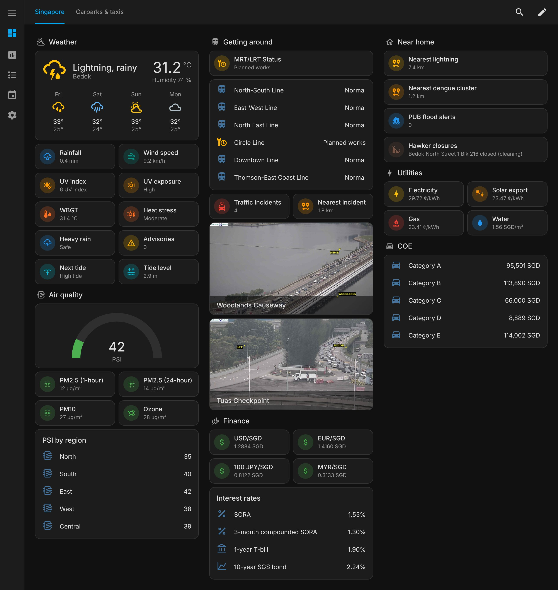
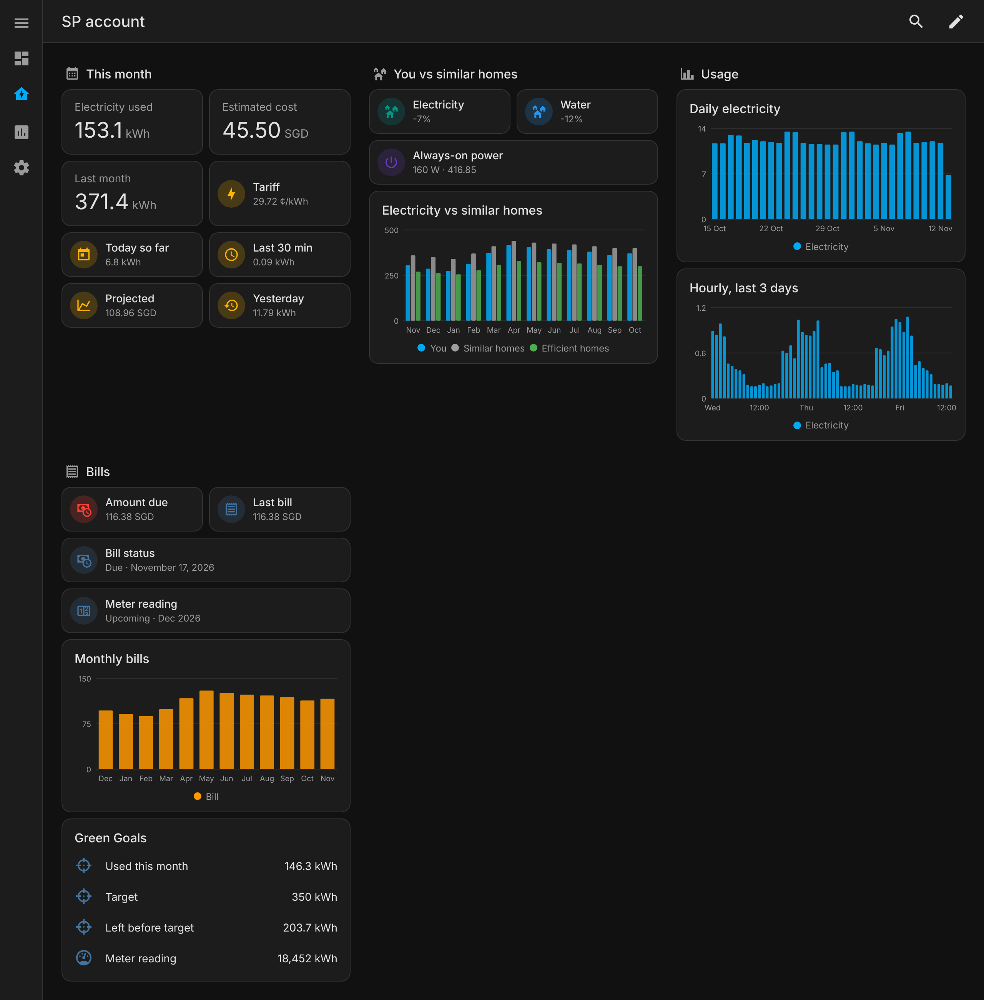
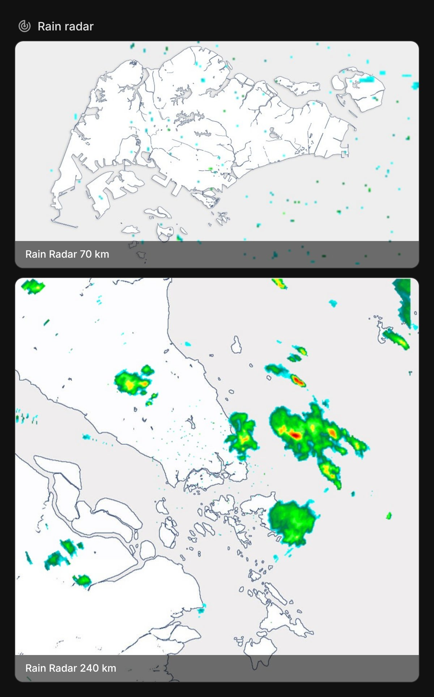
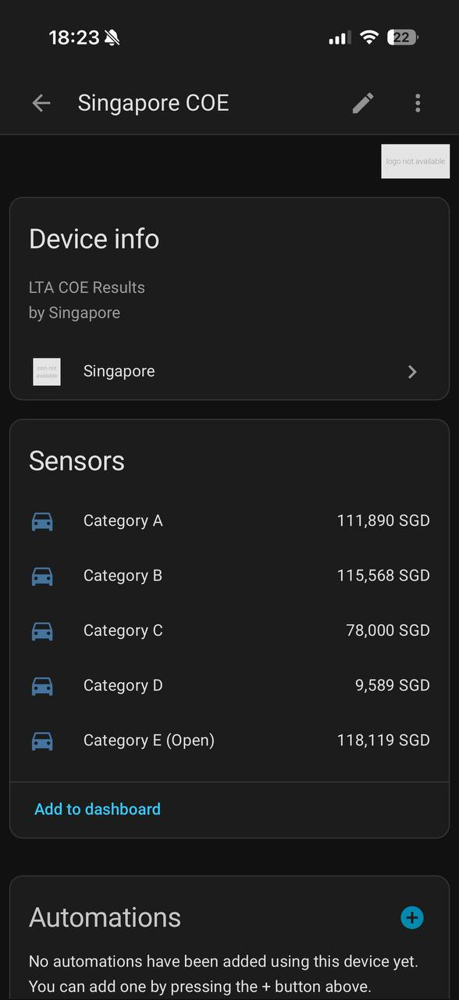
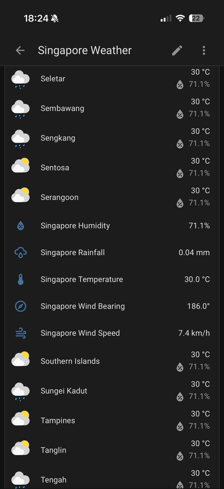
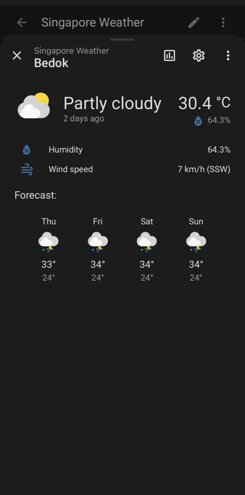
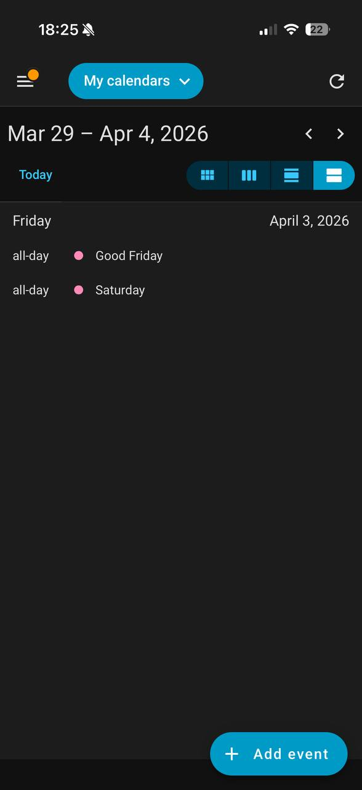

<h1 align="center">
  <picture>
    <source media="(prefers-color-scheme: dark)" srcset="custom_components/singapore/brand/dark_logo@2x.png">
    
  </picture>
</h1>

<p align="center">
  <b>Your own SP Group electricity, water and bills, right in Home Assistant's Energy dashboard.</b><br>
  Plus weather, PSI, MRT status, COE prices, flash floods, dengue and lightning,<br>
  straight from official Singapore government sources. No API keys needed.
</p>

<p align="center">
  <a href="https://hacs.xyz"></a>
  <a href="https://github.com/kianhean/singapore-homeassistant/releases"></a>
  <a href="https://github.com/kianhean/singapore-homeassistant/stargazers"></a>
  <a href="https://github.com/kianhean/singapore-homeassistant/releases"></a>
  <a href="https://analytics.home-assistant.io/custom_integrations.json"></a>
  <a href="https://github.com/kianhean/singapore-homeassistant/actions/workflows/tests.yml"></a>
  
  <a href="LICENSE"></a>
</p>

<p align="center">
  <a href="https://my.home-assistant.io/redirect/hacs_repository/?owner=kianhean&repository=singapore-homeassistant&category=integration"></a>
  <a href="https://my.home-assistant.io/redirect/config_flow_start/?domain=singapore"></a>
</p>

<p align="center">
  
  <br>
  <sub>An example dashboard built only from Home Assistant's built-in cards. The integration provides the entities; <a href="examples/dashboard.yaml">this YAML</a> builds the dashboard. Camera stills are real LTA images.</sub>
</p>

## Your SP Group account, in Home Assistant

Sign in with the email and password you use in the SP app, and your flat or house's own
electricity, water and bills land in Home Assistant. No smart plugs, clamps or extra hardware:
the data comes from the meters SP already reads.

<p align="center">
  
  <br>
  <sub>The dashboard from <a href="examples/sp_account_dashboard.yaml">examples/sp_account_dashboard.yaml</a>, built only from Home Assistant's built-in cards. Example account data.</sub>
</p>

- 📊 **Energy dashboard, ready to go.** Electricity (hourly on a smart meter) with its cost at
  the current SP tariff, plus water and gas, as statistics for Home Assistant's
  built-in [Energy dashboard](#energy-dashboard-electricity-and-water).
- ⏪ **A year of history on day one.** About 13 months of past usage is imported on the first
  poll, so the month and year views fill in straight away.
- 🌡️ **See what the air-con costs.** Half-hourly smart-meter readings show the evening spikes;
  put them next to `sensor.weather_temperature` and the hot afternoons stand out.
- 🧾 **Never miss a bill.** Last bill, amount due, meter readings, prepaid credit and Green Goals
  as sensors, plus a [one-click blueprint](#one-click-blueprints) that tells you when a new bill
  arrives and reminds you before it's due.
- 🔒 **Your password is never stored.** Only the session tokens SP returns are kept, and they
  renew themselves. MFA (SMS, email or authenticator app) works, and you can link more than
  one account.

**[Link your SP account →](#optional-link-your-sp-group-e-account)** It's optional and takes a
minute; everything else works without it. Questions about it? See the [FAQ](#faq).

> [!NOTE]
> This is a community project, not affiliated with or endorsed by SP Group. Account data comes
> from the same unofficial APIs the SP app uses, which SP can change without notice.

## What's inside

| | | |
|---|---|---|
| 🏠 **Your SP account** *(optional)*<br>Sign in once to get your own electricity, water and gas usage, down to the half hour on a smart meter | 📊 **Energy dashboard**<br>Hourly electricity with cost at the current SP tariff, plus monthly water, ready for [Home Assistant's Energy dashboard](#energy-dashboard-electricity-and-water) | 🧾 **Bills**<br>Last bill, amount due, meter readings and SP Green Goals, for [reminders and dashboards](#your-sp-account) |
| 🌦️ **Weather**<br>A weather entity for every NEA forecast area, with hourly and 4-day forecasts, live temperature, humidity, wind and rain, plus NEA rain radar images and animated loops | 😷 **Air quality**<br>PSI and six pollutants, overall and per region, ready for a Map card | ☀️ **UV index**<br>NEA's hourly UV index and exposure level (low to extreme), with today's peak |
| 🚇 **MRT/LRT**<br>Network and per-line status (normal, planned works, disruption) with LTA's message | 🛂 **Checkpoints**<br>Woodlands and Tuas traffic camera stills as camera entities | 🚗 **COE**<br>Category A–E premiums, refreshed after each bidding exercise |
| ⚡ **Lightning**<br>Live strikes and the distance to the nearest one from your home | 🦟 **Dengue**<br>Active NEA clusters and how far the nearest is from your home | 🌊 **Flash floods**<br>PUB flood alerts as they're issued and cancelled |
| 🔌 **Utilities**<br>SP Group electricity, gas and water tariffs, plus your solar export price | 🎉 **Public holidays**<br>MOM's holiday list as a calendar | 🧩 **Blueprints**<br>[One-click automations](#one-click-blueprints) for lightning, MRT disruptions, floods, haze, COE, rain, UV, dengue, holidays and SP bills |

The public data needs no API keys and no account: one config entry, and a diagnostics download when
something looks off. You choose which data sources run ([Options](#options)). Linking your SP Group e-account is optional ([how](#optional-link-your-sp-group-e-account));
that part is built on [maci0/home-assistant-sp](https://github.com/maci0/home-assistant-sp) by
[@maci0](https://github.com/maci0) ([Credits](#credits)).

## What's new

- **v0.13** Animated rain radar loops (the last hour, over NEA's base map) and HACS installs
  from a release zip.
- **v0.12** Choose your data sources, an optional data.gov.sg API key and reduced polling
  ([Options](#options)); repair notices for broken sources; event entities for new COE results
  and MRT/LRT alerts; five more blueprints; Simplified Chinese (简体中文).
- **v0.11** [Link your SP Group e-account](#your-sp-group-account-in-home-assistant) for your
  own usage, bills and the Energy dashboard.

Full notes for every version are on the [Releases](https://github.com/kianhean/singapore-homeassistant/releases)
page. Upgrading from before v0.3.0? Your entity IDs are kept; see the
[note under Setup](#optional-link-your-sp-group-e-account).

## Contents

- [Installation](#installation) and [Setup](#setup): [Options](#options),
  [linking your SP account](#optional-link-your-sp-group-e-account),
  [removing the integration](#removing-the-integration)
- [Recipes](#recipes): [one-click blueprints](#one-click-blueprints) and
  [copy-paste automations](#or-copy-the-yaml)
- [Dashboard ideas](#dashboard-ideas): [your SP account](#your-sp-account) and the
  [Energy dashboard](#energy-dashboard-electricity-and-water)
- [Entity reference](#entity-reference): every sensor, camera, weather, calendar and event entity
- [FAQ](#faq) and [Troubleshooting](#troubleshooting)
- [Data sources](#data-sources), [Development](#development), [Contributing](#contributing),
  [Credits](#credits)

## Installation

The integration is in the default HACS store. Use the **Open in HACS** button above, or:

1. Open **HACS** in Home Assistant.
2. Search for **Singapore** and install it.
3. Restart Home Assistant.

Requires **Home Assistant 2025.4** or newer.

## Setup

1. Go to **Settings → Devices & Services → Add Integration** (or use the **Add integration** button above).
2. Search for **Singapore**.
3. Enter a name and click **Submit**.

Only one Singapore entry can be added. Entities are grouped into devices (Energy, COE,
Weather, MRT/LRT, Air Quality, PUB, NEA, Traffic Cameras, Public Holidays).

The lightning and dengue distances are measured from the home location in
**Settings → System → General**, so make sure it's set.

### Options

Open **Settings → Devices & Services → Singapore → Configure** to change:

- **Data sources:** untick any you don't need (for example lightning, radar or checkpoint
  cameras). A source you turn off stops polling data.gov.sg and its entities are no longer
  provided; delete them from the entity list if you don't want them back. Everything is on
  by default, and sources added in later releases start out on.
- **data.gov.sg API key** (optional): a free key from
  [data.gov.sg](https://data.gov.sg) raises the rate limits, which means fewer HTTP 429
  errors. It's sent only to data.gov.sg.
- **Polling:** *Reduced* polls the fast sources (flood alerts, lightning, traffic cameras,
  radar, trains, weather, PSI, UV) three times less often, for example lightning every
  6 minutes instead of 2.

Saving reloads the integration. Turning off SP Group tariffs also leaves SP account cost
statistics unpriced (usage is still imported).

### Optional: link your SP Group e-account

1. Open **Settings → Devices & Services → Singapore**.
2. Click **Add SP account** and sign in with the email and password you use in the SP app.
   If your account has MFA, you'll be asked for the code from SMS, email or your authenticator app.

There's no price to enter: the electricity cost for the Energy dashboard uses the SP Group
tariff this integration already reads (`sensor.energy_electricity_tariff`).

The password is never stored: only the session tokens SP returns are kept, and they renew
themselves. You can add more than one account. Each one gets its own device, named after the
premise address.

> **Entity IDs on older installs:** since v0.3.0, entity names come from their device
> (for example *Energy Electricity Tariff*). New installs get IDs like
> `sensor.energy_electricity_tariff`. Installs that started before v0.3.0 keep their
> original IDs (for example `sensor.singapore_electricity_tariff`), so existing dashboards
> and automations keep working. This README uses the IDs a new install gets.

### Removing the integration

1. Go to **Settings → Devices & Services → Singapore**, open the three-dot menu and choose
   **Delete**. This removes every entity, the SP accounts and their stored session tokens, and
   any Singapore repair notices. Imported SP Energy statistics stay in the recorder until you
   delete them under **Developer tools → Statistics**.
2. To remove the code too, uninstall **Singapore** in HACS and restart Home Assistant.

## Recipes

<p align="center">
  
  <br>
  <sub>Notifications like these come from the blueprints and automations below.</sub>
</p>

### One-click blueprints

Import a blueprint, then create an automation from it and pick your lines, distance, purifier
and so on from drop-downs. For the notify action, enter your phone's, for example
`notify.mobile_app_your_phone`.

| Blueprint | What it does | |
|---|---|---|
| ⚡ **Lightning nearby** | Notify when lightning strikes within a distance of home that you choose | <a href="https://my.home-assistant.io/redirect/blueprint_import/?blueprint_url=https%3A%2F%2Fgithub.com%2Fkianhean%2Fsingapore-homeassistant%2Fblob%2Fmain%2Fblueprints%2Fautomation%2Fsingapore%2Flightning_nearby.yaml"></a> |
| 🚇 **MRT/LRT line disruption** | Notify when your lines are disrupted (optionally planned works too) during your travel hours, and when service resumes | <a href="https://my.home-assistant.io/redirect/blueprint_import/?blueprint_url=https%3A%2F%2Fgithub.com%2Fkianhean%2Fsingapore-homeassistant%2Fblob%2Fmain%2Fblueprints%2Fautomation%2Fsingapore%2Fmrt_line_disruption.yaml"></a> |
| 🌊 **PUB flash-flood alert** | Notify for each new flash-flood alert, anywhere or only near home | <a href="https://my.home-assistant.io/redirect/blueprint_import/?blueprint_url=https%3A%2F%2Fgithub.com%2Fkianhean%2Fsingapore-homeassistant%2Fblob%2Fmain%2Fblueprints%2Fautomation%2Fsingapore%2Fflood_alert.yaml"></a> |
| 😷 **Haze mode** | Turn purifiers or fans on above a PSI level and off when the air clears | <a href="https://my.home-assistant.io/redirect/blueprint_import/?blueprint_url=https%3A%2F%2Fgithub.com%2Fkianhean%2Fsingapore-homeassistant%2Fblob%2Fmain%2Fblueprints%2Fautomation%2Fsingapore%2Fhaze_purifier.yaml"></a> |
| 🚗 **COE results** | One notification with every category's premium after each bidding exercise | <a href="https://my.home-assistant.io/redirect/blueprint_import/?blueprint_url=https%3A%2F%2Fgithub.com%2Fkianhean%2Fsingapore-homeassistant%2Fblob%2Fmain%2Fblueprints%2Fautomation%2Fsingapore%2Fcoe_results.yaml"></a> |
| 🌧️ **Rain expected** | Notify when the 2-hour forecast for your area turns to rain or thundery showers (bring in the laundry) | <a href="https://my.home-assistant.io/redirect/blueprint_import/?blueprint_url=https%3A%2F%2Fgithub.com%2Fkianhean%2Fsingapore-homeassistant%2Fblob%2Fmain%2Fblueprints%2Fautomation%2Fsingapore%2Frain_forecast.yaml"></a> |
| ☀️ **High UV** | Remind you to cover up when the UV index reaches a level you choose | <a href="https://my.home-assistant.io/redirect/blueprint_import/?blueprint_url=https%3A%2F%2Fgithub.com%2Fkianhean%2Fsingapore-homeassistant%2Fblob%2Fmain%2Fblueprints%2Fautomation%2Fsingapore%2Fuv_high.yaml"></a> |
| 🦟 **Dengue cluster nearby** | Notify when an active dengue cluster is within a distance of home | <a href="https://my.home-assistant.io/redirect/blueprint_import/?blueprint_url=https%3A%2F%2Fgithub.com%2Fkianhean%2Fsingapore-homeassistant%2Fblob%2Fmain%2Fblueprints%2Fautomation%2Fsingapore%2Fdengue_nearby.yaml"></a> |
| 🎉 **Public holiday tomorrow** | The evening before a public holiday, remind you and run actions, such as turning off a weekday alarm | <a href="https://my.home-assistant.io/redirect/blueprint_import/?blueprint_url=https%3A%2F%2Fgithub.com%2Fkianhean%2Fsingapore-homeassistant%2Fblob%2Fmain%2Fblueprints%2Fautomation%2Fsingapore%2Fholiday_tomorrow.yaml"></a> |
| 🧾 **SP bill** *(SP account)* | Notify when a new SP bill arrives, and remind you before the due date while something is outstanding (skipped on GIRO) | <a href="https://my.home-assistant.io/redirect/blueprint_import/?blueprint_url=https%3A%2F%2Fgithub.com%2Fkianhean%2Fsingapore-homeassistant%2Fblob%2Fmain%2Fblueprints%2Fautomation%2Fsingapore%2Fsp_bill.yaml"></a> |

The blueprints live in [`blueprints/automation/singapore/`](blueprints/automation/singapore) and
need Home Assistant 2025.4 or newer.

### Or copy the YAML

Simpler versions to paste into an automation's YAML editor. Change `notify.notify` to your
phone's notify action.

<details>
<summary><b>⚡ Warn me when lightning is close</b></summary>

```yaml
alias: Lightning nearby
triggers:
  - trigger: numeric_state
    entity_id: sensor.nea_nearest_lightning
    below: 5
actions:
  - action: notify.notify
    data:
      title: Lightning nearby
      message: >-
        Lightning {{ states('sensor.nea_nearest_lightning') | float | round(1) }} km away
        ({{ state_attr('sensor.nea_nearest_lightning', 'type') | replace('_', ' ') }})
```

Cloud-to-ground strikes are the dangerous kind. NEA notes that most strikes fall within
5–6 km of a thunderstorm, so 5 km is a sensible threshold for getting out of the pool.
</details>

<details>
<summary><b>🚇 Tell me if my MRT line is disrupted before work</b></summary>

```yaml
alias: Circle Line disruption
triggers:
  - trigger: state
    entity_id: sensor.mrt_lrt_circle_line_status
    to: disruption
conditions:
  - condition: time
    after: "06:30:00"
    before: "09:30:00"
    weekday: [mon, tue, wed, thu, fri]
actions:
  - action: notify.notify
    data:
      title: "Circle Line: Disruption"
      message: "{{ state_attr('sensor.mrt_lrt_status', 'details') }}"
```
</details>

<details>
<summary><b>🌊 Flash-flood alert</b></summary>

```yaml
alias: PUB flood alert
triggers:
  - trigger: numeric_state
    entity_id: sensor.pub_flood_alerts
    above: 0
actions:
  - action: notify.notify
    data:
      title: PUB flood alert
      message: "{{ state_attr('sensor.pub_flood_alerts', 'locations') | join(', ') }}"
```
</details>

<details>
<summary><b>😷 Turn on the air purifier when the haze is bad</b></summary>

```yaml
alias: Haze mode
triggers:
  - trigger: numeric_state
    entity_id: sensor.air_quality_psi
    above: 100
actions:
  - action: fan.turn_on
    target:
      entity_id: fan.living_room_purifier
  - action: notify.notify
    data:
      message: >-
        PSI is {{ states('sensor.air_quality_psi') }}
        ({{ state_attr('sensor.air_quality_psi', 'band') | replace('_', ' ') }}). Purifier on.
```
</details>

<details>
<summary><b>🚗 Send me the COE results</b></summary>

```yaml
alias: COE results
triggers:
  - trigger: state
    entity_id: sensor.coe_category_a
    not_from: [unavailable, unknown]
    not_to: [unavailable, unknown]
actions:
  - action: notify.notify
    data:
      title: COE results
      message: >-
        Cat A {{ '{:,}'.format(states('sensor.coe_category_a') | int) }} SGD ·
        Cat B {{ '{:,}'.format(states('sensor.coe_category_b') | int) }} SGD ·
        Cat E {{ '{:,}'.format(states('sensor.coe_category_e') | int) }} SGD
```
</details>

<details>
<summary><b>☀️ Sunscreen reminder when the UV is high</b></summary>

```yaml
alias: High UV
triggers:
  - trigger: state
    entity_id: sensor.nea_uv_exposure
    to: [high, very_high, extreme]
conditions:
  - condition: time
    weekday: [sat, sun]
actions:
  - action: notify.notify
    data:
      title: UV is {{ states('sensor.nea_uv_exposure') | replace('_', ' ') }}
      message: >-
        UV index {{ states('sensor.nea_uv_index') }}. Sunscreen and a hat if you're
        heading out.
```
</details>

#### With a linked SP account

Replace `1_example_road_singapore` with your SP account device's slug (it's named after your
premise address; the device page shows the entity IDs).

The [SP bill blueprint](#one-click-blueprints) does both of the next two in one automation.

<details>
<summary><b>🧾 Tell me when a new SP bill arrives</b></summary>

```yaml
alias: New SP bill
triggers:
  - trigger: state
    entity_id: sensor.1_example_road_singapore_last_bill
    attribute: bill_date
conditions:
  # Skip restarts: only a real change from one bill to the next.
  - condition: template
    value_template: >-
      {{ trigger.from_state is not none
         and trigger.from_state.attributes.get('bill_date') is not none }}
actions:
  - action: notify.notify
    data:
      title: New SP bill
      message: >-
        
        {{ states('sensor.1_example_road_singapore_last_bill') }} SGD,
        due {{ (as_datetime(due) | as_local).strftime('%-d %b') }}.
```
</details>

<details>
<summary><b>💸 Remind me to pay before the due date (skips GIRO)</b></summary>

```yaml
alias: SP bill due soon
triggers:
  - trigger: time
    at: "09:00:00"
conditions:
  - condition: numeric_state
    entity_id: sensor.1_example_road_singapore_amount_due
    above: 0
  - condition: template
    value_template: >-
      
      {{ due is not none
         and not state_attr('sensor.1_example_road_singapore_amount_due', 'giro_enabled')
         and (as_datetime(due) - now()).days < 3 }}
actions:
  - action: notify.notify
    data:
      title: SP bill due soon
      message: "{{ states('sensor.1_example_road_singapore_amount_due') }} SGD outstanding."
```
</details>

<details>
<summary><b>🎯 Warn me when I pass my Green Goals target</b></summary>

```yaml
alias: Over the Green Goals target
triggers:
  - trigger: template
    value_template: >-
      {{ states('sensor.1_example_road_singapore_electricity_this_month') | float(0)
         > state_attr('sensor.1_example_road_singapore_electricity_this_month', 'goal_target') | float(1e9) }}
actions:
  - action: notify.notify
    data:
      title: Over this month's electricity target
      message: >-
        {{ states('sensor.1_example_road_singapore_electricity_this_month') }} kWh used,
        target {{ state_attr('sensor.1_example_road_singapore_electricity_this_month', 'goal_target') }} kWh.
```
</details>

<details>
<summary><b>🪫 Prepaid credit running low</b></summary>

For prepaid (PPMS) accounts only; the sensor exists when SP reports a prepaid balance.

```yaml
alias: SP prepaid credit low
triggers:
  - trigger: numeric_state
    entity_id: sensor.1_example_road_singapore_prepaid_credit
    below: 20
actions:
  - action: notify.notify
    data:
      title: SP prepaid credit low
      message: "{{ states('sensor.1_example_road_singapore_prepaid_credit') }} SGD left. Top up in the SP app."
```
</details>

## Dashboard ideas

**Copy the whole dashboard:** [`examples/dashboard.yaml`](examples/dashboard.yaml) builds the dashboard
at the top of this page. Paste it into a new dashboard's raw configuration editor.

**PSI by region:** the hero dashboard lists the 24-hour PSI for each region. Each regional sensor
also carries `latitude`/`longitude`, so you can put them on a Map card instead ([YAML below](#psi-on-the-map)).

**Checkpoint cameras:** a picture-entity card per camera gives you a quick look at the Causeway and Second Link queues.

<p align="center">
  
  <br>
  <sub>Real LTA stills from data.gov.sg, Friday 13 November 2026, 16:50.</sub>
</p>

**Rain radar:** a picture-entity card per radar range shows where it's raining right now,
drawn on the same maps NEA uses on its [rain areas page](https://www.nea.gov.sg/weather/rain-areas).

```yaml
type: vertical-stack
cards:
  - type: picture-entity
    entity: camera.weather_rain_radar_70_km
    name: Rain Radar 70 km
    show_state: false
  - type: picture-entity
    entity: camera.weather_rain_radar_240_km
    name: Rain Radar 240 km
    show_state: false
```

For the last hour as a moving loop, use `camera.weather_rain_radar_70_km_animation` and
`camera.weather_rain_radar_240_km_animation` instead (see [Rain radar](#rain-radar)).

<p align="center">
  
  <br>
  <sub>Real NEA radar from data.gov.sg, Friday 13 November 2026, 22:45.</sub>
</p>

### Your SP account

The dashboard pictured [at the top](#your-sp-group-account-in-home-assistant): with an SP account
linked, **[`examples/sp_account_dashboard.yaml`](examples/sp_account_dashboard.yaml)**
adds an *SP account* dashboard built only from built-in cards. Find-and-replace its two
placeholders (your device slug and premise ID, explained at the top of the file), then paste it in.
It shows:

- **This month:** kWh used and the estimated cost so far (Statistic cards on the imported
  statistics), last month's kWh for comparison, the current SP tariff, and today's usage.
- **Usage:** daily bars for the last 30 days, and hourly bars for the last 3 days from the
  smart meter. That's where the evening air-con hours show up.
- **Bills:** amount due, the last bill, a bar chart of every bill in the
  past year, your Green Goals usage against its target, and the meter reading.

A test runs the example against a real Home Assistant, so every entity and statistic in it exists
on a new install.

**The Energy dashboard** is the other half: see the
[step-by-step setup below](#energy-dashboard-electricity-and-water).

**Today's estimated cost.** Combine the account's usage with the tariff the integration
scrapes, using a template sensor in `configuration.yaml`:

```yaml
template:
  - sensor:
      - name: Electricity cost today
        unique_id: sp_electricity_cost_today
        unit_of_measurement: SGD
        device_class: monetary
        state: >-
          {{ (states('sensor.1_example_road_singapore_electricity_today') | float(0)
              * states('sensor.energy_electricity_tariff') | float(0) / 100) | round(2) }}
        availability: >-
          {{ has_value('sensor.1_example_road_singapore_electricity_today')
             and has_value('sensor.energy_electricity_tariff') }}
```

**Weather and usage together.** A History graph card with **Electricity last 30 min** and
`sensor.weather_temperature` shows how much a hot afternoon costs you in air-con. Put both
on one card.

### Energy dashboard: electricity and water

With an SP account linked, Home Assistant's built-in **Energy dashboard** can track your flat or
house's electricity (with cost) and water. Wait for the account's first poll (a minute or so after
adding it), then go to **Settings → Dashboards → Energy**:

1. **Electricity grid → Add consumption.** Pick **SP Group electricity**, a statistic, not a
   sensor. Under cost, choose **Use an entity tracking the total costs** and pick
   **SP Group electricity cost**.
2. **Water consumption → Add water source.** Pick **SP Group water**.
3. **Gas consumption** (only if you have piped gas on the account): pick **SP Group gas**.
4. Save, and open the **Energy** dashboard from the sidebar.

If you have more than one SP account, each has its own set (the ID contains the premise ID,
e.g. `singapore:2001590888_electricity`). **Developer tools → Statistics**, search "SP Group",
lists them.

**What to expect**

- **History right away.** About 13 months of past usage is imported on the first poll, so the
  month and year views fill in immediately. You don't have to wait for Home Assistant to collect it.
- **Electricity is hourly on a smart meter,** but SP publishes it a few hours late. Today's bars
  fill in through the day, so the *today* view looks low until the evening. Check yesterday for
  a complete day. Without a smart meter, SP only has billed months, so you'll see one block per
  month.
- **Water is monthly.** SP bills water monthly, so each month's usage lands as one bar at the
  start of the billing period. Use the month or year view; the day view will look empty.
- **Cost is an estimate.** It uses the SP Group regulated tariff (incl. GST) this integration
  reads, and the whole series is re-priced when the tariff changes each quarter. If you buy
  electricity from an Open Electricity Market retailer, your real rate differs. The **Last bill**
  sensor has the exact amount. Water cost isn't calculated (your bill includes charges beyond
  the per-m³ tariff).
- **Don't pick the sensors** (*Electricity cumulative*, *Electricity today*, *Electricity meter*,
  *Water meter* and so on) as Energy sources. They measure other things, and Home Assistant would
  compute its own sum from them that disagrees with the imported history.

## Entity reference

Everything the integration creates, by data source. Expand a section for its entities and attributes.

### SP Group utility tariffs

Scraped from the [SP Group tariff page](https://www.spgroup.com.sg/our-services/utilities/tariff-information)
every 24 hours.

<details>
<summary>Entities and attributes</summary>

| Entity ID | Name | Unit | Description |
|-----------|------|------|-------------|
| `sensor.energy_electricity_tariff` | Energy Electricity Tariff | ¢/kWh | Total residential electricity tariff (with GST) |
| `sensor.energy_solar_export_price` | Energy Solar Export Price | ¢/kWh | Electricity tariff minus network costs |
| `sensor.energy_gas_tariff` | Energy Gas Tariff | ¢/kWh | Piped natural gas tariff (with GST) |
| `sensor.energy_water_tariff` | Energy Water Tariff | SGD/m³ | Water tariff, lower residential tier (≤40 m³, with GST) |

Tariff sensors include `quarter` (e.g. `Q1`), `year`, and `source` as state attributes.
The solar export price sensor also includes `network_cost` and `total_tariff`.

<p align="center">
  
</p>

</details>

### SP Group e-account (optional)

Your own SP account data, read from the same APIs the SP Group app uses (Auth0 sign-in, then
the Jarvis and Njord services) every 30 minutes. Added per account with **Add SP account**
(see [Setup](#optional-link-your-sp-group-e-account)). The device is named after the premise
address, so entity IDs look like `sensor.<your_address>_electricity_today`.

<details>
<summary>Entities, attributes and the Energy dashboard</summary>

Sensors are only created for what your account has (for example, gas and the EV sensors
appear only when SP returns data for them). New ones are added without a reload.

| Name | What it is |
|------|------------|
| Electricity cumulative | Smart-meter (AMI) or billed total for the loaded window (~13 months) |
| Electricity last billed / Water last billed / Gas last billed | Latest billed month |
| Electricity today | AMI kWh for today (SGT) |
| Electricity last 30 min | Last published AMI half-hour slot (lags a few hours) |
| Water / Gas | Sum of billed months |
| Last bill | Latest bill in SGD |
| Amount due | Outstanding amount; negative is a credit |
| Prepaid credit | PPMS balance, when the account is prepaid |
| Electricity meter / Water meter | Last actual meter register reading |
| Electricity this month / Water this month | Green Goals usage, with `goal_target` and `percent_difference` attributes |
| GreenUP points, EV wallet, EV session, EV last charge, EV unpaid | When you use those SP services |
| Unread notifications, Bill delivery, FCU (Tengah cooling), SP tariff | When SP returns them |
| Account | Account status; carries the address, account number and retailer as attributes |

**Energy dashboard.** After the first poll, long-term statistics are imported (setup steps:
[Energy dashboard: electricity and water](#energy-dashboard-electricity-and-water)):

- Grid consumption: pick the statistic **SP Group electricity**
  (`singapore:<premise_id>_electricity`), not a sensor. It is built from the AMI half-hours
  (folded to hours) where available, else billed months.
- Cost: pick **SP Group electricity cost** (`singapore:<premise_id>_electricity_cost`) as the
  grid source's cost. It's priced at the SP Group regulated tariff (incl. GST) this integration
  scrapes, and the whole series is re-priced when the tariff changes each quarter, so past
  quarters show at the current rate. If you buy from an Open Electricity Market retailer, your
  real rate differs; use your bills (**Last bill**) for exact amounts.
- Water: **SP Group water** (`singapore:<premise_id>_water`), billed months in m³.
- Gas: **SP Group gas** (`singapore:<premise_id>_gas`) when SP returns gas data.
- **SP Group bill** (`singapore:<premise_id>_last_bill`) has one point per billed month.
- Don't use *Electricity cumulative*, *Electricity last billed*, *Electricity meter* or
  *Electricity this month* as a grid source. They measure different things.

</details>

### COE bidding results

Pulled from the [LTA dataset on data.gov.sg](https://data.gov.sg/datasets/d_69b3380ad7e51aff3a7dcc84eba52b8a/view)
daily at **19:30**, after each bidding exercise.

<details>
<summary>Entities and attributes</summary>

| Entity ID | Name | Unit | Category |
|-----------|------|------|----------|
| `sensor.coe_category_a` | COE Category A | SGD | Cars ≤1600cc / ≤97kW (electric) |
| `sensor.coe_category_b` | COE Category B | SGD | Cars >1600cc / >97kW (electric) |
| `sensor.coe_category_c` | COE Category C | SGD | Goods vehicles and buses |
| `sensor.coe_category_d` | COE Category D | SGD | Motorcycles |
| `sensor.coe_category_e` | COE Category E | SGD | Open — all except motorcycles |

Each sensor includes `category`, `description`, `month`, `bidding_no`, and `source` as
state attributes.

`event.coe_new_results` (COE New results) is an event entity that fires `new_results` once
per bidding exercise, with `exercise` (e.g. `2026-11 #2`), `month`, `bidding_no` and
`category_a` … `category_e` as attributes. The last exercise is remembered across restarts,
so results published while Home Assistant was off still fire; a new install fires from the
next exercise.

<p align="center">
  
</p>

</details>

### NEA realtime weather readings

Updated every **10 minutes** from [data.gov.sg collection 1459](https://data.gov.sg/collections/1459/view).
Station readings are averaged across all available stations at fetch time.

<details>
<summary>Entities and attributes</summary>

| Entity ID | Name | Unit | Description |
|-----------|------|------|-------------|
| `sensor.weather_temperature` | Weather Temperature | °C | Aggregated air temperature |
| `sensor.weather_humidity` | Weather Humidity | % | Aggregated relative humidity |
| `sensor.weather_wind_speed` | Weather Wind Speed | km/h | Aggregated wind speed |
| `sensor.weather_wind_bearing` | Weather Wind Bearing | ° | Aggregated wind direction |
| `sensor.weather_rainfall` | Weather Rainfall | mm | Aggregated rainfall |

<p align="center">
  
</p>

</details>

### Weather entities (by forecast area)

One weather entity per NEA forecast area from [data.gov.sg collection 1456](https://data.gov.sg/collections/1456/view),
updated every **10 minutes**.

<details>
<summary>Entities and attributes</summary>

Example entities: `weather.weather_bedok`, `weather.weather_ang_mo_kio`,
`weather.weather_woodlands`.

- **Current condition** comes from the area's 2-hour NEA forecast, mapped to an HA
  condition (`sunny`, `partlycloudy`, `rainy`, `lightning-rainy`, etc.).
- **Current temperature, humidity and wind** come from the live readings above.
- **Daily forecast** is NEA's Singapore-wide 4-day outlook, with high/low temperature,
  humidity and wind for each day. It is the same for every area.
- **Hourly forecast** is NEA's 24-hour forecast for the area's region (north, south, east,
  west or central): one entry per forecast period, usually 6 pm–6 am, 6 am–midday and
  midday–6 pm. NEA gives no temperature per period, so entries carry a condition only. Each
  area is assigned to the region whose centre is nearest its NEA map location, which can be
  a judgement call for areas near a boundary (the `forecast_region` attribute shows which).

Attributes: `forecast_area`, `forecast_region`, `raw_condition` (NEA's original text),
`valid_start` / `valid_end` (the 2-hour forecast window), plus the live readings.

<p align="center">
  
</p>

</details>

### MRT/LRT train status

Updated every **5 minutes** from [mytransport.sg](https://www.mytransport.sg/trainstatus).
Tracks both an overall network status and a per-line status for each MRT/LRT line.

<details>
<summary>Entities and attributes</summary>

| Entity ID | Name | Description |
|-----------|------|-------------|
| `sensor.mrt_lrt_status` | MRT/LRT Status | Overall network status: `normal`, `planned`, or `disruption`; `details` attribute holds LTA's messages |
| `sensor.mrt_lrt_<line>_status` | e.g. MRT/LRT Circle Line Status | Per-line status, e.g. `sensor.mrt_lrt_circle_line_status` |
| `event.mrt_lrt_service_alert` | MRT/LRT Service alert | Event entity: fires `disruption` when a line is disrupted, `planned` when a normal line gets a planned notice, and `resolved` when a disrupted line recovers. Attributes `line`, `status`, `details` |

Trigger an automation on the event entity with a **State** trigger on
`event.mrt_lrt_service_alert` (its state is the time of the last event) and read
`trigger.to_state.attributes.event_type` and `.line`. Events are worked out by comparing
polls, so a line already disrupted when Home Assistant starts fires nothing until it changes.

Lines: North-South, East-West, North East, Circle, Downtown, Thomson-East Coast,
Bukit Panjang LRT, Sengkang LRT, Punggol LRT.

<p align="center">
  
</p>

</details>

### Air quality (PSI)

Updated every **15 minutes** from [data.gov.sg / NEA](https://data.gov.sg/datasets/d_fe37906a0182569d891506e815e819b7/view).
Grouped under an **Air Quality** device.

<details>
<summary>Entities and attributes</summary>

| Entity ID | Name | Unit | Description |
|-----------|------|------|-------------|
| `sensor.air_quality_psi` | Air Quality PSI | — | Singapore-wide 24-hour PSI (highest region); `band` attribute: `good` / `moderate` / `unhealthy` / `very_unhealthy` / `hazardous` |
| `sensor.air_quality_psi_<region>` | e.g. Air Quality PSI North | — | 24-hour PSI for north, south, east, west, central — **with map location and every reading for that region** |
| `sensor.air_quality_pm2_5` | Air Quality PM2.5 | µg/m³ | 24-hour PM2.5 (highest region) |
| `sensor.air_quality_pm10` | Air Quality PM10 | µg/m³ | 24-hour PM10 (highest region) |
| `sensor.air_quality_ozone` | Air Quality Ozone | µg/m³ | 8-hour max O₃ (highest region) |
| `sensor.air_quality_nitrogen_dioxide` | Air Quality Nitrogen Dioxide | µg/m³ | 1-hour max NO₂ (highest region) |
| `sensor.air_quality_sulphur_dioxide` | Air Quality Sulphur Dioxide | µg/m³ | 24-hour SO₂ (highest region) |
| `sensor.air_quality_carbon_monoxide` | Air Quality Carbon Monoxide | mg/m³ | 8-hour max CO (highest region) |

The Singapore-wide pollutant sensors also expose a `regions` attribute with each region's value.

</details>

#### PSI on the map

Each regional PSI sensor has `latitude`/`longitude` attributes (NEA's region label
locations), so it shows up as one circle per region on a Map card. Use `label_mode: state`
to show the PSI number inside each circle; tap a circle to see every reading for that
region (3-hour and 24-hour PSI, PM2.5, PM10, O₃, NO₂, SO₂, CO and the sub-indices):

```yaml
type: map
title: Singapore PSI
default_zoom: 11
entities:
  - entity: sensor.air_quality_psi_north
    label_mode: state
  - entity: sensor.air_quality_psi_south
    label_mode: state
  - entity: sensor.air_quality_psi_east
    label_mode: state
  - entity: sensor.air_quality_psi_west
    label_mode: state
  - entity: sensor.air_quality_psi_central
    label_mode: state
```

### PUB flood alerts

Updated every **2 minutes** from [PUB via data.gov.sg](https://data.gov.sg/datasets/d_f1404e08587ce555b9ea3f565e2eb9a3/view).

<details>
<summary>Entities and attributes</summary>

| Entity ID | Name | Description |
|-----------|------|-------------|
| `sensor.pub_flood_alerts` | PUB Flood Alerts | Number of active flash-flood alerts (`0` when none) |

Attributes: `locations` (list of alert descriptions) and `alerts` (full details per alert:
description, area, severity, instruction, issued time, latitude/longitude). An alert stays
active until PUB issues its matching Cancel, or for 3 hours at most.

See [Recipes](#recipes) for a notification automation.

</details>

### Checkpoint traffic cameras

Updated every **2 minutes** from [LTA via data.gov.sg](https://data.gov.sg/datasets/d_6cdb6b405b25aaaacbaf7689bcc6fae0/view).
Only the Woodlands and Tuas checkpoint cameras are exposed, as `camera` entities showing the latest still.

<details>
<summary>Entities and attributes</summary>

| Entity ID | LTA camera | View |
|-----------|-----------|------|
| `camera.traffic_cameras_woodlands_causeway` | 2701 | Woodlands Causeway (towards Johor) |
| `camera.traffic_cameras_woodlands_checkpoint` | 2702 | Woodlands Checkpoint (towards BKE) |
| `camera.traffic_cameras_tuas_second_link` | 4703 | Tuas Second Link |
| `camera.traffic_cameras_tuas_checkpoint` | 4713 | Tuas Checkpoint |

A camera shows as unavailable while LTA leaves it out of the feed.

</details>

### Rain radar

Updated every **5 minutes** from [NEA's weather radar images via data.gov.sg](https://data.gov.sg/datasets/d_418e9ac3414fd927b7405631e0a7bc82/view)
(a beta dataset). Three `camera` entities on the *Weather* device show the latest radar image,
centred on Singapore, at each range NEA publishes. The 70 km and 240 km images are drawn on
NEA's own base maps from its [rain areas page](https://www.nea.gov.sg/weather/rain-areas),
cropped and scaled exactly as that page shows them.

Two more cameras animate the **last hour** (12 frames, 5 minutes apart) for the near (70 km)
and far (240 km) maps: a looping GIF with the capture time in the corner of each frame,
holding briefly on the latest one. The frames come from the same API call as the still
image, so the loop costs no extra data.gov.sg requests; each new frame is downloaded once.

<details>
<summary>Entities and attributes</summary>

| Entity ID | Range | Image |
|-----------|-------|-------|
| `camera.weather_rain_radar_70_km` | 70 km | Singapore on NEA's map (853 × 479 JPEG) |
| `camera.weather_rain_radar_240_km` | 240 km | Johor, Riau Islands and Sumatra on NEA's map (853 × 853 JPEG) |
| `camera.weather_rain_radar_480_km` | 480 km | Bare radar overlay, no map (480 × 480 transparent PNG); **disabled by default** |
| `camera.weather_rain_radar_70_km_animation` | 70 km | Last hour over Singapore on NEA's map (853 × 479 animated GIF) |
| `camera.weather_rain_radar_240_km_animation` | 240 km | Last hour over the region on NEA's map (853 × 853 animated GIF) |

Rain colours run cyan/green (light), yellow (moderate) and orange/red/magenta (heavy).
Attributes: `range`, `basemap` (whether this range has an NEA map), `image_timestamp` (the
radar capture time), the full radar image's bounding box as `north` / `south` / `east` /
`west`, and the radar station's `center_latitude` / `center_longitude`. The animations add
`frame_count` and `first_frame_timestamp` (the oldest frame; `image_timestamp` is the newest).
Just after midnight the loop also uses the previous day's images, so it stays an hour long.

A radar camera shows as unavailable until its first image loads, and keeps its last image if a
later fetch fails. The base map is downloaded once from nea.gov.sg; if that fails, the camera
shows the bare overlay and tries the map again after 30 minutes. An animation needs its map:
until it loads, the animation camera keeps its last loop (or has no image yet).

NEA has no map for the 480 km range, so that camera is disabled by default. To use it anyway
(for example on a Picture Elements card over your own map), enable it under **Settings →
Devices & services → Entities**.

</details>

### Dengue clusters

Updated every **6 hours** from [NEA via data.gov.sg](https://data.gov.sg/datasets/d_dbfabf16158d1b0e1c420627c0819168/view).

<details>
<summary>Entities and attributes</summary>

| Entity ID | Name | Unit | Description |
|-----------|------|------|-------------|
| `sensor.nea_dengue_clusters` | NEA Dengue Clusters | — | Number of active clusters; attributes `total_cases` and `clusters` (locality, cases, centroid) |
| `sensor.nea_nearest_dengue_cluster` | NEA Nearest Dengue Cluster | km | Distance from your HA home location to the nearest cluster boundary (`0` = inside a cluster) |

The nearest-cluster distance uses the home location in **Settings → System → General**.

</details>

### Lightning

Updated every **2 minutes** from [NEA's Lightning Detection System via data.gov.sg](https://data.gov.sg/datasets/d_08238953fe0f6dd13f10714ebfbcb9f9/view).
Strikes are kept for a rolling **30-minute** window. The feed also covers the region
around Singapore (for example Johor and the Riau Islands).

<details>
<summary>Entities and attributes</summary>

| Entity ID | Name | Unit | Description |
|-----------|------|------|-------------|
| `sensor.nea_lightning_strikes` | NEA Lightning Strikes | — | Strikes detected in the last 30 min; attributes `cloud_to_ground`, `cloud_to_cloud` and `strikes` (newest 50: time, latitude, longitude, type) |
| `sensor.nea_nearest_lightning` | NEA Nearest Lightning | km | Distance from your HA home location to the nearest strike in the last 30 min (unknown when there's none); attributes `strikes_within_10_km`, plus the nearest strike's `type`, `time`, `latitude` and `longitude` |

Cloud-to-ground strikes are the dangerous kind; cloud-to-cloud lightning often comes
before them. NEA notes that most strikes fall within 5–6 km of a thunderstorm, and a storm
more than 10 km away can still reach you.

See [Recipes](#recipes) for a lightning warning automation.

</details>

### UV index

Updated every **15 minutes** from [NEA's hourly UV index via data.gov.sg](https://api-open.data.gov.sg/v2/real-time/api/uv).
NEA publishes one reading an hour from 7 am to 7 pm, so overnight the sensors show the
last reading of the evening.

<details>
<summary>Entities and attributes</summary>

| Entity ID | Name | Unit | Description |
|-----------|------|------|-------------|
| `sensor.nea_uv_index` | NEA UV Index | UV index | Latest hourly UV index; attributes `hour` (the reading's hour), `exposure`, `peak` / `peak_hour` (today's highest) and `readings` (today's hourly values) |
| `sensor.nea_uv_exposure` | NEA UV Exposure | — | NEA's exposure level for the latest reading: `low` (0–2), `moderate` (3–5), `high` (6–7), `very_high` (8–10) or `extreme` (11+) |

See [Recipes](#recipes) for a sunscreen reminder.

</details>

### Public holidays

Updated every 24 hours from [MOM](https://www.mom.gov.sg/employment-practices/public-holidays).
Shows up as a Home Assistant calendar with all-day events from the current year onward.

<details>
<summary>Entities and attributes</summary>

| Entity ID | Name |
|-----------|------|
| `calendar.public_holidays` | Public Holidays |

<p align="center">
  
</p>

</details>

## Example sensor states

<details>
<summary>Show example states</summary>

```yaml
sensor.energy_electricity_tariff:
  state: 29.72
  unit_of_measurement: ¢/kWh
  attributes:
    quarter: Q2
    year: 2026
    source: SP Group

sensor.energy_solar_export_price:
  state: 23.47
  unit_of_measurement: ¢/kWh
  attributes:
    quarter: Q2
    year: 2026
    source: SP Group
    network_cost: 6.25
    total_tariff: 29.72

sensor.coe_category_a:
  state: 95501
  unit_of_measurement: SGD
  attributes:
    category: Category A
    description: Cars up to 1600cc / 97kW (electric)
    month: "2026-03"
    bidding_no: 1
    source: data.gov.sg / LTA

sensor.weather_temperature:
  state: 31.2
  unit_of_measurement: °C
  attributes:
    source: data.gov.sg / NEA (collection 1459)

sensor.nea_uv_index:
  state: 6
  unit_of_measurement: UV index
  attributes:
    hour: "2026-11-13T14:00:00+08:00"
    exposure: high
    peak: 6
    peak_hour: "2026-11-13T14:00:00+08:00"
    readings:
      - hour: "2026-11-13T13:00:00+08:00"
        value: 4
      - hour: "2026-11-13T14:00:00+08:00"
        value: 6
    source: NEA via data.gov.sg

sensor.air_quality_psi_east:
  state: 39
  attributes:
    region: east
    band: good
    latitude: 1.35735
    longitude: 103.94
    psi_twenty_four_hourly: 39
    psi_three_hourly: 0
    pm25_twenty_four_hourly: 0
    pm10_twenty_four_hourly: 3
    o3_eight_hour_max: 9
    no2_one_hour_max: 12
    so2_twenty_four_hourly: 5
    co_eight_hour_max: 19
    reading_time: "2024-07-17T14:00:00+00:00"
    source: data.gov.sg / NEA
```

</details>

## FAQ

<details>
<summary><b>Is it safe to give the integration my SP password?</b></summary>

The password is only used to sign in and is never stored. Home Assistant keeps the session
tokens SP returns (in its config storage, like any other integration's credentials), and they
renew themselves. Diagnostics downloads leave out your address, account number, premise ID,
username and tokens. Deleting the account or the integration removes the tokens.
</details>

<details>
<summary><b>Do I need a smart meter?</b></summary>

No. With a smart meter you get electricity by the half hour (published a few hours late) and
hourly bars on the Energy dashboard. Without one, SP only has billed months, so you get one
reading per month. Water is monthly either way.
</details>

<details>
<summary><b>I buy electricity from an Open Electricity Market retailer. Does it still work?</b></summary>

Yes. Usage comes from SP, who reads the meters whichever retailer you use, and the retailer's name
is an attribute of the *Account* sensor. The **cost** on the Energy dashboard is an estimate at
SP Group's regulated tariff, so it won't match your retailer's rate; the **Last bill** sensor has
the amount SP billed.
</details>

<details>
<summary><b>Does it work with prepaid (PPMS) accounts?</b></summary>

Yes. A *Prepaid credit* sensor appears when SP reports a prepaid balance, and there's a
[low-credit automation](#with-a-linked-sp-account) to copy.
</details>

<details>
<summary><b>Can I add more than one SP account?</b></summary>

Yes, click **Add SP account** again. Each account gets its own device and its own set of Energy
statistics (the statistic ID contains the premise ID).
</details>

<details>
<summary><b>Do I need an API key or account for the rest?</b></summary>

No. Everything except the SP account uses public data. A free
[data.gov.sg](https://data.gov.sg) key is optional and only raises the rate limits
([Options](#options)).
</details>

<details>
<summary><b>Is this an official app from SP Group, NEA, LTA or GovTech?</b></summary>

No. It's a community project, not affiliated with or endorsed by any of them. The public data
comes from the official open-data sources listed under [Data sources](#data-sources); the SP
account uses the unofficial APIs behind the SP app, which SP can change without notice.
</details>

## Troubleshooting

- **Diagnostics:** on the Singapore integration page, open the three-dot menu and choose
  **Download diagnostics**. The file shows each data source's last update result, error
  and parsed data. Attach it when opening an issue.
- **Unavailable sensors:** flood alerts, traffic cameras, rain radar, dengue clusters, lightning, UV, PSI, COE and SP Group tariffs
  load in the background, so the rest of the integration still starts if one of those
  sources is down. Their sensors show as unavailable until a fetch succeeds.
- **SP account sensors unavailable:** if SP rejects the stored session, a repair appears under
  **Settings → Repairs**. Open the account under the Singapore integration and choose
  **Reconfigure** and sign in again. If SP says the sign-in looks suspicious, sign in once in the
  SP app, wait a few minutes, then try again. After a wrong password the next attempt waits
  60 seconds, so Auth0 doesn't lock the account. The rest of the integration keeps working
  either way.
- **HTTP 429 in the log:** without an API key, data.gov.sg's real-time API allows about
  6 requests per 10 seconds from your Home Assistant, across all its datasets. The
  integration paces its requests to stay under that (at most 5 per 10 s, shared by every
  source), and if a 429 still happens, every source waits the 10 seconds data.gov.sg asks
  for and then retries. So you shouldn't see more than the odd debug line. If you also run
  other data.gov.sg integrations or scripts from the same network, they share that limit: a
  free API key, **Polling** → *Reduced*, or turning off unused sources gives more headroom
  (see [Options](#options)).
- **"… has been failing for a day" repair:** a data source has returned data the integration
  can't read for 24 hours, which usually means the site or API changed. Check the
  [issues](https://github.com/kianhean/singapore-homeassistant/issues) and report it with the
  diagnostics file. The repair clears itself after the next successful update, or when you turn
  that source off.
- **SP Group tariffs unavailable for days:** the tariff is scraped from spgroup.com.sg, which
  sometimes refuses connections (TLS errors) from some networks. The rest of the integration
  is unaffected; if you don't need tariffs, turn the source off.
- **Entities left over after turning a source off:** they show as *no longer provided*. Select
  them under **Settings → Devices & services → Entities** and delete them.
- **Language:** entity names, states and the setup forms are translated into English and
  Simplified Chinese (简体中文). Entity IDs are always generated from the English names.

## Data sources

| Source | Data | Refresh |
|--------|------|---------|
| [SP Group](https://www.spgroup.com.sg/our-services/utilities/tariff-information) | Electricity, gas, water tariffs | Every 24 h |
| [data.gov.sg / LTA](https://data.gov.sg/datasets/d_69b3380ad7e51aff3a7dcc84eba52b8a/view) | COE bidding results | Daily at 19:30 |
| [data.gov.sg / NEA (collection 1456)](https://data.gov.sg/collections/1456/view) | 2-hour area forecasts, 24-hour regional forecast and 4-day outlook | Every 10 min |
| [data.gov.sg / NEA (collection 1459)](https://data.gov.sg/collections/1459/view) | Realtime weather readings | Every 10 min |
| [data.gov.sg / NEA](https://data.gov.sg/datasets/d_fe37906a0182569d891506e815e819b7/view) | PSI and pollutant readings | Every 15 min |
| [data.gov.sg / PUB](https://data.gov.sg/datasets/d_f1404e08587ce555b9ea3f565e2eb9a3/view) | Flash-flood alerts | Every 2 min |
| [data.gov.sg / LTA](https://data.gov.sg/datasets/d_6cdb6b405b25aaaacbaf7689bcc6fae0/view) | Woodlands & Tuas checkpoint camera images | Every 2 min |
| [data.gov.sg / NEA](https://data.gov.sg/datasets/d_dbfabf16158d1b0e1c420627c0819168/view) | Dengue clusters | Every 6 h |
| [data.gov.sg / NEA](https://data.gov.sg/datasets/d_08238953fe0f6dd13f10714ebfbcb9f9/view) | Lightning observations | Every 2 min |
| [data.gov.sg / NEA](https://api-open.data.gov.sg/v2/real-time/api/uv) | Hourly UV index | Every 15 min |
| [data.gov.sg / NEA](https://data.gov.sg/datasets/d_418e9ac3414fd927b7405631e0a7bc82/view) | Rain radar images (70 / 240 / 480 km) | Every 5 min |
| [MOM](https://www.mom.gov.sg/employment-practices/public-holidays) | Public holidays | Every 24 h |
| [mytransport.sg](https://www.mytransport.sg/trainstatus) | MRT/LRT train status | Every 5 min |
| SP Group app APIs (optional, your e-account) | Your usage, bills, meters, Green Goals | Every 30 min |

## Development

See [CLAUDE.md](CLAUDE.md) for project structure, test instructions, and conventions.

```bash
pip install -r requirements_test.txt
pytest tests/ -v -m "not e2e"
```

`tests_ha/` runs the integration inside a real Home Assistant; `pytest tests/test_e2e.py -m e2e`
hits the live data sources. See CLAUDE.md for both.

The README images are rendered from HTML in [`docs/mockups/`](docs/mockups): run
`uv run docs/mockups/fetch_cameras.py` for fresh camera stills (`fetch_radar.py` for radar images), then
`cd docs/mockups && npm install && node build.mjs`. The same script renders the icon and logo from
[`images/brand/`](images/brand) into `custom_components/singapore/brand/` (`node build.mjs brand`
for those alone). Keep `hero.html` in sync with
[`examples/dashboard.yaml`](examples/dashboard.yaml).

## Contributing

Bug reports, data source ideas and pull requests are welcome. When something looks wrong, attach
the **Download diagnostics** file to your [issue](https://github.com/kianhean/singapore-homeassistant/issues).
If the integration is useful to you, a ⭐ on GitHub helps other Singapore Home Assistant users find it.

## Credits

The SP Group e-account support is built on
**[maci0/home-assistant-sp](https://github.com/maci0/home-assistant-sp)** by
**Marcel W. Wysocki ([@maci0](https://github.com/maci0))**. The SP API client, sign-in and
MFA handling, sensor mapping, Energy statistics logic and their tests are vendored from its
v1.8.0 release under the MIT License, in
[`custom_components/singapore/sp_account/`](custom_components/singapore/sp_account) with
the original [LICENSE](custom_components/singapore/sp_account/LICENSE). This port fixes its
"Config flow could not be loaded: 500" error
([maci0/home-assistant-sp#21](https://github.com/maci0/home-assistant-sp/issues/21)) by
keeping every form field serializable. If you only want SP account data, use the original
integration. Thank you, Marcel!

## License

This project is licensed under the [MIT License](LICENSE). The vendored SP Group client in
`custom_components/singapore/sp_account/` is MIT licensed, Copyright (c) 2026 Marcel W. Wysocki.

Data and the checkpoint camera stills in the README come from data.gov.sg, LTA, NEA, PUB, MOM and
SP Group, and remain theirs (data.gov.sg data is under the
[Singapore Open Data Licence](https://data.gov.sg/open-data-licence)). This project isn't affiliated
with any of them.
