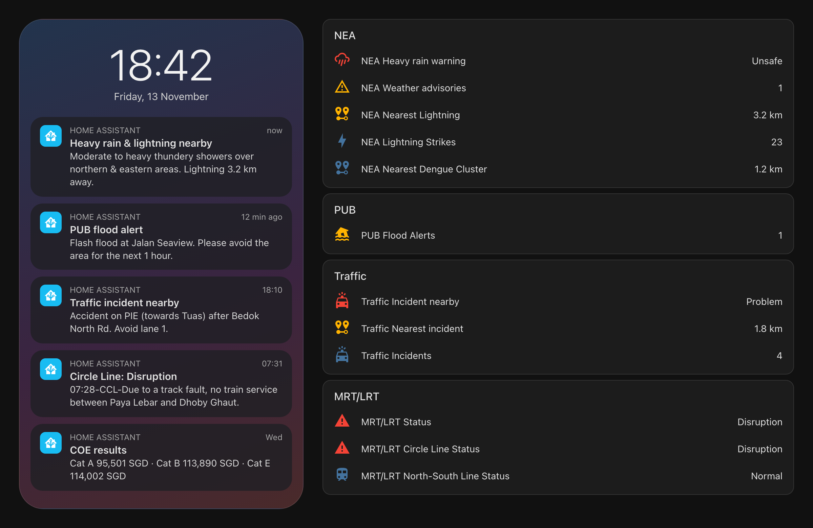
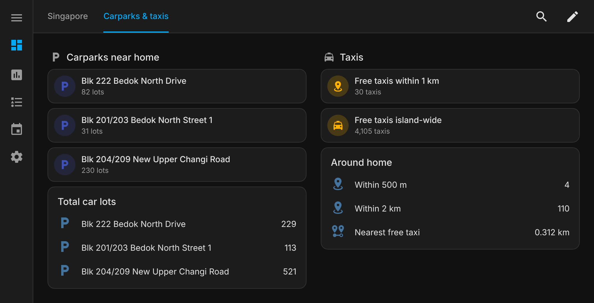
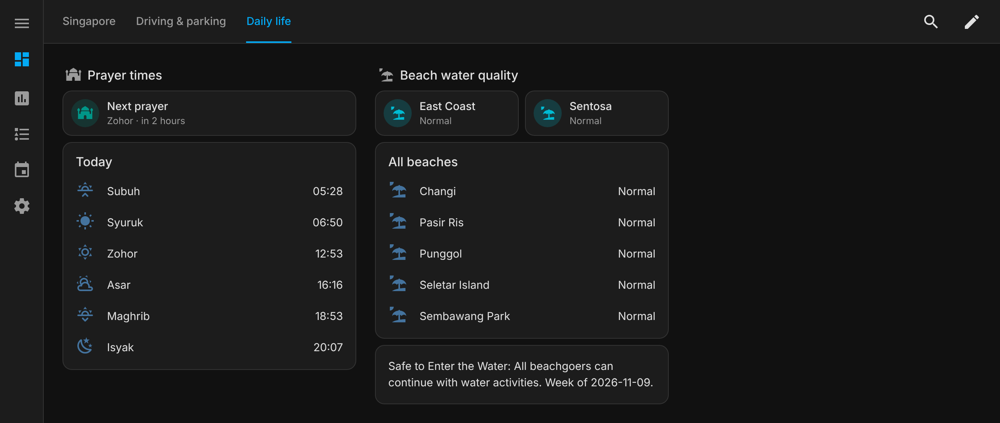
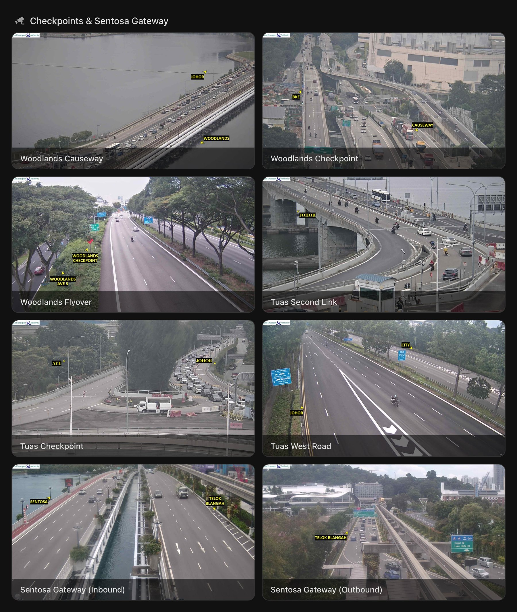

<h1 align="center">
  <picture>
    <source media="(prefers-color-scheme: dark)" srcset="custom_components/singapore/brand/dark_logo@2x.png">
    
  </picture>
</h1>

<p align="center">
  <b>Your own SP Group electricity, water and bills, right in Home Assistant's Energy dashboard.</b><br>
  Plus weather, PSI, MRT status, COE prices, flash floods, carparks, pump prices, prayer times<br>
  and more, straight from official Singapore sources. No API keys needed.<br>
  <sub>In English, Bahasa Melayu, தமிழ் and 简体中文.</sub>
</p>

<p align="center">
  <a href="https://hacs.xyz"></a>
  <a href="https://github.com/kianhean/singapore-homeassistant/releases"></a>
  <a href="https://github.com/kianhean/singapore-homeassistant/stargazers"></a>
  <a href="https://github.com/kianhean/singapore-homeassistant/releases"></a>
  <a href="https://analytics.home-assistant.io/custom_integrations.json"></a>
  <a href="https://github.com/kianhean/singapore-homeassistant/actions/workflows/tests.yml"></a>
  
  <a href="LICENSE"></a>
</p>

<p align="center">
  <a href="https://my.home-assistant.io/redirect/hacs_repository/?owner=kianhean&repository=singapore-homeassistant&category=integration"></a>
  <a href="https://my.home-assistant.io/redirect/config_flow_start/?domain=singapore"></a>
</p>

<p align="center">
  
  <br>
  <sub>An example dashboard built only from Home Assistant's built-in cards. The integration provides the entities; <a href="examples/dashboard.yaml">this YAML</a> builds the dashboard. Camera stills are real LTA images.</sub>
</p>

## Your SP Group account, in Home Assistant

Sign in with the email and password you use in the SP app, and your flat or house's own
electricity, water and bills land in Home Assistant. No smart plugs, clamps or extra hardware:
the data comes from the meters SP already reads.

> [!TIP]
> The SP account support is built on **[maci0/home-assistant-sp](https://github.com/maci0/home-assistant-sp)**
> by Marcel W. Wysocki ([@maci0](https://github.com/maci0)), whose SP API client, sign-in, MFA
> and Energy statistics code is included here under the MIT License. Thank you, Marcel!
> ([Credits](#credits))

<p align="center">
  
  <br>
  <sub>The dashboard from <a href="examples/sp_account_dashboard.yaml">examples/sp_account_dashboard.yaml</a>, built only from Home Assistant's built-in cards. Example account data.</sub>
</p>

- 📊 **Energy dashboard, ready to go.** Electricity (hourly on a smart meter) with its cost at
  the current SP tariff, plus water and gas, as statistics for Home Assistant's
  built-in [Energy dashboard](#energy-dashboard-electricity-and-water).
- ⏪ **A year of history on day one.** About 13 months of past usage is imported on the first
  poll, so the month and year views fill in straight away.
- 🏘️ **How do you compare?** Your monthly electricity and water against SP's average for similar
  homes, your always-on (standby) power and what it costs a year, yesterday's use and cost, and
  a projected bill for the month.
- 🌡️ **See what the air-con costs.** Half-hourly smart-meter readings show the evening spikes;
  put them next to `sensor.weather_temperature` and the hot afternoons stand out.
- 🧾 **Never miss a bill.** Last bill, amount due, bill status (paid / due / overdue), the
  meter-reading submission window, prepaid credit and Green Goals (with what's left) as sensors,
  a calendar of due dates and reading windows, plus a [one-click blueprint](#one-click-blueprints) that tells you when a new bill
  arrives and reminds you before it's due.
- 🔒 **Your password is never stored.** Only the session tokens SP returns are kept, and they
  renew themselves. MFA (SMS, email or authenticator app) works, and you can link more than
  one account.

**[Link your SP account →](#optional-link-your-sp-group-e-account)** It's optional and takes a
minute; everything else works without it. Questions about it? See the [FAQ](#faq).

> [!NOTE]
> This is a community project, not affiliated with or endorsed by SP Group. Account data comes
> from the same unofficial APIs the SP app uses, which SP can change without notice.

## What's inside

| | | |
|---|---|---|
| 🏠 **Your SP account** *(optional)*<br>Sign in once to get your own electricity, water and gas usage, down to the half hour on a smart meter | 📊 **Energy dashboard**<br>Hourly electricity with cost at the current SP tariff, plus monthly water, ready for [Home Assistant's Energy dashboard](#energy-dashboard-electricity-and-water) | 🧾 **Bills**<br>Last bill, amount due, meter readings and SP Green Goals, for [reminders and dashboards](#your-sp-account) |
| 🌦️ **Weather**<br>A weather entity for every NEA forecast area, with hourly and 4-day forecasts, live temperature, humidity, wind and rain, NEA weather warnings & earthquake advisories, tide timings, plus NEA rain radar images and animated loops | 😷 **Air quality**<br>PSI, hourly PM2.5 and six pollutants, overall and per region, ready for a Map card | ☀️ **UV index**<br>NEA's hourly UV index and exposure level (low to extreme), with today's peak |
| 🚇 **MRT/LRT**<br>Network and per-line status (normal, planned works, disruption) with LTA's message, plus live **LTA traffic incidents** | 🛂 **Checkpoints**<br>Woodlands, Tuas and Sentosa Gateway traffic camera stills as camera entities | 🚗 **COE**<br>Category A–E premiums, refreshed after each bidding exercise |
| ⚡ **Lightning**<br>Live strikes and the distance to the nearest one from your home | 🦟 **Dengue**<br>Active NEA clusters and how far the nearest is from your home | 🌊 **Flash floods**<br>PUB flood alerts as they're issued and cancelled |
| 🌡️ **Heat stress**<br>NEA's Wet Bulb Globe Temperature and heat stress level (low, moderate, high) at the station nearest your home | 🍜 **Hawker centres**<br>Cleaning and repair closures of the five hawker centres nearest your home, as a calendar | 🅿️ **Carparks and taxis** *(opt-in)*<br>Free lots at the HDB carparks you pick (or the nearest three) and at CapitaLand malls, and free taxis near your home |
| 🔌 **Utilities**<br>SP Group electricity, gas and water tariffs, plus your solar export price | 🎉 **Holidays and school terms**<br>MOM's public holidays, plus MOE school holidays, terms and national exams, as calendars | 🧩 **Blueprints**<br>[One-click automations](#one-click-blueprints) for lightning, MRT disruptions, floods, haze, COE, rain, UV, dengue, holidays and SP bills |
| ⛽ **Pump prices** *(opt-in)*<br>92, 95, 98, premium and diesel prices from Caltex, SPC and Shell's own websites, with their discounted prices | 🏖️ **Beaches**<br>NEA's weekly water quality band for the seven beaches it monitors, with its advice | 🕌 **Prayer times** *(opt-in)*<br>MUIS's official timetable: today's six times and the next prayer, as timestamps for automations |
| 🛍️ **Mall carparks** *(opt-in, LTA key)*<br>Free lots at ION Orchard, VivoCity, Suntec City, Jem and the other malls on LTA's carpark signs | 💱 **Finance**<br>ECB reference rates against SGD, plus SORA, T-bill and SGS bond yields | 🚉 **Crowds and EV chargers** *(LTA key)*<br>MRT/LRT platform crowd levels and EV charger availability near you |

The public data needs no API keys and no account: one config entry, and a diagnostics download when
something looks off. You choose which data sources run ([Options](#options)). Linking your SP Group e-account is optional ([how](#optional-link-your-sp-group-e-account));
that part is built on [maci0/home-assistant-sp](https://github.com/maci0/home-assistant-sp) by
[@maci0](https://github.com/maci0) ([Credits](#credits)).

## What's new

- **v0.22** [Pump prices](docs/entities.md#pump-prices) (opt-in) from Caltex, SPC and Shell's own websites, and
  [NEA beach water quality](docs/entities.md#beach-water-quality) (weekly band per beach, on by default). The
  example dashboard gains a *Daily life* view (prayer times and beaches) and pump prices on
  *Driving & parking*.
- **v0.21** Two opt-in sources: [mall carparks](docs/entities.md#mall-carparks-lta-datamall) from LTA DataMall
  (ION Orchard, VivoCity, Suntec City, Jem and the other malls LTA shows on its carpark signs,
  whoever runs them; needs the LTA key) and [MUIS prayer times](docs/entities.md#prayer-times) (today's six
  times and the next prayer, as timestamps).
- **v0.19** [NEA weather warnings & regional advisories](docs/entities.md#nea-weather-warnings-and-advisories)
  (Heavy Rain warning binary sensor, active advisories count and latest regional earthquake
  magnitude); [NEA tide timings](docs/entities.md#nea-tide-timings) (next high/low tide and predicted height);
  [LTA traffic incidents](docs/entities.md#lta-traffic-incidents) (active island-wide count, breakdown
  by type, nearest incident distance and a nearby binary sensor); four more
  [checkpoint & gateway traffic cameras](docs/entities.md#checkpoint-traffic-cameras) (Woodlands Flyover, Tuas West
  Road and Sentosa Gateway inbound/outbound).

Earlier versions (SP accounts in v0.11, choosing sources in v0.12, radar loops, school calendars,
carparks, translations and more) and full notes for every release are on the
[Releases](https://github.com/kianhean/singapore-homeassistant/releases) page. Upgrading from before v0.3.0? Your entity IDs are kept; see the
[note under Setup](#optional-link-your-sp-group-e-account).

## Contents

- [Installation](#installation) and [Setup](#setup): [Options](#options),
  [which sources are on](#data-sources-at-a-glance),
  [linking your SP account](#optional-link-your-sp-group-e-account),
  [removing the integration](#removing-the-integration)
- [Recipes](#recipes): [one-click blueprints](#one-click-blueprints) and
  [copy-paste automations](docs/recipes.md)
- [Dashboard ideas](#dashboard-ideas): [your SP account](#your-sp-account) and the
  [Energy dashboard](#energy-dashboard-electricity-and-water)
- [Entity reference](#entity-reference) ([full page](docs/entities.md)): every sensor, camera,
  weather, calendar and event entity
- [FAQ](#faq), [Troubleshooting](#troubleshooting) and [Known limitations](#known-limitations)
- [Data sources](#data-sources), [Development](#development), [Contributing](#contributing),
  [Credits](#credits)

## Installation

The integration is in the default HACS store. Use the **Open in HACS** button above, or:

1. Open **HACS** in Home Assistant.
2. Search for **Singapore** and install it.
3. Restart Home Assistant.

Requires **Home Assistant 2025.4** or newer.

## Setup

1. Go to **Settings → Devices & Services → Add Integration** (or use the **Add integration** button above).
2. Search for **Singapore**.
3. Enter a name and click **Submit**.

Only one Singapore entry can be added. Entities are grouped into a device per data source
(Energy, COE, Weather, MRT/LRT, Air Quality, PUB, NEA, Beaches, one per fuel brand, and so on).

The lightning and dengue distances are measured from the home location in
**Settings → System → General**, so make sure it's set.

### Options

Open **Settings → Devices & Services → Singapore → Configure** to change:

- **Data sources:** untick any you don't need (for example lightning, radar or checkpoint
  cameras), or tick the opt-in ones ([table below](#data-sources-at-a-glance)). A source you
  turn off stops polling, and its entities and devices are removed; turn it back on and they
  come back. Sources added in later releases start out on, unless they're opt-in.
- **School calendars:** which [MOE calendars](docs/entities.md#moe-school-calendar) to create (school holidays,
  school terms, national exams). All three are on by default.
- **data.gov.sg API key** (optional): a free key from
  [data.gov.sg](https://data.gov.sg) raises the rate limits, which means fewer HTTP 429
  errors. It's sent only to data.gov.sg.
- **HDB carparks:** the carpark numbers to track, separated by commas (for example
  `BJ55, TM24`). The number is on the sign at the carpark entrance and in HDB's and
  data.gov.sg's carpark lists. Leave it empty to track the three carparks nearest your home
  location. Only used when HDB carpark availability is on.
- **FX currencies:** the currencies to quote against SGD (USD, EUR, GBP, JPY, MYR, CNY, AUD and
  HKD by default).
- **LTA DataMall AccountKey** (optional): a free key from
  [LTA DataMall](https://datamall.lta.gov.sg/content/datamall/en/request-for-api.html) for MRT/LRT
  crowd density, EV charger availability and mall carparks. It's sent only to LTA DataMall.
- **MRT/LRT crowd stations** and **EV charger postal codes:** what to track for those two sources
  (station codes such as `EW13, NS24`; 6-digit postal codes). Leave them empty for EW13, EW14 and
  NS24, and the chargers within 2 km of home.
- **Mall carparks:** the malls to track when Mall carparks (LTA DataMall) is on, separated by
  commas: part of the name (`VivoCity, ION Orchard, Suntec`) or LTA's CarParkID. Leave it empty
  for the five nearest your home location.
- **Polling:** *Reduced* polls the fast sources (flood alerts, lightning, traffic cameras,
  radar, trains, weather, PSI, UV, heat stress, carparks, taxis, CapitaLand and mall carparks) three times less often, for example lightning every
  6 minutes instead of 2.

Saving reloads the integration. Turning off SP Group tariffs also leaves SP account cost
statistics unpriced (usage is still imported).

### Data sources at a glance

As they're named under **Configure → Data sources**:

| | Sources |
|---|---|
| **On by default** | SP Group utility tariffs, COE bidding results, NEA weather and forecasts, public holidays, MOE school calendar, MRT/LRT train status, air quality (PSI), PUB flood alerts, checkpoint traffic cameras, NEA dengue clusters, lightning, UV index, rain radar, heat stress (WBGT), weather warnings, tide timings and beach water quality, hawker centre closures, LTA traffic incidents, FX rates (ECB), interest rates (MAS/SingStat) |
| **Opt-in** | HDB carpark availability and taxi availability (each poll downloads island-wide data, about 300 KB and 80 KB, for a few numbers near you); CapitaLand mall carparks and pump prices (Caltex, SPC, Shell) (read from the companies' websites, not open data); prayer times (MUIS) |
| **Opt-in, LTA key** | MRT/LRT crowd density, EV charger availability, mall carparks (LTA DataMall): tick them and enter a free LTA DataMall AccountKey |

Apart from the LTA key, none of them needs an account or key; your [SP Group e-account](#optional-link-your-sp-group-e-account)
is a separate, optional link. Where each one comes from and how often it updates is under
[Data sources](#data-sources).

### Optional: link your SP Group e-account

1. Open **Settings → Devices & Services → Singapore**.
2. Click **Add SP account** and sign in with the email and password you use in the SP app.
   If your account has MFA, you'll be asked for the code from SMS, email or your authenticator app.

There's no price to enter: the electricity cost for the Energy dashboard uses the SP Group
tariff this integration already reads (`sensor.energy_electricity_tariff`).

The password is never stored: only the session tokens SP returns are kept, and they renew
themselves. You can add more than one account. Each one gets its own device, named after the
premise address.

> **Entity IDs on older installs:** since v0.3.0, entity names come from their device
> (for example *Energy Electricity Tariff*). New installs get IDs like
> `sensor.energy_electricity_tariff`. Installs that started before v0.3.0 keep their
> original IDs (for example `sensor.singapore_electricity_tariff`), so existing dashboards
> and automations keep working. This README uses the IDs a new install gets.

### Removing the integration

1. Go to **Settings → Devices & Services → Singapore**, open the three-dot menu and choose
   **Delete**. This removes every entity, the SP accounts and their stored session tokens, and
   any Singapore repair notices. Imported SP Energy statistics stay in the recorder until you
   delete them under **Developer tools → Statistics**.
2. To remove the code too, uninstall **Singapore** in HACS and restart Home Assistant.

## Recipes

<p align="center">
  
  <br>
  <sub>Notifications like these come from the blueprints and the copy-paste automations.</sub>
</p>

### One-click blueprints

Import a blueprint, then create an automation from it and pick your lines, distance, purifier
and so on from drop-downs. For the notify action, enter your phone's, for example
`notify.mobile_app_your_phone`.

| Blueprint | What it does | |
|---|---|---|
| ⚡ **Lightning nearby** | Notify when lightning strikes within a distance of home that you choose | <a href="https://my.home-assistant.io/redirect/blueprint_import/?blueprint_url=https%3A%2F%2Fgithub.com%2Fkianhean%2Fsingapore-homeassistant%2Fblob%2Fmain%2Fblueprints%2Fautomation%2Fsingapore%2Flightning_nearby.yaml"></a> |
| 🚇 **MRT/LRT line disruption** | Notify when your lines are disrupted (optionally planned works too) during your travel hours, and when service resumes | <a href="https://my.home-assistant.io/redirect/blueprint_import/?blueprint_url=https%3A%2F%2Fgithub.com%2Fkianhean%2Fsingapore-homeassistant%2Fblob%2Fmain%2Fblueprints%2Fautomation%2Fsingapore%2Fmrt_line_disruption.yaml"></a> |
| 🌊 **PUB flash-flood alert** | Notify for each new flash-flood alert, anywhere or only near home | <a href="https://my.home-assistant.io/redirect/blueprint_import/?blueprint_url=https%3A%2F%2Fgithub.com%2Fkianhean%2Fsingapore-homeassistant%2Fblob%2Fmain%2Fblueprints%2Fautomation%2Fsingapore%2Fflood_alert.yaml"></a> |
| 😷 **Haze mode** | Turn purifiers or fans on above a PSI level and off when the air clears | <a href="https://my.home-assistant.io/redirect/blueprint_import/?blueprint_url=https%3A%2F%2Fgithub.com%2Fkianhean%2Fsingapore-homeassistant%2Fblob%2Fmain%2Fblueprints%2Fautomation%2Fsingapore%2Fhaze_purifier.yaml"></a> |
| 🚗 **COE results** | One notification with every category's premium after each bidding exercise | <a href="https://my.home-assistant.io/redirect/blueprint_import/?blueprint_url=https%3A%2F%2Fgithub.com%2Fkianhean%2Fsingapore-homeassistant%2Fblob%2Fmain%2Fblueprints%2Fautomation%2Fsingapore%2Fcoe_results.yaml"></a> |
| 🌧️ **Rain expected** | Notify when the 2-hour forecast for your area turns to rain or thundery showers (bring in the laundry) | <a href="https://my.home-assistant.io/redirect/blueprint_import/?blueprint_url=https%3A%2F%2Fgithub.com%2Fkianhean%2Fsingapore-homeassistant%2Fblob%2Fmain%2Fblueprints%2Fautomation%2Fsingapore%2Frain_forecast.yaml"></a> |
| ☀️ **High UV** | Remind you to cover up when the UV index reaches a level you choose | <a href="https://my.home-assistant.io/redirect/blueprint_import/?blueprint_url=https%3A%2F%2Fgithub.com%2Fkianhean%2Fsingapore-homeassistant%2Fblob%2Fmain%2Fblueprints%2Fautomation%2Fsingapore%2Fuv_high.yaml"></a> |
| 🦟 **Dengue cluster nearby** | Notify when an active dengue cluster is within a distance of home | <a href="https://my.home-assistant.io/redirect/blueprint_import/?blueprint_url=https%3A%2F%2Fgithub.com%2Fkianhean%2Fsingapore-homeassistant%2Fblob%2Fmain%2Fblueprints%2Fautomation%2Fsingapore%2Fdengue_nearby.yaml"></a> |
| 🎉 **Public holiday tomorrow** | The evening before a public holiday, remind you and run actions, such as turning off a weekday alarm | <a href="https://my.home-assistant.io/redirect/blueprint_import/?blueprint_url=https%3A%2F%2Fgithub.com%2Fkianhean%2Fsingapore-homeassistant%2Fblob%2Fmain%2Fblueprints%2Fautomation%2Fsingapore%2Fholiday_tomorrow.yaml"></a> |
| 🧾 **SP bill** *(SP account)* | Notify when a new SP bill arrives, and remind you before the due date while something is outstanding (skipped on GIRO) | <a href="https://my.home-assistant.io/redirect/blueprint_import/?blueprint_url=https%3A%2F%2Fgithub.com%2Fkianhean%2Fsingapore-homeassistant%2Fblob%2Fmain%2Fblueprints%2Fautomation%2Fsingapore%2Fsp_bill.yaml"></a> |

The blueprints live in [`blueprints/automation/singapore/`](blueprints/automation/singapore) and
need Home Assistant 2025.4 or newer.

### Or copy the YAML

**[Automation recipes →](docs/recipes.md)** Simpler automations to paste into the YAML editor:
lightning, MRT/LRT disruptions, floods, haze, COE and UV; a reminder before each prayer, pump
price changes, the beach band before the weekend and a mall carpark filling up; and, with an SP
account, new bills, due dates, Green Goals and prepaid credit.

## Dashboard ideas

**Copy the whole dashboard:** [`examples/dashboard.yaml`](examples/dashboard.yaml) builds the dashboard
at the top of this page. Paste it into a new dashboard's raw configuration editor.

**Driving and parking:** the same YAML has a second view, *Driving & parking*, for four
opt-in sources: a tile per HDB carpark and per CapitaLand mall with its free lots, the total
lots of each, free taxis near home, and pump prices at Caltex, SPC and Shell. Tick **HDB
carpark availability**, **Taxi availability**, **CapitaLand mall carparks** and **Pump prices
(Caltex, SPC, Shell)** under Configure first, and swap the example carpark numbers (`B8B`,
`B8`, `B6`) and malls for yours. [Mall carparks from LTA DataMall](docs/entities.md#mall-carparks-lta-datamall)
work the same way (`sensor.mall_carparks_<mall>` tiles); they aren't in the picture because it
only shows real readings and was made without an LTA key.

<p align="center">
  
  <br>
  <sub>Pump prices from the companies' websites, 22 November 2026.</sub>
</p>

**Daily life:** a third view, *Daily life*, shows today's [prayer times](docs/entities.md#prayer-times) with
the next one, and [beach water quality](docs/entities.md#beach-water-quality) with NEA's advice for the week.
Prayer times are opt-in; beach water quality is on by default.

<p align="center">
  
  <br>
  <sub>MUIS timetable and NEA bands for Sunday 22 November 2026, 10:30.</sub>
</p>

**PSI by region:** the hero dashboard lists the 24-hour PSI for each region. Each regional sensor
also carries `latitude`/`longitude`, so you can put them on a Map card instead ([YAML](docs/entities.md#psi-on-the-map)).

**Checkpoint cameras:** a picture-entity card per camera gives you a quick look at the Causeway, Second Link and Sentosa Gateway queues.

<p align="center">
  
  <br>
  <sub>Real LTA stills from data.gov.sg.</sub>
</p>

**Rain radar:** a picture-entity card per radar range shows where it's raining right now,
drawn on the same maps NEA uses on its [rain areas page](https://www.nea.gov.sg/weather/rain-areas).

```yaml
type: vertical-stack
cards:
  - type: picture-entity
    entity: camera.weather_rain_radar_70_km
    name: Rain Radar 70 km
    show_state: false
  - type: picture-entity
    entity: camera.weather_rain_radar_240_km
    name: Rain Radar 240 km
    show_state: false
```

For the last hour as a moving loop, use `camera.weather_rain_radar_70_km_animation` and
`camera.weather_rain_radar_240_km_animation` instead (see [Rain radar](docs/entities.md#rain-radar)).

<p align="center">
  
  <br>
  <sub>Real NEA radar from data.gov.sg, Friday 13 November 2026, 22:45.</sub>
</p>

### Your SP account

The dashboard pictured [at the top](#your-sp-group-account-in-home-assistant): with an SP account
linked, **[`examples/sp_account_dashboard.yaml`](examples/sp_account_dashboard.yaml)**
adds an *SP account* dashboard built only from built-in cards. Find-and-replace its two
placeholders (your device slug and premise ID, explained at the top of the file), then paste it in.
It shows:

- **This month:** kWh used and the estimated cost so far (Statistic cards on the imported
  statistics), last month's kWh for comparison, the current SP tariff, today's usage, the
  projected cost for the whole month, and yesterday's total.
- **You vs similar homes:** how your last billed month of electricity and water compares with
  SP's average for similar homes, your always-on (standby) power with what it costs a year, and
  a monthly chart of your usage against similar and efficient homes.
- **Usage:** daily bars for the last 30 days, and hourly bars for the last 3 days from the
  smart meter. That's where the evening air-con hours show up.
- **Bills:** amount due, the last bill, whether it's paid, due or overdue (with the due date),
  the meter-reading submission window, a bar chart of every bill in the past year, your Green
  Goals usage against its target and what's left, and the meter reading.

A test runs the example against a real Home Assistant, so every entity and statistic in it exists
on a new install.

**The Energy dashboard** is the other half: see the
[step-by-step setup below](#energy-dashboard-electricity-and-water).

**Bill due dates and meter-reading windows on a calendar.** Each account also has a calendar,
`calendar.<your_address>_bills_and_meter_readings`: every bill's due date as an all-day event,
and the meter-reading submission window as a timed one. Add it to a Calendar card, or trigger
automations on its events.

**Weather and usage together.** A History graph card with **Electricity last 30 min** and
`sensor.weather_temperature` shows how much a hot afternoon costs you in air-con. Put both
on one card.

### Energy dashboard: electricity and water

With an SP account linked, Home Assistant's built-in **Energy dashboard** can track your flat or
house's electricity (with cost) and water. Wait for the account's first poll (a minute or so after
adding it), then go to **Settings → Dashboards → Energy**:

1. **Electricity grid → Add consumption.** Pick **SP Group electricity**, a statistic, not a
   sensor. Under cost, choose **Use an entity tracking the total costs** and pick
   **SP Group electricity cost**.
2. **Water consumption → Add water source.** Pick **SP Group water**.
3. **Gas consumption** (only if you have piped gas on the account): pick **SP Group gas**.
4. Save, and open the **Energy** dashboard from the sidebar.

If you have more than one SP account, each has its own set (the ID contains the premise ID,
e.g. `singapore:2001590888_electricity`). **Developer tools → Statistics**, search "SP Group",
lists them.

**What to expect**

- **History right away.** About 13 months of past usage is imported on the first poll, so the
  month and year views fill in immediately. You don't have to wait for Home Assistant to collect it.
- **Electricity is hourly on a smart meter,** but SP publishes it a few hours late. Today's bars
  fill in through the day, so the *today* view looks low until the evening. Check yesterday for
  a complete day. Without a smart meter, SP only has billed months, so you'll see one block per
  month.
- **Water is monthly.** SP bills water monthly, so each month's usage lands as one bar at the
  start of the billing period. Use the month or year view; the day view will look empty.
- **Cost is an estimate.** It uses the SP Group regulated tariff (incl. GST) this integration
  reads, and the whole series is re-priced when the tariff changes each quarter. If you buy
  electricity from an Open Electricity Market retailer, your real rate differs. The **Last bill**
  sensor has the exact amount. Water cost isn't calculated (your bill includes charges beyond
  the per-m³ tariff).
- **Don't pick the sensors** (*Electricity cumulative*, *Electricity today*, *Electricity meter*,
  *Water meter* and so on) as Energy sources. They measure other things, and Home Assistant would
  compute its own sum from them that disagrees with the imported history.

## Entity reference

**[Everything the integration creates →](docs/entities.md)** Each data source's entities,
attributes and update interval, with example states:

[SP Group utility tariffs](docs/entities.md#sp-group-utility-tariffs) · [SP Group e-account (optional)](docs/entities.md#sp-group-e-account-optional) · [COE bidding results](docs/entities.md#coe-bidding-results) · [NEA realtime weather readings](docs/entities.md#nea-realtime-weather-readings) · [Weather entities (by forecast area)](docs/entities.md#weather-entities-by-forecast-area) · [MRT/LRT train status](docs/entities.md#mrtlrt-train-status) · [Air quality (PSI)](docs/entities.md#air-quality-psi) · [PUB flood alerts](docs/entities.md#pub-flood-alerts) · [Checkpoint traffic cameras](docs/entities.md#checkpoint-traffic-cameras) · [LTA traffic incidents](docs/entities.md#lta-traffic-incidents) · [Rain radar](docs/entities.md#rain-radar) · [Dengue clusters](docs/entities.md#dengue-clusters) · [Lightning](docs/entities.md#lightning) · [UV index](docs/entities.md#uv-index) · [Heat stress (WBGT)](docs/entities.md#heat-stress-wbgt) · [NEA weather warnings and advisories](docs/entities.md#nea-weather-warnings-and-advisories) · [NEA tide timings](docs/entities.md#nea-tide-timings) · [Hawker centre closures](docs/entities.md#hawker-centre-closures) · [HDB carpark availability](docs/entities.md#hdb-carpark-availability) · [Taxi availability](docs/entities.md#taxi-availability) · [CapitaLand mall carparks](docs/entities.md#capitaland-mall-carparks) · [Mall carparks (LTA DataMall)](docs/entities.md#mall-carparks-lta-datamall) · [Prayer times](docs/entities.md#prayer-times) · [Pump prices](docs/entities.md#pump-prices) · [Beach water quality](docs/entities.md#beach-water-quality) · [Public holidays](docs/entities.md#public-holidays) · [MOE school calendar](docs/entities.md#moe-school-calendar) · [FX rates and interest rates](docs/entities.md#fx-rates-and-interest-rates) · [MRT/LRT crowd density and EV charger availability (optional LTA DataMall key)](docs/entities.md#mrtlrt-crowd-density-and-ev-charger-availability-optional-lta-datamall-key)

## FAQ

<details>
<summary><b>Is it safe to give the integration my SP password?</b></summary>

The password is only used to sign in and is never stored. Home Assistant keeps the session
tokens SP returns (in its config storage, like any other integration's credentials), and they
renew themselves. Diagnostics downloads leave out your address, account number, premise ID,
username and tokens. Deleting the account or the integration removes the tokens.
</details>

<details>
<summary><b>Do I need a smart meter?</b></summary>

No. With a smart meter you get electricity by the half hour (published a few hours late) and
hourly bars on the Energy dashboard. Without one, SP only has billed months, so you get one
reading per month. Water is monthly either way.
</details>

<details>
<summary><b>I buy electricity from an Open Electricity Market retailer. Does it still work?</b></summary>

Yes. Usage comes from SP, who reads the meters whichever retailer you use, and the retailer's name
is an attribute of the *Account* sensor. The **cost** on the Energy dashboard is an estimate at
SP Group's regulated tariff, so it won't match your retailer's rate; the **Last bill** sensor has
the amount SP billed.
</details>

<details>
<summary><b>Does it work with prepaid (PPMS) accounts?</b></summary>

Yes. A *Prepaid credit* sensor appears when SP reports a prepaid balance, and there's a
[low-credit automation](docs/recipes.md#with-a-linked-sp-account) to copy.
</details>

<details>
<summary><b>Can I add more than one SP account?</b></summary>

Yes, click **Add SP account** again. Each account gets its own device and its own set of Energy
statistics (the statistic ID contains the premise ID).
</details>

<details>
<summary><b>Do I need an API key or account for the rest?</b></summary>

No. Everything except the SP account uses public data. A free
[data.gov.sg](https://data.gov.sg) key is optional and only raises the rate limits
([Options](#options)).
</details>

<details>
<summary><b>Is this an official app from SP Group, NEA, LTA or GovTech?</b></summary>

No. It's a community project, not affiliated with or endorsed by any of them. The public data
comes from the official open-data sources listed under [Data sources](#data-sources); the SP
account uses the unofficial APIs behind the SP app, which SP can change without notice.
</details>

## Troubleshooting

- **Diagnostics:** on the Singapore integration page, open the three-dot menu and choose
  **Download diagnostics**. The file shows each data source's last update result, error
  and parsed data. Attach it when opening an issue.
- **Unavailable sensors:** flood alerts, traffic cameras, rain radar, dengue clusters, lightning, UV, heat stress, hawker closures, carparks, taxis, PSI, COE and SP Group tariffs
  load in the background, so the rest of the integration still starts if one of those
  sources is down. Their sensors show as unavailable until a fetch succeeds.
- **SP account sensors unavailable:** if SP rejects the stored session, a repair appears under
  **Settings → Repairs**. Open the account under the Singapore integration and choose
  **Reconfigure** and sign in again. If SP says the sign-in looks suspicious, sign in once in the
  SP app, wait a few minutes, then try again. After a wrong password the next attempt waits
  60 seconds, so Auth0 doesn't lock the account. The rest of the integration keeps working
  either way.
- **HTTP 429 in the log:** without an API key, data.gov.sg's real-time API allows about
  6 requests per 10 seconds from your Home Assistant, across all its datasets. The
  integration paces its requests to stay under that (at most 5 per 10 s, shared by every
  source), and if a 429 still happens, every source waits the 10 seconds data.gov.sg asks
  for and then retries. So you shouldn't see more than the odd debug line. If you also run
  other data.gov.sg integrations or scripts from the same network, they share that limit: a
  free API key, **Polling** → *Reduced*, or turning off unused sources gives more headroom
  (see [Options](#options)).
- **"… has been failing for a day" repair:** a data source has returned data the integration
  can't read for 24 hours, which usually means the site or API changed. Check the
  [issues](https://github.com/kianhean/singapore-homeassistant/issues) and report it with the
  diagnostics file. The repair clears itself after the next successful update, or when you turn
  that source off.
- **SP Group tariffs unavailable for days:** the tariff is scraped from spgroup.com.sg, which
  sometimes refuses connections (TLS errors) from some networks. The rest of the integration
  is unaffected; if you don't need tariffs, turn the source off.
- **Entities left over after turning a source off:** since v0.15 they are removed on the
  reload that follows. A device the integration no longer provides can also be deleted from its
  device page (**⋮ → Delete**); devices still in use refuse, as they would come straight back.
- **Language:** entity names, states and the setup forms are translated into English, Malay
  (Bahasa Melayu), Tamil (தமிழ்) and Simplified Chinese (简体中文), following your Home Assistant
  language. Entity IDs are always generated from the English names.

## Known limitations

What the integration can't do, mostly because of what the sources publish:

- **COE results** are fetched once a day at 19:30, after LTA usually publishes them. Results
  that appear earlier show up at 19:30 (or when you reload the integration).
- **SP Group tariffs** are read from the tariff page on spgroup.com.sg, so a redesign of that
  page can break them until a fix is released. Some networks get TLS errors from the site.
- **Public holidays** are read from MOM's web page and cover the current year onwards.
- **The MOE school calendar** is read from moe.gov.sg/calendar, which shows the current year
  only; next year's dates appear when MOE publishes them (by the end of August, the page says).
  There's no per-level filter yet, so the calendars hold every level's dates. MOE sometimes
  answers cloud and datacenter addresses with a "verify you're not a bot" page; the calendars
  then keep their last dates and retry the next day (a home connection normally gets the page).
- **Hourly forecasts** have a condition only, in NEA's ~6-hour periods for five regions; NEA
  gives no hourly temperature. The daily (4-day) outlook is Singapore-wide, so it's the same
  for every area.
- **MRT/LRT status** comes from the endpoint behind mytransport.sg, which isn't a documented
  API. Planned works are read from LTA's notice text.
- **Flood alerts:** data.gov.sg only returns the last ~50 minutes of messages, so the alert list
  is built up across polls. An alert whose *Cancel* was missed (for example while Home
  Assistant was off) is dropped after 3 hours.
- **Checkpoint cameras** are the four Woodlands and Tuas cameras only. LTA's feed sometimes
  leaves a camera out (camera 2702 was missing on 7 November 2026), and that camera is
  unavailable until it's back.
- **Rain radar:** NEA has no base map for the 480 km image, so that camera shows bare rain blobs
  and is disabled by default, with no animation. The base maps are loaded from NEA's website
  at runtime.
- **UV index** is published hourly from 7 am to 7 pm only. **Lightning** keeps a 30-minute
  window and includes strikes beyond Singapore (Batam, Johor). **Dengue clusters** update every
  6 hours. Distances are measured from your Home Assistant home location.
- **PSI and pollutant headline values** are the highest of the five regions (as NEA headlines
  them); use the regional sensors for your area.
- **data.gov.sg rate limits:** without an API key, about 6 requests per 10 seconds per network,
  shared with anything else you run against data.gov.sg (see
  [Troubleshooting](#troubleshooting)).
- **SP accounts** use the unofficial APIs behind the SP app, which SP can change without notice.
  They're polled every 30 minutes; smart-meter readings arrive a few hours late, homes without a
  smart meter get one reading per billed month, and water is monthly for everyone. Energy
  dashboard costs are estimated at SP Group's regulated tariff, not your retailer's rate.
- **Pump prices** come from Caltex's, SPC's and Shell's own websites, so a redesign can break a
  brand until a fix is released (the others keep working). Esso's site refuses automated requests
  and Sinopec has no official price page, so those brands aren't covered. Prices are before
  card and membership discounts, except the `discounted_price` attribute.
- **Beach water quality** is weekly and about a week behind (lab results take that long).
- **Prayer times** come from MUIS's yearly timetable on data.gov.sg; a new year appears once MUIS
  publishes it.
- **Mall carparks (LTA DataMall)** only cover the carparks LTA collects for its signs (Orchard,
  Marina Bay, HarbourFront, Jurong Lake District and URA carparks), not every mall.
- **Entity IDs** are always generated from the English names, whatever your language.

## Data sources

| Source | Data | Refresh |
|--------|------|---------|
| [SP Group](https://www.spgroup.com.sg/our-services/utilities/tariff-information) | Electricity, gas, water tariffs | Every 24 h |
| [data.gov.sg / LTA](https://data.gov.sg/datasets/d_69b3380ad7e51aff3a7dcc84eba52b8a/view) | COE bidding results | Daily at 19:30 |
| [data.gov.sg / NEA (collection 1456)](https://data.gov.sg/collections/1456/view) | 2-hour area forecasts, 24-hour regional forecast and 4-day outlook | Every 10 min |
| [data.gov.sg / NEA (collection 1459)](https://data.gov.sg/collections/1459/view) | Realtime weather readings | Every 10 min |
| [data.gov.sg / NEA](https://data.gov.sg/datasets/d_fe37906a0182569d891506e815e819b7/view) | PSI and pollutant readings | Every 15 min |
| [data.gov.sg / PUB](https://data.gov.sg/datasets/d_f1404e08587ce555b9ea3f565e2eb9a3/view) | Flash-flood alerts | Every 2 min |
| [data.gov.sg / LTA](https://data.gov.sg/datasets/d_6cdb6b405b25aaaacbaf7689bcc6fae0/view) | Woodlands, Tuas & Sentosa Gateway camera images | Every 2 min |
| [mytransport.sg / LTA](https://www.mytransport.sg) | Live traffic incidents | Every 5 min |
| [data.gov.sg / NEA](https://data.gov.sg/datasets/d_dbfabf16158d1b0e1c420627c0819168/view) | Dengue clusters | Every 6 h |
| [data.gov.sg / NEA](https://data.gov.sg/datasets/d_08238953fe0f6dd13f10714ebfbcb9f9/view) | Lightning observations | Every 2 min |
| [data.gov.sg / NEA](https://api-open.data.gov.sg/v2/real-time/api/uv) | Hourly UV index | Every 15 min |
| [data.gov.sg / NEA](https://data.gov.sg/datasets/d_418e9ac3414fd927b7405631e0a7bc82/view) | Rain radar images (70 / 240 / 480 km) | Every 5 min |
| [data.gov.sg / NEA](https://api-open.data.gov.sg/v2/real-time/api/pm25) | Hourly PM2.5 | Every 15 min |
| [data.gov.sg / NEA](https://api-open.data.gov.sg/v2/real-time/api/weather?api=wbgt) | Wet Bulb Globe Temperature (heat stress) | Every 15 min |
| [NEA](https://www.nea.gov.sg/weather) | Weather warnings & regional earthquake/volcanic advisories | Every 5 min |
| [NEA](https://www.nea.gov.sg/corporate-functions/weather/tide-timings) | Tide timings | Every 24 h |
| [data.gov.sg / NEA](https://data.gov.sg/datasets/d_bda4baa634dd1cc7a6c7cad5f19e2d68/view) | Hawker centre closure dates | Every 24 h |
| [data.gov.sg / HDB](https://data.gov.sg/datasets/d_ca933a644e55d34fe21f28b8052fac63/view) | Carpark availability (opt-in) | Every 5 min (carpark details daily) |
| [data.gov.sg / LTA](https://data.gov.sg/datasets/d_e25662f1a062dd046453926aa284ba64/view) | Taxi availability (opt-in) | Every 5 min |
| [CapitaLand JustPark](https://justpark.capitaland.com/Lot-Availability) | CapitaLand mall carpark lots (opt-in) | Every 5 min |
| [LTA DataMall](https://datamall.lta.gov.sg) | Mall and URA carpark lots (opt-in, LTA key) | Every 5 min |
| [LTA DataMall](https://datamall.lta.gov.sg) | MRT/LRT platform crowd density (opt-in, LTA key) | Every 10 min |
| [LTA DataMall](https://datamall.lta.gov.sg) | EV charger availability (opt-in, LTA key) | Every 5 min |
| [ECB](https://www.ecb.europa.eu/stats/policy_and_exchange_rates/euro_reference_exchange_rates/html/index.en.html) | FX reference rates, as SGD crosses | Every 4 h |
| [SingStat / MAS](https://tablebuilder.singstat.gov.sg/table/TS/M700071) | SORA, T-bill and SGS bond yields | Every 12 h |
| [Caltex](https://www.caltex.com/sg/), [SPC](https://www.spc.com.sg/our-business/spc-service-station/latest-pump-price/), [Shell](https://www.shell.com.sg/fuels-oils-and-coolants/shell-fuels/shell-station-price-board.html) | Pump prices (opt-in) | Every 6 h |
| [NEA](https://www.nea.gov.sg/beach-water-quality) | Beach water quality bands | Every 6 h |
| [data.gov.sg / MUIS](https://data.gov.sg/datasets/d_a6a206cba471fe04b62dd886ef5eaf22/view) | Muslim prayer timetable (opt-in) | Every 12 h |
| [MOM](https://www.mom.gov.sg/employment-practices/public-holidays) | Public holidays | Every 24 h |
| [MOE](https://www.moe.gov.sg/calendar) | School holidays, terms and national exams | Every 24 h |
| [mytransport.sg](https://www.mytransport.sg/trainstatus) | MRT/LRT train status | Every 5 min |
| SP Group app APIs (optional, your e-account) | Your usage, bills, meters, Green Goals | Every 30 min |

## Development

See [CLAUDE.md](CLAUDE.md) for project structure, test instructions, and conventions.

```bash
pip install -r requirements_test.txt
pytest tests/ -v -m "not e2e"
```

`tests_ha/` runs the integration inside a real Home Assistant; `pytest tests/test_e2e.py -m e2e`
hits the live data sources. See CLAUDE.md for both.

The README images are rendered from HTML in [`docs/mockups/`](docs/mockups): run
`uv run docs/mockups/fetch_cameras.py` for fresh camera stills (`fetch_radar.py` for radar images), then
`cd docs/mockups && npm install && node build.mjs`. The same script renders the icon and logo from
[`images/brand/`](images/brand) into `custom_components/singapore/brand/` (`node build.mjs brand`
for those alone). Keep `hero.html` in sync with
[`examples/dashboard.yaml`](examples/dashboard.yaml).

## Contributing

Bug reports, data source ideas and pull requests are welcome. When something looks wrong, attach
the **Download diagnostics** file to your [issue](https://github.com/kianhean/singapore-homeassistant/issues).
If the integration is useful to you, a ⭐ on GitHub helps other Singapore Home Assistant users find it.

## Credits

The SP Group e-account support is built on
**[maci0/home-assistant-sp](https://github.com/maci0/home-assistant-sp)** by
**Marcel W. Wysocki ([@maci0](https://github.com/maci0))**. The SP API client, sign-in and
MFA handling, sensor mapping, Energy statistics logic and their tests are vendored from its
v1.8.0 release under the MIT License, in
[`custom_components/singapore/sp_account/`](custom_components/singapore/sp_account) with
the original [LICENSE](custom_components/singapore/sp_account/LICENSE). This port fixes its
"Config flow could not be loaded: 500" error
([maci0/home-assistant-sp#21](https://github.com/maci0/home-assistant-sp/issues/21)) by
keeping every form field serializable. If you only want SP account data, use the original
integration. Thank you, Marcel!

## License

This project is licensed under the [MIT License](LICENSE). The vendored SP Group client in
`custom_components/singapore/sp_account/` is MIT licensed, Copyright (c) 2026 Marcel W. Wysocki.

Data and the checkpoint camera stills in the README come from data.gov.sg, LTA, NEA, PUB, MOM and
SP Group, and remain theirs (data.gov.sg data is under the
[Singapore Open Data Licence](https://data.gov.sg/open-data-licence)). This project isn't affiliated
with any of them.
