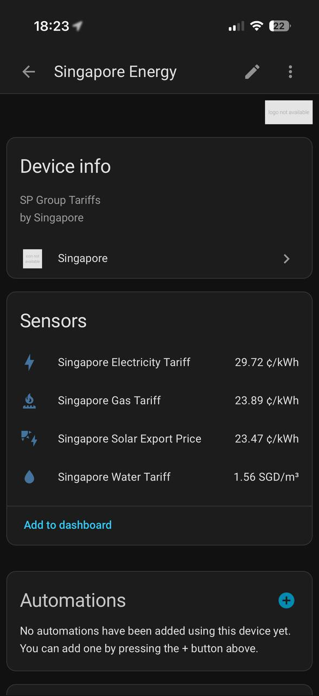
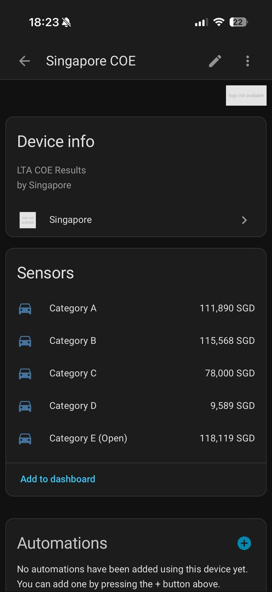
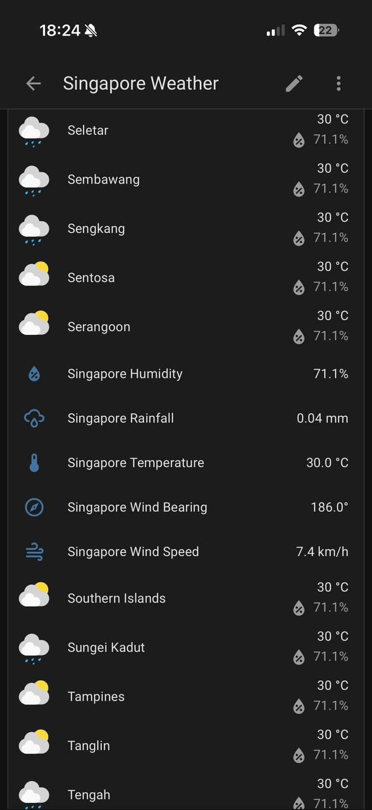
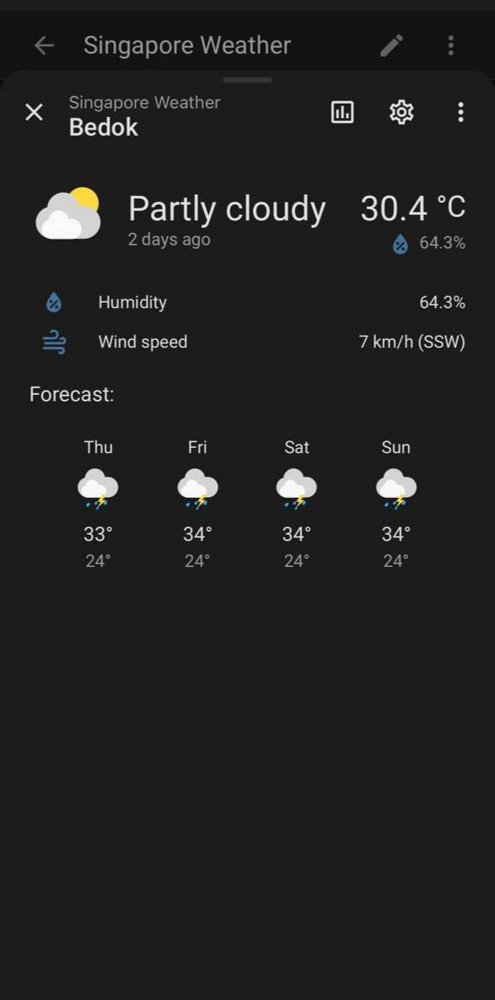
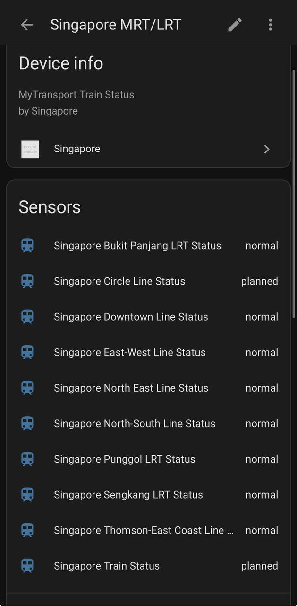
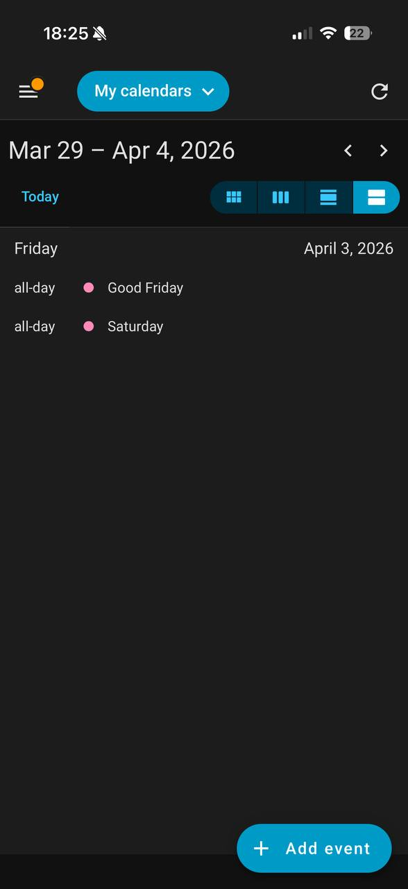

# Entity reference

[← Back to the README](../README.md)

Everything the integration creates, by data source. Expand a section for its entities and attributes.
Entity IDs are the ones a new install gets; installs from before v0.3.0 keep their
`sensor.singapore_*` IDs ([why](../README.md#optional-link-your-sp-group-e-account)).

## SP Group utility tariffs

Scraped from the [SP Group tariff page](https://www.spgroup.com.sg/our-services/utilities/tariff-information)
every 24 hours.

<details>
<summary>Entities and attributes</summary>

| Entity ID | Name | Unit | Description |
|-----------|------|------|-------------|
| `sensor.energy_electricity_tariff` | Energy Electricity Tariff | ¢/kWh | Total residential electricity tariff (with GST) |
| `sensor.energy_solar_export_price` | Energy Solar Export Price | ¢/kWh | Electricity tariff minus network costs |
| `sensor.energy_gas_tariff` | Energy Gas Tariff | ¢/kWh | Piped natural gas tariff (with GST) |
| `sensor.energy_water_tariff` | Energy Water Tariff | SGD/m³ | Water tariff, lower residential tier (≤40 m³, with GST) |

Tariff sensors include `quarter` (e.g. `Q1`), `year`, and `source` as state attributes.
The solar export price sensor also includes `network_cost` and `total_tariff`.

<p align="center">
  
</p>

</details>

## SP Group e-account (optional)

Your own SP account data, read from the same APIs the SP Group app uses (Auth0 sign-in, then
the Jarvis and Njord services) every 30 minutes. Added per account with **Add SP account**
(see [Setup](../README.md#optional-link-your-sp-group-e-account)). The device is named after the premise
address, so entity IDs look like `sensor.<your_address>_electricity_today`.

<details>
<summary>Entities, attributes and the Energy dashboard</summary>

Sensors are only created for what your account has (for example, gas and the EV sensors
appear only when SP returns data for them). New ones are added without a reload.

| Name | What it is |
|------|------------|
| Electricity cumulative | Smart-meter (AMI) or billed total for the loaded window (~13 months) |
| Electricity last billed / Water last billed / Gas last billed | Latest billed month |
| Electricity today | AMI kWh for today (SGT) |
| Electricity last 30 min | Last published AMI half-hour slot (lags a few hours) |
| Water / Gas | Sum of billed months |
| Last bill | Latest bill in SGD |
| Amount due | Outstanding amount; negative is a credit |
| Prepaid credit | PPMS balance, when the account is prepaid |
| Electricity meter / Water meter | Last actual meter register reading |
| Electricity this month / Water this month | Green Goals usage, with `goal_target` and `percent_difference` attributes |
| GreenUP points, EV wallet, EV session, EV last charge, EV unpaid | When you use those SP services |
| Unread notifications, Bill delivery, FCU (Tengah cooling), SP tariff | When SP returns them |
| Account | Account status; carries the address, account number and retailer as attributes |

Worked out from the same poll (no extra requests to SP):

| Name | What it is |
|------|------------|
| Always-on power | Your standby load in W: the lowest half-hour of each of the last 7 full days (median), with `estimated_yearly_kwh` / `estimated_yearly_cost` |
| Electricity yesterday | Yesterday's AMI total, once its last half-hour is in; `peak_half_hour` and `peak_half_hour_kwh` |
| Electricity cost yesterday / today / this month | AMI kWh × the scraped SP tariff (incl. GST) |
| Projected electricity cost | This month so far plus the last 7 full days' average for the rest of the month; `projected_kwh` |
| Electricity vs similar homes / Water vs similar homes | Last billed month against SP's average for similar homes, in % (negative is below); `similar_homes_average`, `efficient_homes` |
| Electricity goal remaining / Water goal remaining | Green Goals target minus usage so far (negative is over); `on_track` if this month's pace stays under the target |
| Bill status | `paid` / `due` / `overdue`, from the amount due and the latest bill's due date; `due_date`, `days_until_due` |
| Meter reading window | `upcoming` / `open` / `closed`, for homes that submit their own meter readings; `opens`, `closes`, `period` |

The cost sensors need the SP Group tariff source on (they're priced from it). Most need a smart
meter (AMI); *vs similar homes* and the goals come from SP's monthly figures.

A calendar, **Bills and meter readings**, carries every bill's due date and the meter-reading
window.

**Energy dashboard.** After the first poll, long-term statistics are imported (setup steps:
[Energy dashboard: electricity and water](../README.md#energy-dashboard-electricity-and-water)):

- Grid consumption: pick the statistic **SP Group electricity**
  (`singapore:<premise_id>_electricity`), not a sensor. It is built from the AMI half-hours
  (folded to hours) where available, else billed months.
- Cost: pick **SP Group electricity cost** (`singapore:<premise_id>_electricity_cost`) as the
  grid source's cost. It's priced at the SP Group regulated tariff (incl. GST) this integration
  scrapes, and the whole series is re-priced when the tariff changes each quarter, so past
  quarters show at the current rate. If you buy from an Open Electricity Market retailer, your
  real rate differs; use your bills (**Last bill**) for exact amounts.
- Water: **SP Group water** (`singapore:<premise_id>_water`), billed months in m³.
- Gas: **SP Group gas** (`singapore:<premise_id>_gas`) when SP returns gas data.
- **SP Group bill** (`singapore:<premise_id>_last_bill`) has one point per billed month.
- **Similar homes** (`singapore:<premise_id>_electricity_monthly`, `..._electricity_peer_average`,
  `..._electricity_peer_efficient`, and the same for `water`) have one point per billing month:
  your usage, SP's average for similar homes and its efficient homes. Plot them together in a
  Statistics graph card (`period: month`, `stat_types: [state]`).
- Don't use *Electricity cumulative*, *Electricity last billed*, *Electricity meter* or
  *Electricity this month* as a grid source. They measure different things.

</details>

## COE bidding results

Pulled from the [LTA dataset on data.gov.sg](https://data.gov.sg/datasets/d_69b3380ad7e51aff3a7dcc84eba52b8a/view)
daily at **19:30**, after each bidding exercise.

<details>
<summary>Entities and attributes</summary>

| Entity ID | Name | Unit | Category |
|-----------|------|------|----------|
| `sensor.coe_category_a` | COE Category A | SGD | Cars ≤1600cc / ≤97kW (electric) |
| `sensor.coe_category_b` | COE Category B | SGD | Cars >1600cc / >97kW (electric) |
| `sensor.coe_category_c` | COE Category C | SGD | Goods vehicles and buses |
| `sensor.coe_category_d` | COE Category D | SGD | Motorcycles |
| `sensor.coe_category_e` | COE Category E | SGD | Open — all except motorcycles |

Each sensor includes `category`, `description`, `month`, `bidding_no`, and `source` as
state attributes.

`event.coe_new_results` (COE New results) is an event entity that fires `new_results` once
per bidding exercise, with `exercise` (e.g. `2026-11 #2`), `month`, `bidding_no` and
`category_a` … `category_e` as attributes. The last exercise is remembered across restarts,
so results published while Home Assistant was off still fire; a new install fires from the
next exercise.

<p align="center">
  
</p>

</details>

## NEA realtime weather readings

Updated every **10 minutes** from [data.gov.sg collection 1459](https://data.gov.sg/collections/1459/view).
Uses the **nearest NEA station** to your Home Assistant home location (falling back to the
island-wide average when station coordinates are unavailable). Each sensor exposes `station`,
`station_id`, `distance_km`, and `island_average` as attributes.

<details>
<summary>Entities and attributes</summary>

| Entity ID | Name | Unit | Description |
|-----------|------|------|-------------|
| `sensor.weather_temperature` | Weather Temperature | °C | Air temperature at nearest station |
| `sensor.weather_humidity` | Weather Humidity | % | Relative humidity at nearest station |
| `sensor.weather_wind_speed` | Weather Wind Speed | km/h | Wind speed at nearest station |
| `sensor.weather_wind_bearing` | Weather Wind Bearing | ° | Wind direction at nearest station |
| `sensor.weather_rainfall` | Weather Rainfall | mm | Rainfall at nearest station |

<p align="center">
  
</p>

</details>

## Weather entities (by forecast area)

One weather entity per NEA forecast area from [data.gov.sg collection 1456](https://data.gov.sg/collections/1456/view),
updated every **10 minutes**.

<details>
<summary>Entities and attributes</summary>

Example entities: `weather.weather_bedok`, `weather.weather_ang_mo_kio`,
`weather.weather_woodlands`.

- **Current condition** comes from the area's 2-hour NEA forecast, mapped to an HA
  condition (`sunny`, `partlycloudy`, `rainy`, `lightning-rainy`, etc.).
- **Current temperature, humidity and wind** come from the live readings above.
- **Daily forecast** is NEA's Singapore-wide 4-day outlook, with high/low temperature,
  humidity and wind for each day. It is the same for every area.
- **Hourly forecast** is NEA's 24-hour forecast for the area's region (north, south, east,
  west or central): one entry per forecast period, usually 6 pm–6 am, 6 am–midday and
  midday–6 pm. NEA gives no temperature per period, so entries carry a condition only. Each
  area is assigned to the region whose centre is nearest its NEA map location, which can be
  a judgement call for areas near a boundary (the `forecast_region` attribute shows which).

Attributes: `forecast_area`, `forecast_region`, `raw_condition` (NEA's original text),
`valid_start` / `valid_end` (the 2-hour forecast window), plus the live readings.

<p align="center">
  
</p>

</details>

## MRT/LRT train status

Updated every **5 minutes** from [mytransport.sg](https://www.mytransport.sg/trainstatus).
Tracks both an overall network status and a per-line status for each MRT/LRT line.

<details>
<summary>Entities and attributes</summary>

| Entity ID | Name | Description |
|-----------|------|-------------|
| `sensor.mrt_lrt_status` | MRT/LRT Status | Overall network status: `normal`, `planned`, or `disruption`; `details` attribute holds LTA's messages |
| `sensor.mrt_lrt_<line>_status` | e.g. MRT/LRT Circle Line Status | Per-line status, e.g. `sensor.mrt_lrt_circle_line_status` |
| `event.mrt_lrt_service_alert` | MRT/LRT Service alert | Event entity: fires `disruption` when a line is disrupted, `planned` when a normal line gets a planned notice, and `resolved` when a disrupted line recovers. Attributes `line`, `status`, `details` |

Trigger an automation on the event entity with a **State** trigger on
`event.mrt_lrt_service_alert` (its state is the time of the last event) and read
`trigger.to_state.attributes.event_type` and `.line`. Events are worked out by comparing
polls, so a line already disrupted when Home Assistant starts fires nothing until it changes.

Lines: North-South, East-West, North East, Circle, Downtown, Thomson-East Coast,
Bukit Panjang LRT, Sengkang LRT, Punggol LRT.

<p align="center">
  
</p>

</details>

## Air quality (PSI)

Updated every **15 minutes** from [data.gov.sg / NEA](https://data.gov.sg/datasets/d_fe37906a0182569d891506e815e819b7/view).
Grouped under an **Air Quality** device.

<details>
<summary>Entities and attributes</summary>

| Entity ID | Name | Unit | Description |
|-----------|------|------|-------------|
| `sensor.air_quality_psi` | Air Quality PSI | — | Singapore-wide 24-hour PSI (highest region); `band` attribute: `good` / `moderate` / `unhealthy` / `very_unhealthy` / `hazardous` |
| `sensor.air_quality_psi_<region>` | e.g. Air Quality PSI North | — | 24-hour PSI for north, south, east, west, central — **with map location and every reading for that region** |
| `sensor.air_quality_pm2_5` | Air Quality PM2.5 | µg/m³ | 24-hour PM2.5 (highest region) |
| `sensor.air_quality_pm2_5_1_hour` | Air Quality PM2.5 (1-hour) | µg/m³ | 1-hour PM2.5 (highest region), from NEA's separate hourly feed; `band` attribute: `normal` (0–55) / `elevated` (56–150) / `high` (151–250) / `very_high` (251+). NEA publishes no 1-hour PSI: this is the figure it suggests for planning the next few hours |
| `sensor.air_quality_pm10` | Air Quality PM10 | µg/m³ | 24-hour PM10 (highest region) |
| `sensor.air_quality_ozone` | Air Quality Ozone | µg/m³ | 8-hour max O₃ (highest region) |
| `sensor.air_quality_nitrogen_dioxide` | Air Quality Nitrogen Dioxide | µg/m³ | 1-hour max NO₂ (highest region) |
| `sensor.air_quality_sulphur_dioxide` | Air Quality Sulphur Dioxide | µg/m³ | 24-hour SO₂ (highest region) |
| `sensor.air_quality_carbon_monoxide` | Air Quality Carbon Monoxide | mg/m³ | 8-hour max CO (highest region) |

The Singapore-wide pollutant sensors also expose a `regions` attribute with each region's value.

</details>

### PSI on the map

Each regional PSI sensor has `latitude`/`longitude` attributes (NEA's region label
locations), so it shows up as one circle per region on a Map card. Use `label_mode: state`
to show the PSI number inside each circle; tap a circle to see every reading for that
region (3-hour and 24-hour PSI, PM2.5, PM10, O₃, NO₂, SO₂, CO and the sub-indices):

```yaml
type: map
title: Singapore PSI
default_zoom: 11
entities:
  - entity: sensor.air_quality_psi_north
    label_mode: state
  - entity: sensor.air_quality_psi_south
    label_mode: state
  - entity: sensor.air_quality_psi_east
    label_mode: state
  - entity: sensor.air_quality_psi_west
    label_mode: state
  - entity: sensor.air_quality_psi_central
    label_mode: state
```

## PUB flood alerts

Updated every **2 minutes** from [PUB via data.gov.sg](https://data.gov.sg/datasets/d_f1404e08587ce555b9ea3f565e2eb9a3/view).

<details>
<summary>Entities and attributes</summary>

| Entity ID | Name | Description |
|-----------|------|-------------|
| `sensor.pub_flood_alerts` | PUB Flood Alerts | Number of active flash-flood alerts (`0` when none) |
| `binary_sensor.pub_flood_alert_nearby` | PUB Flood alert nearby | `on` when an active flash-flood alert is within 5 km of home (`safety`); attributes `radius_km`, `nearest_km`, `nearby_alerts` |

Attributes: `locations` (list of alert descriptions) and `alerts` (full details per alert:
description, area, severity, instruction, issued time, latitude/longitude). An alert stays
active until PUB issues its matching Cancel, or for 3 hours at most.

See [Recipes](recipes.md) for a notification automation.

</details>

## Checkpoint traffic cameras

Updated every **2 minutes** from [LTA via data.gov.sg](https://data.gov.sg/datasets/d_6cdb6b405b25aaaacbaf7689bcc6fae0/view).
The Woodlands, Tuas and Sentosa Gateway cameras in LTA's feed are exposed as `camera` entities showing the latest still.

<details>
<summary>Entities and attributes</summary>

| Entity ID | LTA camera | View |
|-----------|-----------|------|
| `camera.traffic_cameras_woodlands_causeway` | 2701 | Woodlands Causeway (towards Johor) |
| `camera.traffic_cameras_woodlands_checkpoint` | 2702 | Woodlands Checkpoint (towards BKE) |
| `camera.traffic_cameras_woodlands_flyover` | 2704 | Woodlands Flyover (towards Checkpoint) |
| `camera.traffic_cameras_tuas_second_link` | 4703 | Tuas Second Link |
| `camera.traffic_cameras_tuas_west_road` | 4712 | After Tuas West Road |
| `camera.traffic_cameras_tuas_checkpoint` | 4713 | Tuas Checkpoint |
| `camera.traffic_cameras_sentosa_gateway_outbound` | 4798 | Sentosa Gateway (towards Telok Blangah) |
| `camera.traffic_cameras_sentosa_gateway_inbound` | 4799 | Sentosa Gateway (towards Sentosa) |

A camera shows as unavailable while LTA leaves it out of the feed.

</details>

## LTA traffic incidents

Updated every **5 minutes** from [mytransport.sg](https://www.mytransport.sg). Tracks live LTA
traffic incidents (accidents, vehicle breakdowns, roadworks, heavy traffic, obstacles) across
Singapore and around your Home Assistant home location, on a *Traffic* device.

<details>
<summary>Entities and attributes</summary>

| Entity ID | Name | Unit | Description |
|-----------|------|------|-------------|
| `sensor.traffic_incidents` | Traffic Incidents | — | Active traffic incidents island-wide; attributes `counts_by_type` and `incidents` (newest 50: type, message, latitude, longitude) |
| `sensor.traffic_nearest_incident` | Traffic Nearest incident | km | Distance from your HA home location to the nearest active incident (unknown when none); attributes `type`, `message`, `latitude`, `longitude` |
| `binary_sensor.traffic_incident_nearby` | Traffic Incident nearby | — | `on` when an active traffic incident is within 5 km of home (`problem`); attributes `radius_km`, `nearest_km`, `nearest_type`, `nearby_incidents` |
| `geo_location.traffic_incident_<n>` | Traffic incident 1, 2, … | km | One per active incident with coordinates, nearest first (at most 50); state = distance from home, `latitude` / `longitude`, `type`, `message`, `source: singapore_traffic` (Map card) |

Plot active incidents alongside the checkpoint cameras on a Map card:

```yaml
type: map
geo_location_sources:
  - singapore_traffic
entities:
  - zone.home
  - camera.traffic_cameras_woodlands_causeway
  - camera.traffic_cameras_tuas_second_link
```

</details>

## Rain radar

Updated every **5 minutes** from [NEA's weather radar images via data.gov.sg](https://data.gov.sg/datasets/d_418e9ac3414fd927b7405631e0a7bc82/view)
(a beta dataset). Three `camera` entities on the *Weather* device show the latest radar image,
centred on Singapore, at each range NEA publishes. The 70 km and 240 km images are drawn on
NEA's own base maps from its [rain areas page](https://www.nea.gov.sg/weather/rain-areas),
cropped and scaled exactly as that page shows them.

Two more cameras animate the **last hour** (12 frames, 5 minutes apart) for the near (70 km)
and far (240 km) maps: a looping GIF with the capture time in the corner of each frame,
holding briefly on the latest one. The frames come from the same API call as the still
image, so the loop costs no extra data.gov.sg requests; each new frame is downloaded once.

<details>
<summary>Entities and attributes</summary>

| Entity ID | Range | Image |
|-----------|-------|-------|
| `camera.weather_rain_radar_70_km` | 70 km | Singapore on NEA's map (853 × 479 JPEG) |
| `camera.weather_rain_radar_240_km` | 240 km | Johor, Riau Islands and Sumatra on NEA's map (853 × 853 JPEG) |
| `camera.weather_rain_radar_480_km` | 480 km | Bare radar overlay, no map (480 × 480 transparent PNG); **disabled by default** |
| `camera.weather_rain_radar_70_km_animation` | 70 km | Last hour over Singapore on NEA's map (853 × 479 animated GIF) |
| `camera.weather_rain_radar_240_km_animation` | 240 km | Last hour over the region on NEA's map (853 × 853 animated GIF) |

Rain colours run cyan/green (light), yellow (moderate) and orange/red/magenta (heavy).
Attributes: `range`, `basemap` (whether this range has an NEA map), `image_timestamp` (the
radar capture time), the full radar image's bounding box as `north` / `south` / `east` /
`west`, and the radar station's `center_latitude` / `center_longitude`. The animations add
`frame_count` and `first_frame_timestamp` (the oldest frame; `image_timestamp` is the newest).
Just after midnight the loop also uses the previous day's images, so it stays an hour long.

A radar camera shows as unavailable until its first image loads, and keeps its last image if a
later fetch fails. The base map is downloaded once from nea.gov.sg; if that fails, the camera
shows the bare overlay and tries the map again after 30 minutes. An animation needs its map:
until it loads, the animation camera keeps its last loop (or has no image yet).

NEA has no map for the 480 km range, so that camera is disabled by default. To use it anyway
(for example on a Picture Elements card over your own map), enable it under **Settings →
Devices & services → Entities**.

</details>

## Dengue clusters

Updated every **6 hours** from [NEA via data.gov.sg](https://data.gov.sg/datasets/d_dbfabf16158d1b0e1c420627c0819168/view).

<details>
<summary>Entities and attributes</summary>

| Entity ID | Name | Unit | Description |
|-----------|------|------|-------------|
| `sensor.nea_dengue_clusters` | NEA Dengue Clusters | — | Number of active clusters; attributes `total_cases` and `clusters` (locality, cases, centroid) |
| `sensor.nea_nearest_dengue_cluster` | NEA Nearest Dengue Cluster | km | Distance from your HA home location to the nearest cluster boundary (`0` = inside a cluster) |
| `binary_sensor.nea_in_dengue_cluster` | NEA In dengue cluster | — | `on` when your HA home location is inside an active dengue cluster (`problem`); attributes `nearest_km`, `locality`, `cases` |

The nearest-cluster distance uses the home location in **Settings → System → General**.

</details>

## Lightning

Updated every **2 minutes** from [NEA's Lightning Detection System via data.gov.sg](https://data.gov.sg/datasets/d_08238953fe0f6dd13f10714ebfbcb9f9/view).
Strikes are kept for a rolling **30-minute** window. The feed also covers the region
around Singapore (for example Johor and the Riau Islands).

<details>
<summary>Entities and attributes</summary>

| Entity ID | Name | Unit | Description |
|-----------|------|------|-------------|
| `sensor.nea_lightning_strikes` | NEA Lightning Strikes | — | Strikes detected in the last 30 min; attributes `cloud_to_ground`, `cloud_to_cloud` and `strikes` (newest 50: time, latitude, longitude, type) |
| `sensor.nea_nearest_lightning` | NEA Nearest Lightning | km | Distance from your HA home location to the nearest strike in the last 30 min (unknown when there's none); attributes `strikes_within_10_km`, plus the nearest strike's `type`, `time`, `latitude` and `longitude` |
| `binary_sensor.nea_lightning_nearby` | NEA Lightning nearby | — | `on` when lightning was detected within 10 km of home in the last 30 min (`safety`); attributes `radius_km`, `nearest_km`, `strikes_within_10_km` |

Cloud-to-ground strikes are the dangerous kind; cloud-to-cloud lightning often comes
before them. NEA notes that most strikes fall within 5–6 km of a thunderstorm, and a storm
more than 10 km away can still reach you.

See [Recipes](recipes.md) for a lightning warning automation.

</details>

## UV index

Updated every **15 minutes** from [NEA's hourly UV index via data.gov.sg](https://api-open.data.gov.sg/v2/real-time/api/uv).
NEA publishes one reading an hour from 7 am to 7 pm, so overnight the sensors show the
last reading of the evening.

<details>
<summary>Entities and attributes</summary>

| Entity ID | Name | Unit | Description |
|-----------|------|------|-------------|
| `sensor.nea_uv_index` | NEA UV Index | UV index | Latest hourly UV index; attributes `hour` (the reading's hour), `exposure`, `peak` / `peak_hour` (today's highest) and `readings` (today's hourly values) |
| `sensor.nea_uv_exposure` | NEA UV Exposure | — | NEA's exposure level for the latest reading: `low` (0–2), `moderate` (3–5), `high` (6–7), `very_high` (8–10) or `extreme` (11+) |

See [Recipes](recipes.md) for a sunscreen reminder.

</details>

## Heat stress (WBGT)

Updated every **15 minutes** from [NEA's Wet Bulb Globe Temperature readings via data.gov.sg](https://api-open.data.gov.sg/v2/real-time/api/weather?api=wbgt).
WBGT combines temperature, humidity, sun and wind into one figure for heat stress, and is what
NEA's heat stress advisories use. Both sensors use the station nearest your home location and
sit on the *NEA* device.

<details>
<summary>Entities and attributes</summary>

| Entity ID | Name | Unit | Description |
|-----------|------|------|-------------|
| `sensor.nea_heat_stress_wbgt` | NEA Heat stress WBGT | °C | WBGT at the nearest station; attributes `heat_stress`, `station`, `town`, `distance_km`, `latitude` / `longitude`, `highest_wbgt` / `highest_station` (island-wide) and `reading_time` |
| `sensor.nea_heat_stress` | NEA Heat stress | — | NEA's heat stress level at the nearest station: `low` (below 31 °C), `moderate` (31 to below 33 °C) or `high` (33 °C and above) |

</details>

## NEA weather warnings and advisories

Updated every **5 minutes** from [NEA's weather warnings feed](https://www.nea.gov.sg/api/Warning/GetAllWarning/).
Tracks NEA's Heavy Rain warnings along with regional earthquake & tsunami notices, volcanic ash
advisories, haze advisories, and tropical cyclone warnings on the *NEA* device.

<details>
<summary>Entities and attributes</summary>

| Entity ID | Name | Unit | Description |
|-----------|------|------|-------------|
| `binary_sensor.nea_heavy_rain_warning` | NEA Heavy rain warning | — | `on` when NEA has an active Heavy Rain warning (`safety`); attributes `warning`, `issued`, `expires` |
| `sensor.nea_weather_advisories` | NEA Weather advisories | — | Number of active NEA warnings/advisories across all 5 categories; attributes `active_categories` and `advisories` |
| `sensor.nea_latest_earthquake` | NEA Latest earthquake | — | Magnitude of the latest regional earthquake reported by MSS/NEA; attributes `advisory`, `issued`, `expires`, `url` |

</details>

## NEA tide timings

Updated every **24 hours** from [NEA's tide timings table](https://www.nea.gov.sg/corporate-functions/weather/tide-timings).
Reports the next high or low tide and its predicted height in metres on the *NEA* device.

<details>
<summary>Entities and attributes</summary>

| Entity ID | Name | Unit | Description |
|-----------|------|------|-------------|
| `sensor.nea_next_tide` | NEA Next tide | — | Whether the next tide is `high` (*High tide*) or `low` (*Low tide*); attributes `time`, `height_m`, `next_high_tide`, `next_high_height_m`, `next_low_tide`, `next_low_height_m`, and `upcoming` (next 8 tides) |
| `sensor.nea_next_tide_level` | NEA Next tide level | m | Predicted height of the next tide in metres; attributes `tide` and `time` |

</details>

## Hawker centre closures

Updated every 24 hours from [NEA's hawker centre closure dates via data.gov.sg](https://data.gov.sg/datasets/d_bda4baa634dd1cc7a6c7cad5f19e2d68/view).
A calendar with all-day events for the quarterly cleaning and other works (repairs,
redecoration) of the **five hawker centres nearest your home location**, on a *Hawker Centres*
device. Each event is named like *Adam Road Food Centre closed (cleaning)*, with the
address as its location and NEA's remarks as its description. Dates NEA hasn't fixed yet
("TBC") are left out until it publishes them.

<details>
<summary>Entities and attributes</summary>

| Entity ID | Name |
|-----------|------|
| `calendar.hawker_centres_closures` | Hawker Centres Closures |

Attributes: `centres` (the five centres, each with `name`, `address` and `distance_km`) and
`source`.

</details>

## HDB carpark availability

*Opt-in: tick **HDB carpark availability** under Configure.* Updated every **5 minutes** from
[HDB's carpark availability via data.gov.sg](https://data.gov.sg/datasets/d_ca933a644e55d34fe21f28b8052fac63/view),
joined to [HDB's carpark information](https://data.gov.sg/datasets/d_23f946fa557947f93a8043bbef41dd09/view)
(read once a day) for the address and map location. One sensor per carpark, on an *HDB
Carparks* device: the carparks listed under **Configure → HDB carparks**, or else the three
nearest your home location that report availability.

<details>
<summary>Entities and attributes</summary>

| Entity ID | Name | Unit | Description |
|-----------|------|------|-------------|
| `sensor.hdb_carparks_<number>` | e.g. HDB Carparks BJ55 | lots | Car lots available; attributes `car_lots_total`, `motorcycle_lots_available` / `_total` and `heavy_lots_available` / `_total` where the carpark has them, `updated`, `address`, `latitude` / `longitude` (Map card), `distance_km`, `car_park_type`, `parking_system`, `short_term_parking`, `free_parking`, `night_parking`, `gantry_height` |

Removing a number from the list removes its sensor. In "nearest home" mode, a sensor left
behind after you move your home location can be deleted from the entity's settings.

</details>

## Taxi availability

*Opt-in: tick **Taxi availability** under Configure.* Updated every **5 minutes** from
[LTA's taxi availability via data.gov.sg](https://data.gov.sg/datasets/d_e25662f1a062dd046453926aa284ba64/view),
the position of every free taxi island-wide. On a *Taxis* device. The taxis within 1 km of your
home location also appear on a Map card: each is a `geo_location` entity (*Free taxi 1* is the
nearest, up to 50), with `source: singapore`:

```yaml
type: map
geo_location_sources:
  - singapore
entities:
  - zone.home
```

The map card groups nearby markers into numbered clusters; its grouping button (or
`cluster: false`) shows every taxi. Positions are kept only for these markers and are never in
the diagnostics download. The markers' states (distance from home) change on every poll; to
keep them out of the history database, add this to `configuration.yaml`:

```yaml
recorder:
  exclude:
    entity_globs:
      - geo_location.free_taxi_*
```

<details>
<summary>Entities and attributes</summary>

| Entity ID | Name | Unit | Description |
|-----------|------|------|-------------|
| `sensor.taxis_available` | Taxis Available | taxis | Free taxis island-wide; `reading_time` attribute |
| `sensor.taxis_nearby` | Taxis Nearby | taxis | Free taxis within 1 km of your home location; attributes `within_500_m`, `within_2_km` and `nearest_km` |
| `geo_location.free_taxi_<n>` | Free taxi 1, 2, … | km | One per free taxi within 1 km, nearest first (at most 50); state = distance from home, `latitude` / `longitude`, `source: singapore` (Map card) |

</details>

## CapitaLand mall carparks

*Opt-in: tick **CapitaLand mall carparks** under Configure.* Updated every **5 minutes** from
[CapitaLand JustPark's lot availability](https://justpark.capitaland.com/Lot-Availability), the
same numbers that page shows. One sensor per CapitaLand mall that reports its lots (Bedok Mall,
Bugis+, Clarke Quay, Funan, IMM, Junction 8, Lot One, Plaza Singapura, Raffles City, Sengkang
Grand Mall, Tampines Mall, The Atrium@Orchard and Westgate as of November 2026), on a
*CapitaLand Carparks* device. A mall CapitaLand adds later gets its sensor automatically;
disable the ones you don't need from their entity settings.

<details>
<summary>Entities and attributes</summary>

| Entity ID | Name | Unit | Description |
|-----------|------|------|-------------|
| `sensor.capitaland_carparks_<mall>` | e.g. CapitaLand Carparks Plaza Singapura | lots | Car lots available; attributes `site_code`, `total_lots` and `full` |

</details>

## Mall carparks (LTA DataMall)

*Opt-in: tick **Mall carparks (LTA DataMall)** under Configure and enter an LTA DataMall
AccountKey.* Updated every **5 minutes** from DataMall's `CarParkAvailabilityv2`: the free lots
LTA collects for its carpark signs in Orchard, Marina Bay, HarbourFront and Jurong Lake District
(ION Orchard, Paragon, 313@somerset, Suntec City, Marina Square, VivoCity, Jem, Westgate and
others), whichever company runs the mall, plus URA's public carparks. Frasers, Lendlease,
Mapletree and Changi Airport don't publish live lots on their own websites, so this is how their
malls in those areas are covered; HDB carparks have [their own source](#hdb-carpark-availability).
One sensor per tracked carpark on a *Mall Carparks* device: the malls you list under
**Configure → Mall carparks**, or the five LTA carparks nearest home. A mall with several
carparks (VivoCity P2 and P3) matches all of them.

<details>
<summary>Entities and attributes</summary>

| Entity ID | Name | Unit | Description |
|-----------|------|------|-------------|
| `sensor.mall_carparks_<development>` | e.g. Mall Carparks Suntec City | lots | Car lots available; attributes `carpark_id`, `agency`, `development`, `area`, `car_lots_available` / `motorcycle_lots_available` / `heavy_vehicle_lots_available`, `latitude`, `longitude`, `distance_km` |

</details>

## Prayer times

*Opt-in: tick **Prayer times (MUIS)** under Configure.* MUIS's official Muslim prayer timetable
from [data.gov.sg](https://data.gov.sg/datasets/d_a6a206cba471fe04b62dd886ef5eaf22/view), read
twice a day. Timestamp sensors on a *Prayer Times* device, so they work as time triggers in
automations; they move on to the next day at midnight and to the next prayer as each one passes,
without waiting for a poll.

<details>
<summary>Entities and attributes</summary>

| Entity ID | Name | Description |
|-----------|------|-------------|
| `sensor.prayer_times_subuh` … `_isyak` | Prayer Times Subuh, Syuruk, Zohor, Asar, Maghrib, Isyak | Today's time; attributes `date` and `next` (the next occurrence, today or tomorrow). Syuruk is sunrise |
| `sensor.prayer_times_next_prayer` | Prayer Times Next prayer | Time of the next prayer (Syuruk excluded); attribute `prayer` (`subuh`, `zohor`, `asar`, `maghrib`, `isyak`) |

</details>

## Pump prices

*Opt-in: tick **Pump prices (Caltex, SPC, Shell)** under Configure.* Read every **6 hours**
from each company's own website: Caltex's [fuel prices](https://www.caltex.com/sg/motorists/fuel-prices.html),
SPC's [latest pump prices](https://www.spc.com.sg/our-business/spc-service-station/latest-pump-price/)
and the spreadsheet on Shell's [station price board](https://www.shell.com.sg/fuels-oils-and-coolants/shell-fuels/shell-station-price-board.html).
One device per brand with a sensor per grade it sells, in SGD per litre before discounts. Esso's
website refuses automated requests and no official Sinopec Singapore site publishes prices, so
they aren't included. A brand whose site is down keeps its last prices; one whose page changes
goes unavailable until it's fixed here.

<details>
<summary>Entities and attributes</summary>

| Entity ID | Name | Unit | Description |
|-----------|------|------|-------------|
| `sensor.caltex_92`, `_95`, `_98`, `_diesel` | Caltex 92, 95, 98, Diesel | SGD/L | Pump price; attributes `product` (e.g. Premium 95 with Techron®), `discounted_price`, `updated` |
| `sensor.spc_92`, `_95`, `_98`, `_diesel` | SPC 92, 95, 98, Diesel | SGD/L | Pump price; attributes `product` (SPC LEVO 95), `updated` |
| `sensor.shell_95`, `_98`, `_premium`, `_diesel` | Shell 95, 98, Premium, Diesel | SGD/L | Listed pump price; `premium` is V-Power. Attributes `product`, `discounted_price` (the nett price with every discount Shell lists), `updated` |

</details>

## Beach water quality

*On by default.* NEA's weekly [beach water quality](https://www.nea.gov.sg/beach-water-quality)
for the seven beaches it monitors (Changi, East Coast, Pasir Ris, Punggol, Seletar Island,
Sembawang Park and Sentosa), read every **6 hours**. Each beach is one enum sensor on a *Beaches*
device with the worst band among its sampling areas: `normal` (Enterococcus ≤ 200 per 100 ml),
`elevated`, `high` or `advisory`. Lab results take about a week, so the band is for the week
before.

<details>
<summary>Entities and attributes</summary>

| Entity ID | Name | Description |
|-----------|------|-------------|
| `sensor.beaches_<beach>` | e.g. Beaches East Coast | Band (`normal` / `elevated` / `high` / `advisory`); attributes `advisory` and `advice` (NEA's text for the band), `areas` (each sampling area with its band), `previous_weeks`, `week_start`, `week_end`, `latitude`, `longitude` |

</details>

## Public holidays

Updated every 24 hours from [MOM](https://www.mom.gov.sg/employment-practices/public-holidays).
Shows up as a Home Assistant calendar with all-day events from the current year onward.

<details>
<summary>Entities and attributes</summary>

| Entity ID | Name |
|-----------|------|
| `calendar.public_holidays` | Public Holidays |
| `binary_sensor.public_holidays_today` | Public Holidays Today (`on` when today is a public holiday; attributes `holiday`, `next_holiday`, `next_holiday_date`) |

<p align="center">
  
</p>

</details>

## MOE school calendar

Updated every 24 hours from [MOE](https://www.moe.gov.sg/calendar). Three calendars with all-day
events, on a *School* device: school holidays, school terms and national exams (PSLE, GCE
N/O/A-Levels, results days). Untick the ones you don't need under **Configure → School
calendars**; turning one off removes its calendar.

MOE lists most dates per level, so the level is part of each event's name, for example
*Term 4 school holidays (MK, Primary & Secondary)* and *Term 4 school holidays (Post-secondary
Years 1, 2)*. A calendar is *on* while one of its events is under way, so
`calendar.school_holidays` turning on is a trigger for "the school holidays have started". The
[Public holiday tomorrow](../README.md#one-click-blueprints) blueprint also works with it: pick
`calendar.school_holidays` as its calendar.

<details>
<summary>Entities and attributes</summary>

| Entity ID | Name | Events |
|-----------|------|--------|
| `calendar.school_holidays` | School Holidays | Term breaks, the year-end holidays and one-day school holidays (e.g. Youth Day, Children's Day) |
| `calendar.school_terms` | School Terms | Terms 1–4, per level |
| `calendar.school_exams` | School Exams | PSLE and GCE exam periods, marking and results release |
| `binary_sensor.school_holiday_today` | School Holiday today | `on` when today falls within a school holiday (created when School holidays is ticked) |

Attributes: `events` (number of events in the calendar), `source` and `url`.

</details>

## FX rates and interest rates

Key-free financial rates on a *Finance* device:

- **FX rates (ECB)**: Updated every **4 hours** from the [European Central Bank daily reference rates](https://www.ecb.europa.eu/stats/policy_and_exchange_rates/euro_reference_exchange_rates/html/index.en.html) (published each working day around 16:00 CET). Derives SGD crosses for USD, EUR, GBP, JPY (per 100), MYR, CNY, AUD and HKD by default; choose any of the 29 ECB currencies under **Configure → FX currencies**.
- **Interest rates (MAS/SingStat)**: Updated every **12 hours** from [SingStat TableBuilder table M700071](https://tablebuilder.singstat.gov.sg/api/table/tabledata/M700071) (republishing monthly end-of-period MAS data). Includes SORA, 3-Month Compounded SORA, 1-Year T-Bill Yield, and 2/5/10/15/20-Year SGS Bond Yields. (SIBOR was discontinued at the end of 2024 and replaced by SORA.)

<details>
<summary>Entities and attributes</summary>

| Entity ID | Name | Unit | Description |
|-----------|------|------|-------------|
| `sensor.finance_usd_sgd` (and other selected currencies) | Finance USD/SGD (or `100 JPY/SGD` for small-unit currencies) | SGD | SGD price per 1 unit (or 100 units); attributes `currency`, `quote_units`, `rate_date`, `source` |
| `sensor.finance_sora` | Finance SORA | % | Monthly end-of-period SORA; attributes `period`, `series`, `data_last_updated`, `source` |
| `sensor.finance_3_month_compounded_sora` | Finance 3-Month Compounded SORA | % | Monthly 3-Month Compounded SORA |
| `sensor.finance_1_year_t_bill_yield` | Finance 1-Year T-Bill Yield | % | 1-Year Singapore Treasury Bill yield |
| `sensor.finance_2_year_sgs_bond_yield` … `20_year` | Finance 2/5/10/15/20-Year SGS Bond Yield | % | Singapore Government Securities benchmark bond yields |

</details>

## MRT/LRT crowd density and EV charger availability (optional LTA DataMall key)

*Opt-in: requires a free **LTA DataMall AccountKey**.* Request one at [datamall.lta.gov.sg](https://datamall.lta.gov.sg/content/datamall/en/request-for-api.html), enter it under **Configure → LTA DataMall AccountKey**, and tick either or both sources:

- **MRT/LRT crowd density (LTA DataMall)**: Polls `PCDRealTime` every **10 minutes** for the lines covering your chosen stations (set comma-separated station codes such as `EW13, NS24, CC1` under **Configure → MRT/LRT crowd stations**, or leave empty for `EW13`, `EW14` and `NS24`). Adds one enum sensor (`low`, `moderate`, `high`) per station on the *MRT/LRT* device.
- **EV charger availability (LTA DataMall)**: Polls every **5 minutes** on an *EV Chargers* device. Specify comma-separated 6-digit Singapore postal codes under **Configure → EV charger postal codes** to query `EVChargingPoints` directly, or leave empty to download `EVCBatch` and track chargers within 2 km of your Home Assistant home location.

<details>
<summary>Entities and attributes</summary>

| Entity ID | Name | Unit | Description |
|-----------|------|------|-------------|
| `sensor.mrt_lrt_ew13_crowd` (per station) | MRT/LRT EW13 Crowd | — | Real-time platform crowd density (`low`, `moderate`, `high`); attributes `station`, `train_line`, `start_time`, `end_time`, `source` |
| `sensor.ev_chargers_available` | EV Chargers Available | chargers | Total available EV charging connectors; attributes `total_chargers`, `locations_count`, `locations` (operator, plug types, max kW, distance) |
| `sensor.ev_chargers_nearest_available` | EV Chargers Nearest available | km | Distance to the nearest location with an available EV charger; attributes `name`, `address`, `available`, `total`, `operators`, `plug_types`, `max_power_kw` |

</details>
## Example sensor states

<details>
<summary>Show example states</summary>

```yaml
sensor.energy_electricity_tariff:
  state: 29.72
  unit_of_measurement: ¢/kWh
  attributes:
    quarter: Q2
    year: 2026
    source: SP Group

sensor.energy_solar_export_price:
  state: 23.47
  unit_of_measurement: ¢/kWh
  attributes:
    quarter: Q2
    year: 2026
    source: SP Group
    network_cost: 6.25
    total_tariff: 29.72

sensor.coe_category_a:
  state: 95501
  unit_of_measurement: SGD
  attributes:
    category: Category A
    description: Cars up to 1600cc / 97kW (electric)
    month: "2026-03"
    bidding_no: 1
    source: data.gov.sg / LTA

sensor.weather_temperature:
  state: 31.2
  unit_of_measurement: °C
  attributes:
    source: data.gov.sg / NEA (collection 1459)

sensor.nea_uv_index:
  state: 6
  unit_of_measurement: UV index
  attributes:
    hour: "2026-11-13T14:00:00+08:00"
    exposure: high
    peak: 6
    peak_hour: "2026-11-13T14:00:00+08:00"
    readings:
      - hour: "2026-11-13T13:00:00+08:00"
        value: 4
      - hour: "2026-11-13T14:00:00+08:00"
        value: 6
    source: NEA via data.gov.sg

sensor.air_quality_psi_east:
  state: 39
  attributes:
    region: east
    band: good
    latitude: 1.35735
    longitude: 103.94
    psi_twenty_four_hourly: 39
    psi_three_hourly: 0
    pm25_twenty_four_hourly: 0
    pm10_twenty_four_hourly: 3
    o3_eight_hour_max: 9
    no2_one_hour_max: 12
    so2_twenty_four_hourly: 5
    co_eight_hour_max: 19
    reading_time: "2024-07-17T14:00:00+00:00"
    source: data.gov.sg / NEA
```

</details>
